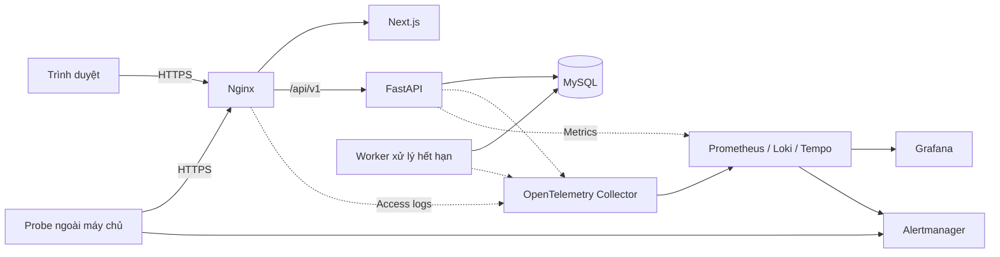

# Production Readiness Lab

Ứng dụng đặt lịch tư vấn tại trường đại học, kết hợp môi trường thực hành xây dựng và vận hành hệ thống phần mềm: từ thiết kế nghiệp vụ, bảo vệ dữ liệu đến triển khai, giám sát và phục hồi khi có sự cố.

Dự án lấy một bài toán thực tế làm nền tảng: sinh viên chọn nhu cầu tư vấn, nhân viên/cố vấn và thời gian phù hợp để đặt lịch. Trên nền tảng đó, Production Readiness Lab tập trung vào câu hỏi **làm thế nào để hệ thống hoạt động đúng, có thể quan sát và phục hồi được trong điều kiện vận hành thực tế?**

## Mục tiêu

- Xây dựng luồng đặt lịch nhất quán, kể cả khi nhiều người cùng chọn một khung giờ hoặc gửi lại yêu cầu.
- Phân quyền theo vai trò và phạm vi dữ liệu, bảo vệ thông tin cá nhân và nội dung tư vấn.
- Tổ chức mã nguồn rõ ràng để nhóm phát triển có thể mở rộng, kiểm thử và bảo trì.
- Chuẩn hóa quy trình kiểm tra, đóng gói, phát hành và rollback.
- Đánh giá chất lượng vận hành bằng số liệu, bài tải và diễn tập sự cố.

## Nghiệp vụ

| Vai trò             | Chức năng                                                                                                                   |
| ------------------- | --------------------------------------------------------------------------------------------------------------------------- |
| Sinh viên           | Chọn nhu cầu và nhân viên, xem giờ trống, đặt/hủy lịch, phản hồi đề nghị đổi lịch, xem lịch sử và thông báo cá nhân.        |
| Nhân viên / cố vấn  | Quản lý nhu cầu tiếp nhận và thời gian không nhận, xem lịch được giao, đề nghị đổi giờ/địa điểm, ghi nhận kết quả buổi gặp. |
| Quản trị viên       | Quản lý tài khoản, danh mục nhu cầu tư vấn và giờ phục vụ chung.                                                            |
| Thành viên vận hành | Triển khai release, theo dõi hệ thống, xử lý cảnh báo, sao lưu, khôi phục và diễn tập sự cố.                                |

Quyền vận hành hạ tầng được quản lý riêng với vai trò quản trị viên trong ứng dụng.

### Luồng đặt lịch

1. Sinh viên chọn nhu cầu tư vấn, nhân viên và giờ trống.
2. Hệ thống kiểm tra quyền, thời gian, hạn mức và xung đột lịch trong cùng giao dịch trước khi xác nhận.
3. Nhân viên có thể đề nghị đổi giờ hoặc địa điểm; sinh viên chấp thuận hoặc từ chối đề nghị.
4. Worker xử lý đề nghị quá hạn phản hồi. Nhân viên ghi nhận kết quả buổi gặp sau khi lịch kết thúc.
5. Các thay đổi nghiệp vụ được ghi vào lịch sử thao tác và thông báo cho những người liên quan.

### Quy tắc cốt lõi

- Mỗi sinh viên có tối đa **ba lịch đang chiếm chỗ**.
- Hai trạng thái `UPCOMING` và `CHANGE_PENDING` giữ chỗ. Khoảng thời gian dùng dạng `[starts_at, ends_at)`, cho phép hai lịch tiếp giáp.
- Không cho phép lịch đang chiếm chỗ giao nhau của cùng nhân viên hoặc cùng sinh viên.
- Khi chờ phản hồi đổi lịch, giờ gốc vẫn được giữ; giờ mới được kiểm tra lại khi sinh viên chấp thuận.
- Từ chối hoặc hết hạn đề nghị đổi lịch dẫn đến hủy lịch.
- Yêu cầu tạo lịch dùng `Idempotency-Key` để retry không tạo thêm lịch.
- Lịch hẹn, đề nghị, audit và thông báo liên quan được ghi trong cùng transaction.
- Thời điểm được lưu theo UTC và hiển thị theo múi giờ nghiệp vụ `Asia/Ho_Chi_Minh`.

Chi tiết trạng thái, ràng buộc và giao dịch nằm trong [thiết kế cơ sở dữ liệu](docs/architecture/database-design.md).

## Công nghệ

| Thành phần              | Công nghệ                                              |
| ----------------------- | ------------------------------------------------------ |
| Giao diện               | Next.js App Router, React, TypeScript strict           |
| Backend                 | FastAPI, Python 3.11+, Pydantic                        |
| Truy cập dữ liệu        | SQLAlchemy 2, asyncmy, Alembic                         |
| Cơ sở dữ liệu           | MySQL 8.4 LTS, InnoDB                                  |
| Worker                  | Tiến trình Python dùng chung mã nguồn và image backend |
| Reverse proxy           | Nginx                                                  |
| Đóng gói và triển khai  | Docker, Docker Compose trên Linux/VM                   |
| CI/CD                   | GitHub Actions, container registry                     |
| Thu thập telemetry      | OpenTelemetry Collector                                |
| Metrics, logs và traces | Prometheus, Loki, Tempo                                |
| Dashboard và cảnh báo   | Grafana, Alertmanager, probe ngoài máy chủ ứng dụng    |

## Kiến trúc

Backend theo mô hình **modular monolith**: một ứng dụng chia thành các module tài khoản, danh mục, khả dụng, lịch hẹn, thông báo và audit. API và worker chạy ở hai tiến trình, dùng chung các quy tắc nghiệp vụ và MySQL làm nguồn dữ liệu chính thức.



- **Cùng origin:** Nginx phục vụ giao diện và định tuyến `/api/v1` đến backend.
- **Nhất quán dữ liệu:** service quản lý transaction và thứ tự khóa; database bổ sung ràng buộc và chỉ mục.
- **Xử lý nền bền vững:** worker đọc đề nghị từ database và tiếp tục xử lý sau restart.
- **Quan sát xuyên suốt:** request ID, logs và traces giúp đối chiếu lỗi từ gateway đến database.
- **Phục hồi release:** frontend, API và worker được phát hành đồng bộ bằng image digest; rollback giữ dữ liệu đã commit và schema tương thích.

Xem [thiết kế hệ thống](docs/architecture/system-design.md) để hiểu trách nhiệm các tầng, xác thực, xử lý lỗi và vòng đời triển khai.

## Tiêu chí chất lượng

Các tiêu chí dưới đây là mục tiêu nghiệm thu. Kết quả được đánh giá bằng dữ liệu đo và bằng chứng kiểm thử.

| Tiêu chí         | Mục tiêu                                                                               |
| ---------------- | -------------------------------------------------------------------------------------- |
| Availability     | ≥99,5% trên request hợp lệ trong cửa sổ trượt 7 ngày.                                  |
| Độ trễ           | ≥95% request hợp lệ thành công hoàn tất trong ≤500 ms tại gateway, cùng cửa sổ 7 ngày. |
| Nhất quán lịch   | Không có cặp lịch đang chiếm chỗ giao nhau của cùng nhân viên.                         |
| Phát hiện sự cố  | Alert chuyển sang trạng thái firing trong ≤3 phút khi diễn tập.                        |
| Phục hồi release | Rollback và xác minh phục hồi trong ≤5 phút kể từ quyết định rollback.                 |

Phạm vi triển khai là một trường đại học với máy chủ demo dùng Docker Compose. Probe và kênh cảnh báo nằm ngoài máy chủ ứng dụng để phát hiện được sự cố toàn máy chủ. RPO/RTO của sao lưu được đánh giá qua bài khôi phục dữ liệu.

## Cấu trúc repository

```text
Production-Readiness-Lab/
├── docs/
│   ├── architecture/       # Thiết kế hệ thống và cơ sở dữ liệu
│   ├── other/              # Coding convention và Git Flow
│   └── tasks/              # Tài liệu công việc
├── src/
│   ├── backend/
│   │   └── app/            # API, domain, services, repositories, models, schemas
│   └── frontend/           # Pages, components, features, hooks và API services
├── tests/
│   ├── backend/            # Unit và integration tests
│   └── frontend/           # Kiểm thử giao diện và E2E
├── tools/
│   ├── deploy/             # Cấu hình phát hành và triển khai
│   ├── infra/              # Cấu hình hạ tầng và giám sát
│   └── scripts/            # Công cụ tự động hóa và vận hành
├── build/                  # Đầu ra build
└── README.md
```

## Tài liệu

| Tài liệu                                                              | Nội dung                                                                    |
| --------------------------------------------------------------------- | --------------------------------------------------------------------------- |
| [Thiết kế hệ thống](docs/architecture/system-design.md)               | Kiến trúc, luồng nghiệp vụ, bảo mật, observability, triển khai và phục hồi. |
| [Thiết kế cơ sở dữ liệu](docs/architecture/database-design.md)        | Mô hình 11 bảng, ràng buộc, chỉ mục và xử lý giao dịch cạnh tranh.          |
| [Models cơ sở dữ liệu](docs/architecture/database-models.md)          | Ánh xạ SQLAlchemy, chuyển đổi kiểu dữ liệu và hướng dẫn chạy kiểm tra.      |
| [Task database models](docs/tasks/database-models.md)                 | Phạm vi triển khai, kiểm thử và bàn giao bộ models.                         |
| [Task frontend bootstrap](docs/tasks/frontend-bootstrap.md)           | Bản gộp mốc 1 + 2: nền tảng, CI, UI đặt lịch và kiểm chứng.                 |
| [Mock services và UI đặt lịch](docs/tasks/frontend-mock-services.md)  | Chi tiết fixtures, preset, clock và thao tác đặt lịch bằng dữ liệu demo.    |
| [Coding convention](docs/other/CONVENTION.md)                         | Quy ước tổ chức và viết mã frontend/backend.                                |
| [Git Flow](docs/other/GITFLOW.md)                                     | Vai trò các branch, Pull Request và quy trình release/hotfix.               |

## Phát triển và kiểm thử

### Chạy frontend

Frontend nằm trong npm workspace `src/frontend`. Dùng Node.js 24 theo `.nvmrc`
và npm 12.2.0; chạy từ thư mục gốc repository:

```bash
npm ci
npm --workspace src/frontend run dev
```

Mở `http://127.0.0.1:3000/booking` để trải nghiệm trực tiếp UI đặt lịch với dữ liệu
mock, không cần đăng nhập hoặc chạy FastAPI/MySQL. Sidebar có tab Đặt lịch tư vấn;
bạn chọn nhu cầu, cố vấn, ngày/giờ rồi xác nhận để xem `/booking/result`.
Panel **Thiết lập bản demo** ở cuối trang cung cấp các kịch bản lỗi/thử lại/xung đột.
`/login` hiện vẫn là trang khung; UI đăng nhập và Home sẽ được triển khai tiếp theo
trong issue #7. Nền tảng và mock booking được bàn giao chung trong
[bản gộp mốc 1 + 2](docs/tasks/frontend-bootstrap.md); hợp đồng services và các
kịch bản nằm trong [tài liệu mock services](docs/tasks/frontend-mock-services.md).

Trên PowerShell, nếu `node` chưa có trên PATH nhưng dependencies đã được cài,
có thể chạy `./tools/scripts/start-frontend.ps1`. Script tìm Node trên PATH,
thư mục cài Node chuẩn hoặc runtime Codex của người dùng, rồi mở dev server;
không yêu cầu npm trên PATH và không đổi PATH hệ thống.

```bash
npm --workspace src/frontend run format:check
npm --workspace src/frontend run lint
npm --workspace src/frontend run typecheck
npm --workspace src/frontend run test
npm --workspace src/frontend run build
npm --workspace src/frontend exec -- playwright install chromium
npm --workspace src/frontend run test:e2e
```

Playwright tự chạy production server trên cổng 3100 sau khi đã build.
Xem [hướng dẫn frontend](docs/tasks/frontend-bootstrap.md) để biết phiên bản,
cấu trúc và phạm vi kiểm tra hiện tại.

### Chạy nền tảng FastAPI

Cài `requirements-dev.txt`, rồi cài backend dạng editable (`python -m pip install -e .`).
Sao chép `.env.example` thành `.env` ở thư mục gốc và thay mọi giá trị `replace-with-*`
bằng giá trị local riêng. Không commit `.env`. Với môi trường demo/production, dùng
`APPLICATION_ORIGIN=https://...` và `COOKIE_SECURE=true`. Khởi động từ gốc repo:

```bash
python -m uvicorn app.main:app --app-dir src/backend --no-proxy-headers
```

API khởi động khi MySQL tạm thời không truy cập được. `/health/live` kiểm tra tiến trình
không hỏi database; `/health/ready` kiểm tra `SELECT 1` và phiên bản trong `alembic_version`.
Chạy migration theo `docs/tasks/database-migrations.md` trước khi mong readiness trả 200.
Phiên bản schema ban đầu được chấp nhận là `a1b2c3d4e5f6`. `ACCEPTED_SCHEMA_REVISIONS`
có thể liệt kê nhiều revision tương thích, cách nhau bằng dấu phẩy; revision khác luôn trả 503.

| Biến môi trường                     | Bắt buộc / mặc định | Ý nghĩa và giá trị hợp lệ                                                                                             |
| ----------------------------------- | ------------------- | --------------------------------------------------------------------------------------------------------------------- |
| `DATABASE_URL`                      | Bắt buộc            | URL `mysql+asyncmy` có tên database; chỉ cung cấp qua môi trường hoặc `.env` local.                                   |
| `MYSQL_TEST_URL`                    | Chỉ cho tests MySQL | URL tài khoản test có quyền tạo/xóa schema riêng; không dùng database demo.                                           |
| `ENVIRONMENT`                       | `local`             | `local`, `test`, `demo`, `production`.                                                                                |
| `APPLICATION_ORIGIN`                | Bắt buộc            | Origin HTTP(S), không có path/query/credentials; demo/production phải HTTPS.                                          |
| `COOKIE_SECRET`, `CSRF_SECRET`      | Bắt buộc            | Hai secret không rỗng, độc lập; không đưa vào Git/log.                                                                |
| `COOKIE_SECURE`                     | `true`              | Boolean; bắt buộc `true` trong demo/production và khi SameSite là `none`. Local HTTP đặt `false`.                     |
| `COOKIE_SAMESITE`                   | `lax`               | `lax`, `strict`, `none`.                                                                                              |
| `COOKIE_DOMAIN`                     | Không đặt           | Hostname cookie; không đặt để cookie host-only.                                                                       |
| `DB_POOL_SIZE`, `DB_MAX_OVERFLOW`   | `5`, `5`            | Số kết nối cơ bản >0 và kết nối vượt mức >=0 trên mỗi API process.                                                    |
| `DB_CONNECT_TIMEOUT_SECONDS`        | `1` giây            | Timeout kết nối hữu hạn, >0.                                                                                          |
| `DB_POOL_TIMEOUT_SECONDS`           | `0.5` giây          | Timeout chờ pool hữu hạn, >0.                                                                                         |
| `DB_QUERY_TIMEOUT_SECONDS`          | `1` giây            | Timeout truy vấn hữu hạn, >0; dành cho services sau này.                                                              |
| `DB_LOCK_TIMEOUT_SECONDS`           | `0.5` giây          | Timeout chờ khóa hữu hạn, >0; dành cho services sau này.                                                              |
| `REQUEST_TIMEOUT_SECONDS`           | `3` giây            | Ngân sách request hữu hạn, >0; dành cho business routes sau này.                                                      |
| `READINESS_TIMEOUT_SECONDS`         | `2` giây            | Deadline hữu hạn, >0 cho toàn bộ readiness, gồm chờ pool, kết nối và cả hai query.                                    |
| `MAX_DEADLOCK_RETRIES`              | `2`                 | Số lần retry >=0, dành cho services sau này.                                                                          |
| `WORKER_POLL_INTERVAL_SECONDS`      | `5` giây            | Chu kỳ quét hữu hạn, >0; dành cho worker sau này.                                                                     |
| `WORKER_BATCH_SIZE`                 | `100`               | Số bản ghi/batch >0, dành cho worker sau này.                                                                         |
| `WORKER_GRACE_SECONDS`              | `30` giây           | Grace period hữu hạn, >0; dành cho worker sau này.                                                                    |
| `WORKER_HEARTBEAT_INTERVAL_SECONDS` | `15` giây           | Chu kỳ heartbeat hữu hạn, >0; dành cho worker sau này.                                                                |
| `ACCEPTED_SCHEMA_REVISIONS`         | Bắt buộc            | Danh sách Alembic revision không rỗng, cách nhau bằng dấu phẩy.                                                       |
| `TRUSTED_GATEWAY_CIDRS`             | Rỗng                | Danh sách CIDR của **peer mạng trực tiếp**, cách nhau bằng dấu phẩy; rỗng nghĩa là không tin incoming `X-Request-ID`. |

Gateway chuyển `X-Request-ID` nhưng chỉ IP Nginx được cấu hình trong
`TRUSTED_GATEWAY_CIDRS`. Chạy Uvicorn với `--no-proxy-headers` hoặc cấu hình proxy sao cho
địa chỉ peer gốc đến được middleware; không dùng `X-Forwarded-For` để quyết định tin ID.
Nginx không được cho client bên ngoài giả danh peer nội bộ. ID hợp lệ dài 1–128 ký tự ASCII
`[A-Za-z0-9._-]`; API thay ID thiếu, sai hoặc lặp và trả ID ở mọi response ứng dụng.

Kiểm thử từ gốc repo: `python -m pytest tests/backend -q` với MySQL 8.4 test riêng,
`python tools/scripts/export_openapi.py`, rồi `git diff --exit-code -- docs/api/openapi.yaml`.
Trên Windows, một số chính sách sandbox có thể chặn event loop asyncio; chạy tests async
trong môi trường Python được phép tạo event loop.

### Kiểm thử hệ thống

Đọc thiết kế hệ thống và cơ sở dữ liệu trước khi thay đổi nghiệp vụ. Router xử lý hợp đồng HTTP; service chịu trách nhiệm quy tắc và transaction; repository thực hiện truy vấn với session do service cung cấp. Frontend tập trung lời gọi API trong lớp `services` và xử lý đầy đủ trạng thái loading, lỗi, dữ liệu rỗng và xung đột.

Các lớp kiểm thử tập trung vào:

- **Unit:** quy tắc thời gian, quyền thao tác và chuyển trạng thái.
- **Integration:** API, transaction, constraint, idempotency và cạnh tranh trên MySQL 8.4/InnoDB thật.
- **E2E:** đăng nhập, đặt/hủy lịch, phản hồi đổi lịch và ghi kết quả buổi gặp.
- **Bài tải:** độ trễ, tỷ lệ lỗi và tính nhất quán khi nhiều người dùng thao tác đồng thời.
- **Diễn tập sự cố:** database mất kết nối, worker dừng, telemetry gián đoạn, máy chủ ngừng phục vụ và rollback release lỗi.

Bài cạnh tranh kiểm tra 50 sinh viên cùng đặt một khoảng giờ của một nhân viên: chỉ một lịch được tạo. Bài tải chuẩn sử dụng 20 phiên đồng thời trong 10 phút với dữ liệu seed ít nhất 10 nhân viên và 1.000 lịch.

## Vận hành và bảo mật

- Quản lý secret theo môi trường; giữ mật khẩu, token và tệp `.env` ngoài Git.
- Dùng dữ liệu giả cho seed, demo và diễn tập.
- Kiểm tra quyền tại backend cho từng đối tượng; bảo vệ thao tác ghi bằng cơ chế CSRF và kiểm tra origin.
- Loại bỏ mật khẩu, token và nội dung tư vấn khỏi logs, traces và metadata audit.
- Tách liveness, readiness và heartbeat worker; theo dõi cả backlog xử lý hết hạn.
- Phát hành artifact đã qua kiểm tra; serialize deploy/rollback và xác minh bằng health check, smoke test.
- Kiểm thử restore vào database riêng; đối chiếu dữ liệu và ràng buộc sau khôi phục.
- Giới hạn công cụ gây lỗi bằng `LAB_MODE`, thời gian hết hiệu lực và kiểm tra release.

Bằng chứng nghiệm thu gồm cấu hình môi trường, commit/image digest, kết quả kiểm thử và bài tải, trace mẫu, trạng thái cảnh báo và timeline phục hồi.

## Đóng góp

1. Đọc [coding convention](docs/other/CONVENTION.md) và [Git Flow](docs/other/GITFLOW.md).
2. Tạo branch theo loại thay đổi và phạm vi công việc.
3. Cập nhật mã nguồn, tài liệu và kiểm thử liên quan; đồng bộ thiết kế khi thay đổi nghiệp vụ hoặc kiến trúc.
4. Chạy các kiểm tra phù hợp với thay đổi và ghi kết quả trong Pull Request.
5. Mở Pull Request vào branch phù hợp để review trước khi merge; không push trực tiếp vào `main` hoặc `develop`.
