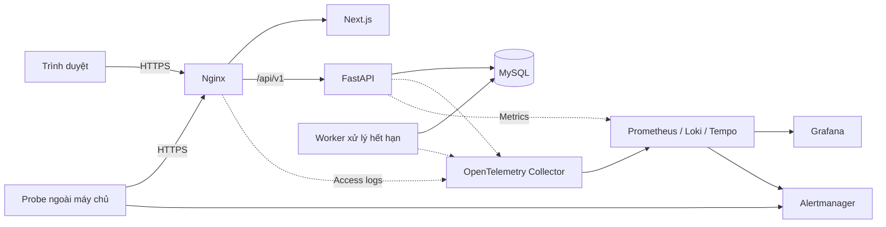

# Production Readiness Lab

Ứng dụng đặt lịch tư vấn tại trường đại học, kết hợp môi trường thực hành xây dựng và vận hành hệ thống phần mềm: từ thiết kế nghiệp vụ, bảo vệ dữ liệu đến triển khai, giám sát và phục hồi khi có sự cố.

Dự án lấy một bài toán thực tế làm nền tảng: sinh viên chọn nhu cầu tư vấn, nhân viên/cố vấn và thời gian phù hợp để đặt lịch. Trên nền tảng đó, Production Readiness Lab tập trung vào câu hỏi **làm thế nào để hệ thống hoạt động đúng, có thể quan sát và phục hồi được trong điều kiện vận hành thực tế?**

## Mục tiêu

- Xây dựng luồng đặt lịch nhất quán, kể cả khi nhiều người cùng chọn một khung giờ hoặc gửi lại yêu cầu.
- Phân quyền theo vai trò và phạm vi dữ liệu, bảo vệ thông tin cá nhân và nội dung tư vấn.
- Tổ chức mã nguồn rõ ràng để nhóm phát triển có thể mở rộng, kiểm thử và bảo trì.
- Chuẩn hóa quy trình kiểm tra, đóng gói, phát hành và rollback.
- Đánh giá chất lượng vận hành bằng số liệu, bài tải và diễn tập sự cố.

## Nghiệp vụ

| Vai trò             | Chức năng                                                                                                                   |
| ------------------- | --------------------------------------------------------------------------------------------------------------------------- |
| Sinh viên           | Chọn nhu cầu và nhân viên, xem giờ trống, đặt/hủy lịch, phản hồi đề nghị đổi lịch, xem lịch sử và thông báo cá nhân.        |
| Nhân viên / cố vấn  | Quản lý nhu cầu tiếp nhận và thời gian không nhận, xem lịch được giao, đề nghị đổi giờ/địa điểm, ghi nhận kết quả buổi gặp. |
| Quản trị viên       | Quản lý tài khoản, danh mục nhu cầu tư vấn và giờ phục vụ chung.                                                            |
| Thành viên vận hành | Triển khai release, theo dõi hệ thống, xử lý cảnh báo, sao lưu, khôi phục và diễn tập sự cố.                                |

Quyền vận hành hạ tầng được quản lý riêng với vai trò quản trị viên trong ứng dụng.

### Luồng đặt lịch

1. Sinh viên chọn nhu cầu tư vấn, nhân viên và giờ trống.
2. Hệ thống kiểm tra quyền, thời gian, hạn mức và xung đột lịch trong cùng giao dịch trước khi xác nhận.
3. Nhân viên có thể đề nghị đổi giờ hoặc địa điểm; sinh viên chấp thuận hoặc từ chối đề nghị.
4. Worker xử lý đề nghị quá hạn phản hồi. Nhân viên ghi nhận kết quả buổi gặp sau khi lịch kết thúc.
5. Các thay đổi nghiệp vụ được ghi vào lịch sử thao tác và thông báo cho những người liên quan.

### Quy tắc cốt lõi

- Mỗi sinh viên có tối đa **ba lịch đang chiếm chỗ**.
- Hai trạng thái `UPCOMING` và `CHANGE_PENDING` giữ chỗ. Khoảng thời gian dùng dạng `[starts_at, ends_at)`, cho phép hai lịch tiếp giáp.
- Không cho phép lịch đang chiếm chỗ giao nhau của cùng nhân viên hoặc cùng sinh viên.
- Khi chờ phản hồi đổi lịch, giờ gốc vẫn được giữ; giờ mới được kiểm tra lại khi sinh viên chấp thuận.
- Từ chối hoặc hết hạn đề nghị đổi lịch dẫn đến hủy lịch.
- Yêu cầu tạo lịch dùng `Idempotency-Key` để retry không tạo thêm lịch.
- Lịch hẹn, đề nghị, audit và thông báo liên quan được ghi trong cùng transaction.
- Thời điểm được lưu theo UTC và hiển thị theo múi giờ nghiệp vụ `Asia/Ho_Chi_Minh`.

Chi tiết trạng thái, ràng buộc và giao dịch nằm trong [thiết kế cơ sở dữ liệu](docs/architecture/database-design.md).

## Công nghệ

| Thành phần              | Công nghệ                                              |
| ----------------------- | ------------------------------------------------------ |
| Giao diện               | Next.js App Router, React, TypeScript strict           |
| Backend                 | FastAPI, Python 3.11+, Pydantic                        |
| Truy cập dữ liệu        | SQLAlchemy 2, asyncmy, Alembic                         |
| Cơ sở dữ liệu           | MySQL 8.4 LTS, InnoDB                                  |
| Worker                  | Tiến trình Python dùng chung mã nguồn và image backend |
| Reverse proxy           | Nginx                                                  |
| Đóng gói và triển khai  | Docker, Docker Compose trên Linux/VM                   |
| CI/CD                   | GitHub Actions, container registry                     |
| Thu thập telemetry      | OpenTelemetry Collector                                |
| Metrics, logs và traces | Prometheus, Loki, Tempo                                |
| Dashboard và cảnh báo   | Grafana, Alertmanager, probe ngoài máy chủ ứng dụng    |

## Kiến trúc

Backend theo mô hình **modular monolith**: một ứng dụng chia thành các module tài khoản, danh mục, khả dụng, lịch hẹn, thông báo và audit. API và worker chạy ở hai tiến trình, dùng chung các quy tắc nghiệp vụ và MySQL làm nguồn dữ liệu chính thức.



- **Cùng origin:** Nginx phục vụ giao diện và định tuyến `/api/v1` đến backend.
- **Nhất quán dữ liệu:** service quản lý transaction và thứ tự khóa; database bổ sung ràng buộc và chỉ mục.
- **Xử lý nền bền vững:** worker đọc đề nghị từ database và tiếp tục xử lý sau restart.
- **Quan sát xuyên suốt:** request ID, logs và traces giúp đối chiếu lỗi từ gateway đến database.
- **Phục hồi release:** frontend, API và worker được phát hành đồng bộ bằng image digest; rollback giữ dữ liệu đã commit và schema tương thích.

Xem [thiết kế hệ thống](docs/architecture/system-design.md) để hiểu trách nhiệm các tầng, xác thực, xử lý lỗi và vòng đời triển khai.

## Tiêu chí chất lượng

Các tiêu chí dưới đây là mục tiêu nghiệm thu. Kết quả được đánh giá bằng dữ liệu đo và bằng chứng kiểm thử.

| Tiêu chí         | Mục tiêu                                                                               |
| ---------------- | -------------------------------------------------------------------------------------- |
| Availability     | ≥99,5% trên request hợp lệ trong cửa sổ trượt 7 ngày.                                  |
| Độ trễ           | ≥95% request hợp lệ thành công hoàn tất trong ≤500 ms tại gateway, cùng cửa sổ 7 ngày. |
| Nhất quán lịch   | Không có cặp lịch đang chiếm chỗ giao nhau của cùng nhân viên.                         |
| Phát hiện sự cố  | Alert chuyển sang trạng thái firing trong ≤3 phút khi diễn tập.                        |
| Phục hồi release | Rollback và xác minh phục hồi trong ≤5 phút kể từ quyết định rollback.                 |

Phạm vi triển khai là một trường đại học với máy chủ demo dùng Docker Compose. Probe và kênh cảnh báo nằm ngoài máy chủ ứng dụng để phát hiện được sự cố toàn máy chủ. RPO/RTO của sao lưu được đánh giá qua bài khôi phục dữ liệu.

## Cấu trúc repository

```text
Production-Readiness-Lab/
├── docs/
│   ├── architecture/       # Thiết kế hệ thống và cơ sở dữ liệu
│   ├── other/              # Coding convention và Git Flow
│   └── tasks/              # Tài liệu công việc
├── src/
│   ├── backend/
│   │   └── app/            # API, domain, services, repositories, models, schemas
│   └── frontend/           # Pages, components, features, hooks và API services
├── tests/
│   ├── backend/            # Unit và integration tests
│   └── frontend/           # Kiểm thử giao diện và E2E
├── tools/
│   ├── deploy/             # Cấu hình phát hành và triển khai
│   ├── infra/              # Cấu hình hạ tầng và giám sát
│   └── scripts/            # Công cụ tự động hóa và vận hành
├── build/                  # Đầu ra build
└── README.md
```

## Tài liệu

| Tài liệu                                                              | Nội dung                                                                    |
| --------------------------------------------------------------------- | --------------------------------------------------------------------------- |
| [Thiết kế hệ thống](docs/architecture/system-design.md)               | Kiến trúc, luồng nghiệp vụ, bảo mật, observability, triển khai và phục hồi. |
| [Thiết kế cơ sở dữ liệu](docs/architecture/database-design.md)        | Mô hình 11 bảng, ràng buộc, chỉ mục và xử lý giao dịch cạnh tranh.          |
| [Models cơ sở dữ liệu](docs/architecture/database-models.md)          | Ánh xạ SQLAlchemy, chuyển đổi kiểu dữ liệu và hướng dẫn chạy kiểm tra.      |
| [Task database models](docs/tasks/database-models.md)                 | Phạm vi triển khai, kiểm thử và bàn giao bộ models.                         |
| [Catalog và availability](docs/tasks/catalog-availability.md)           | Hợp đồng ba API đọc, cách gọi bằng session và bằng chứng/giới hạn nghiệm thu. |
| [Đặt lịch appointment](docs/tasks/appointment-booking.md)               | API tạo lịch, xem chi tiết, idempotency và khôi phục khi mất phản hồi.       |
| [Đề nghị đổi lịch](docs/tasks/appointment-change-proposals.md)            | API staff/student, replay/precondition, migration và shared expiry transition. |
| [Lịch sử và quản lý lịch hẹn](docs/tasks/student-appointment-management.md) | API lịch sử, ngữ cảnh ngày đặt, hủy lịch và hành vi retry.                  |
| [Task frontend bootstrap](docs/tasks/frontend-bootstrap.md)           | Nền tảng, routes, các mốc triển khai, cài đặt và kiểm chứng.                 |
| [Mock services và UI đặt lịch](docs/tasks/frontend-mock-services.md)  | Chi tiết fixtures, preset, clock và thao tác đặt lịch bằng dữ liệu demo.    |
| [Đăng nhập demo và Home](docs/tasks/frontend-login.md)               | Mốc 3: form đăng nhập, phiên trong bộ nhớ, Home và đăng xuất.               |
| [Booking wizard và state](docs/tasks/frontend-booking.md)           | Mốc 4: reset draft, vòng đời request và kiểm thử các trạng thái đặt lịch.   |
| [Kết quả và lịch đã đặt](docs/tasks/frontend-results.md)            | Mốc 5: danh sách trong phiên, chi tiết từng lịch và thao tác bàn phím.      |
| [Kiểm thử frontend và CI](docs/tasks/frontend-testing.md)           | Mốc 6: ma trận hành vi, clean install, báo cáo E2E và chẩn đoán CI.         |
| [Bàn giao và nghiệm thu frontend](docs/tasks/frontend-handoff.md)   | Mốc 7: acceptance criteria, cách review, ảnh và phụ thuộc tích hợp API.     |
| [Tích hợp frontend API thật](docs/tasks/frontend-api-integration.md) | Issue #20: session, đặt/hủy lịch, phục hồi reload và E2E MySQL thật.        |
| [Hồ sơ sinh viên](docs/tasks/student-profile.md)                    | Trang hồ sơ riêng, API cá nhân và migration thông tin sinh viên.          |
| [Mô tả thay đổi và review issue #20](docs/tasks/issue-20-change-description.md) | Phạm vi từng file, kiểm thử, bằng chứng và hướng dẫn triển khai trước commit. |
| [Coding convention](docs/other/CONVENTION.md)                         | Quy ước tổ chức và viết mã frontend/backend.                                |
| [Git Flow](docs/other/GITFLOW.md)                                     | Vai trò các branch, Pull Request và quy trình release/hotfix.               |

## Phát triển và kiểm thử

### Chạy frontend

Frontend nằm trong npm workspace `src/frontend`. Dùng Node.js 24 theo `.nvmrc`
và npm 12.2.0. Mặc định dùng **API thật**. Chạy FastAPI/MySQL với migration hiện tại,
đặt `APPLICATION_ORIGIN=http://127.0.0.1:3000` và `COOKIE_SECURE=false` cho local HTTP.
Sao chép `src/frontend/.env.example` thành `src/frontend/.env.local`, rồi chạy từ gốc:

```bash
npm ci
npm --workspace src/frontend run dev
```

Mở `http://127.0.0.1:3000/login` bằng tài khoản sinh viên có trong database local.
Next.js chuyển tiếp `/api/v1/*` tới `API_UPSTREAM_URL` (mặc định ví dụ là
`http://127.0.0.1:8000`). Trình duyệt dùng cùng origin cho cookie, CSRF và API;
không cần Nginx/Docker để chạy local. Sau đăng nhập, chọn nhu cầu, cố vấn, ngày/giờ
và xác nhận. Kết quả có UUID trong URL; `/appointments` đọc lịch sử phân trang,
lọc trạng thái, mở chi tiết và hủy lịch. Lịch đã commit vẫn tồn tại sau reload.
Mục sidebar **Thông tin sinh viên** mở `/profile`, hiển thị họ tên, email, mã sinh viên,
khoa, ngành, giới tính và vai trò; dữ liệu chưa có được ghi là “Chưa cập nhật”.

Để chạy demo độc lập, đặt `NEXT_PUBLIC_APP_MODE=mock` trước khi dev/build.
Chế độ này hiển thị nhãn DEMO và giữ các kịch bản giả lập cũ; chỉ dùng thông tin giả,
lịch sử nằm trong bộ nhớ và bị xóa sau reload. Không có fallback từ API sang mock.
Các tài liệu [bootstrap](docs/tasks/frontend-bootstrap.md),
[mock services](docs/tasks/frontend-mock-services.md),
[login demo](docs/tasks/frontend-login.md), [wizard demo](docs/tasks/frontend-booking.md)
và [nghiệm thu 15/10](docs/tasks/frontend-handoff.md) mô tả phiên bản mock lịch sử.
Hướng dẫn tích hợp, thiết lập, retry và kiểm thử thật nằm trong
[frontend API integration](docs/tasks/frontend-api-integration.md).

Trên PowerShell, nếu `node` chưa có trên PATH nhưng dependencies đã được cài,
có thể chạy `./tools/scripts/start-frontend.ps1`. Script tìm Node trên PATH,
thư mục cài Node chuẩn hoặc runtime Codex của người dùng, rồi mở dev server;
không yêu cầu npm trên PATH và không đổi PATH hệ thống.

```bash
npm --workspace src/frontend run format:check
npm --workspace src/frontend run lint
npm --workspace src/frontend run typecheck
npm --workspace src/frontend run test
```

Chạy hồi quy mock sau khi build đúng chế độ (PowerShell):

```powershell
$env:NEXT_PUBLIC_APP_MODE='mock'
npm --workspace src/frontend run build
npm --workspace src/frontend exec -- playwright install chromium
npm --workspace src/frontend run test:e2e
```

`test:e2e` là bộ hồi quy mock: cần build với `NEXT_PUBLIC_APP_MODE=mock` và dùng cổng 3100.
`test:e2e:api` cần build API với `API_UPSTREAM_URL=http://127.0.0.1:8101`, cấu hình
`MYSQL_TEST_URL` và Python đã cài backend dependencies; bộ này khởi động FastAPI và
Next.js trên 8101/3101 cùng schema MySQL 8.4 riêng. Thiếu database sẽ làm kiểm tra thất bại.
Xem [lệnh kiểm chứng đầy đủ](docs/tasks/frontend-api-integration.md).

### Chạy nền tảng FastAPI

Cài `requirements-dev.txt`, rồi cài backend dạng editable (`python -m pip install -e .`).
Sao chép `.env.example` thành `.env` ở thư mục gốc và thay mọi giá trị `replace-with-*`
bằng giá trị local riêng. Không commit `.env`. Với môi trường demo/production, dùng
`APPLICATION_ORIGIN=https://...` và `COOKIE_SECURE=true`. Khởi động từ gốc repo:

```bash
python -m uvicorn app.main:app --app-dir src/backend --no-proxy-headers
```

API khởi động khi MySQL tạm thời không truy cập được. `/health/live` kiểm tra tiến trình
không hỏi database; `/health/ready` kiểm tra `SELECT 1` và phiên bản trong `alembic_version`.
Chạy migration theo `docs/tasks/database-migrations.md` trước khi mong readiness trả 200.
Phiên bản schema ban đầu là `a1b2c3d4e5f6`; revision được chấp nhận phải tương thích với release
đang chạy. Sau migration #14, `ACCEPTED_SCHEMA_REVISIONS` dùng revision
`20261016_1200_audit_reqid128` theo `.env.example`. Revision cũ không hỗ trợ request ID audit
tối đa 128 ký tự; chỉ liệt kê nhiều revision khi release tương thích với tất cả. Revision ngoài danh sách
trả 503.

Ba API đọc catalog/availability mới là `GET /api/v1/purposes`,
`GET /api/v1/staff?purpose_id=...` và
`GET /api/v1/availability?purpose_id=...&staff_id=...&date=YYYY-MM-DD`.
Chúng chỉ dành cho sinh viên có session hợp lệ; GET không cần CSRF. Dữ liệu nhu cầu,
nhân viên, giờ phục vụ và singleton `service_settings` phải được cấp trong MySQL riêng.
API không tự seed cấu hình; singleton thiếu hoặc không hợp lệ trả `503`, không giả làm
danh sách/giờ trống. Ngày khả dụng phải nằm trong cửa sổ D+1 đến D+`booking_horizon_days`
theo timezone trong DB. Xem [bàn giao catalog và availability](docs/tasks/catalog-availability.md)
để biết quy tắc slot, lỗi, giới hạn và ma trận kiểm thử.

`POST /api/v1/appointments` tạo lịch cho sinh viên đã đăng nhập; request cần same-origin,
CSRF và `Idempotency-Key`. `GET /api/v1/appointments/{appointment_id}` chỉ trả chi tiết
lịch thuộc sinh viên hiện tại. Preview availability không giữ chỗ: backend kiểm tra lại
slot trong transaction khi tạo. Nếu kết quả POST không đến được trình duyệt, frontend phải
giữ nguyên cả key lẫn body và gửi lại đúng request để nhận receipt gốc. Xem
[hợp đồng đặt lịch và khôi phục](docs/tasks/appointment-booking.md) để biết ví dụ, lỗi,
quy tắc key và cách kiểm thử MySQL 8.4.

GET /api/v1/booking-context trả múi giờ nghiệp vụ, ngày hiện tại và hai biên ngày đặt
bao gồm cả D+1 đến D+N lấy từ cấu hình DB; frontend không dùng đồng hồ trình duyệt để
xác định cửa sổ. GET /api/v1/appointments phân trang lịch sử của sinh viên; GET chi tiết
trả trạng thái hiện tại. POST /api/v1/appointments/{appointment_id}/cancel hủy lịch còn
đang chiếm chỗ trước nửa đêm theo múi giờ nghiệp vụ. Các GET không cần CSRF; toàn bộ phản hồi thành công hoặc lỗi của nhóm API này đều có
Cache-Control: private, no-store. Ghi chú về trường strict,
lỗi, tên hiển thị lịch sử, khóa giao dịch và kết quả commit chưa rõ nằm trong
[hợp đồng quản lý lịch hẹn](docs/tasks/student-appointment-management.md).

Ví dụ sau dùng tài khoản `STUDENT` đã được cấp cho môi trường của bạn. Với `.env.example`,
API chạy trực tiếp trên `http://localhost:8000`, còn `APPLICATION_ORIGIN` là
`http://localhost:3000`; nếu đổi cấu hình, sửa hai giá trị tương ứng. Mật khẩu được nhập
bằng `getpass`; HTTPX giữ cookie trong bộ nhớ và script không in cookie hay thông tin đăng nhập.
Ngày cần chọn là ngày hợp lệ theo cửa sổ nghiệp vụ, không nhất thiết là ngày trong ví dụ.

```bash
python - <<'PY'
import asyncio
from getpass import getpass

import httpx

API_URL = "http://localhost:8000"
APPLICATION_ORIGIN = "http://localhost:3000"


def read_json(response: httpx.Response) -> dict:
    if response.is_error:
        try:
            error = response.json().get("error", {})
        except ValueError:
            error = {}
        raise RuntimeError(
            f"HTTP {response.status_code}: {error.get('code', 'REQUEST_FAILED')} "
            f"(request_id={error.get('request_id', 'unavailable')})"
        )
    return response.json()


async def main() -> None:
    email = input("Email sinh viên: ").strip()
    password = getpass("Mật khẩu: ")

    async with httpx.AsyncClient(base_url=API_URL, timeout=4.0) as client:
        login = await client.post(
            "/api/v1/auth/login",
            json={"email": email, "password": password},
            headers={"Origin": APPLICATION_ORIGIN},
        )
        read_json(login)

        purpose_page = read_json(await client.get("/api/v1/purposes"))
        purposes = purpose_page["items"]
        if not purposes:
            print("Không có nhu cầu đang hoạt động.")
            return
        for number, purpose in enumerate(purposes, start=1):
            print(f"{number}. {purpose['code']} — {purpose['name']}")
        purpose = purposes[int(input("Chọn nhu cầu: ")) - 1]

        staff_page = read_json(
            await client.get("/api/v1/staff", params={"purpose_id": purpose["id"]})
        )
        staff_members = staff_page["items"]
        if not staff_members:
            print("Chưa có nhân viên nhận nhu cầu này.")
            return
        for number, member in enumerate(staff_members, start=1):
            print(f"{number}. {member['name']}")
        staff = staff_members[int(input("Chọn nhân viên: ")) - 1]
        selected_date = input("Ngày muốn xem (YYYY-MM-DD): ").strip()

        result = read_json(
            await client.get(
                "/api/v1/availability",
                params={
                    "purpose_id": purpose["id"],
                    "staff_id": staff["id"],
                    "date": selected_date,
                },
            )
        )
        print(f"Ngày {result['date']} — {result['timezone']}")
        for slot in result["slots"]:
            print(f"{slot['starts_at']} – {slot['ends_at']}")
        if not result["slots"]:
            print("Không có giờ trống phù hợp.")


asyncio.run(main())
PY
```

Đây là cách gọi dự kiến, chưa phải kết quả smoke test của môi trường MySQL trong lượt này.

| Biến môi trường                     | Bắt buộc / mặc định | Ý nghĩa và giá trị hợp lệ                                                                                             |
| ----------------------------------- | ------------------- | --------------------------------------------------------------------------------------------------------------------- |
| `DATABASE_URL`                      | Bắt buộc            | URL `mysql+asyncmy` có tên database; chỉ cung cấp qua môi trường hoặc `.env` local.                                   |
| `MYSQL_TEST_URL`                    | Chỉ cho tests MySQL | URL tài khoản test có quyền tạo/xóa schema riêng; không dùng database demo.                                           |
| `ENVIRONMENT`                       | `local`             | `local`, `test`, `demo`, `production`.                                                                                |
| `APPLICATION_ORIGIN`                | Bắt buộc            | Origin HTTP(S), không có path/query/credentials; demo/production phải HTTPS.                                          |
| `COOKIE_SECRET`, `CSRF_SECRET`      | Bắt buộc            | Hai secret không rỗng, độc lập; không đưa vào Git/log.                                                                |
| `COOKIE_SECURE` | `true` | Demo/production bắt buộc HTTPS và Secure; local HTTP đặt false. |
| `COOKIE_SAMESITE` | `lax` | Chỉ `lax` cho session authentication. |
| `COOKIE_DOMAIN` | Không đặt | Bắt buộc host-only; không đặt domain cho auth cookies. |
| `DB_POOL_SIZE`, `DB_MAX_OVERFLOW`   | `5`, `5`            | Số kết nối cơ bản >0 và kết nối vượt mức >=0 trên mỗi API process.                                                    |
| `DB_CONNECT_TIMEOUT_SECONDS`        | `1` giây            | Timeout kết nối hữu hạn, >0.                                                                                          |
| `DB_POOL_TIMEOUT_SECONDS`           | `0.5` giây          | Timeout chờ pool hữu hạn, >0.                                                                                         |
| `DB_QUERY_TIMEOUT_SECONDS`          | `1` giây            | Timeout truy vấn hữu hạn, >0; bao transaction đọc của catalog/availability.                                           |
| `DB_LOCK_TIMEOUT_SECONDS`           | `0.5` giây          | Timeout chờ khóa hữu hạn, >0; dành cho services sau này.                                                              |
| `REQUEST_TIMEOUT_SECONDS`           | `3` giây            | Ngân sách request hữu hạn, >0; áp cho request catalog/availability.                                                  |
| `READINESS_TIMEOUT_SECONDS`         | `2` giây            | Deadline hữu hạn, >0 cho toàn bộ readiness, gồm chờ pool, kết nối và cả hai query.                                    |
| `MAX_DEADLOCK_RETRIES`              | `2`                 | Số lần retry >=0, dành cho services sau này.                                                                          |
| `WORKER_POLL_INTERVAL_SECONDS`      | `5` giây            | Chu kỳ quét hữu hạn, >0; dành cho worker sau này.                                                                     |
| `WORKER_BATCH_SIZE`                 | `100`               | Số bản ghi/batch >0, dành cho worker sau này.                                                                         |
| `WORKER_GRACE_SECONDS`              | `30` giây           | Grace period hữu hạn, >0; dành cho worker sau này.                                                                    |
| `WORKER_HEARTBEAT_INTERVAL_SECONDS` | `15` giây           | Chu kỳ heartbeat hữu hạn, >0; dành cho worker sau này.                                                                |
| `ACCEPTED_SCHEMA_REVISIONS`         | Bắt buộc            | Danh sách Alembic revision không rỗng, cách nhau bằng dấu phẩy.                                                       |
| `TRUSTED_GATEWAY_CIDRS`             | Rỗng                | Danh sách CIDR của **peer mạng trực tiếp**, cách nhau bằng dấu phẩy; rỗng nghĩa là không tin incoming `X-Request-ID`. |

Gateway chuyển `X-Request-ID` nhưng chỉ IP Nginx được cấu hình trong
`TRUSTED_GATEWAY_CIDRS`. Chạy Uvicorn với `--no-proxy-headers` hoặc cấu hình proxy sao cho
địa chỉ peer gốc đến được middleware; không dùng `X-Forwarded-For` để quyết định tin ID.
Nginx không được cho client bên ngoài giả danh peer nội bộ. ID hợp lệ dài 1–128 ký tự ASCII
`[A-Za-z0-9._-]`; API thay ID thiếu, sai hoặc lặp và trả ID ở mọi response ứng dụng.

Kiểm thử từ gốc repo: `python -m pytest tests/backend -q` với MySQL 8.4 test riêng,
`python tools/scripts/export_openapi.py`, rồi `git diff --exit-code -- docs/api/openapi.yaml`.
Trên Windows, một số chính sách sandbox có thể chặn event loop asyncio; chạy tests async
trong môi trường Python được phép tạo event loop.

### Kiểm thử hệ thống

Đọc thiết kế hệ thống và cơ sở dữ liệu trước khi thay đổi nghiệp vụ. Router xử lý hợp đồng HTTP; service chịu trách nhiệm quy tắc và transaction; repository thực hiện truy vấn với session do service cung cấp. Frontend tập trung lời gọi API trong lớp `services` và xử lý đầy đủ trạng thái loading, lỗi, dữ liệu rỗng và xung đột.

Các lớp kiểm thử tập trung vào:

- **Unit:** quy tắc thời gian, quyền thao tác và chuyển trạng thái.
- **Integration:** API, transaction, constraint, idempotency và cạnh tranh trên MySQL 8.4/InnoDB thật.
- **E2E:** đăng nhập, đặt/hủy lịch, phản hồi đổi lịch và ghi kết quả buổi gặp.
- **Bài tải:** độ trễ, tỷ lệ lỗi và tính nhất quán khi nhiều người dùng thao tác đồng thời.
- **Diễn tập sự cố:** database mất kết nối, worker dừng, telemetry gián đoạn, máy chủ ngừng phục vụ và rollback release lỗi.

Bài cạnh tranh kiểm tra 50 sinh viên cùng đặt một khoảng giờ của một nhân viên: chỉ một lịch được tạo. Bài tải chuẩn sử dụng 20 phiên đồng thời trong 10 phút với dữ liệu seed ít nhất 10 nhân viên và 1.000 lịch.

## Vận hành và bảo mật

- Quản lý secret theo môi trường; giữ mật khẩu, token và tệp `.env` ngoài Git.
- Dùng dữ liệu giả cho seed, demo và diễn tập.
- Kiểm tra quyền tại backend cho từng đối tượng; bảo vệ thao tác ghi bằng cơ chế CSRF và kiểm tra origin.
- Loại bỏ mật khẩu, token và nội dung tư vấn khỏi logs, traces và metadata audit.
- Tách liveness, readiness và heartbeat worker; theo dõi cả backlog xử lý hết hạn.
- Phát hành artifact đã qua kiểm tra; serialize deploy/rollback và xác minh bằng health check, smoke test.
- Kiểm thử restore vào database riêng; đối chiếu dữ liệu và ràng buộc sau khôi phục.
- Giới hạn công cụ gây lỗi bằng `LAB_MODE`, thời gian hết hiệu lực và kiểm tra release.

Bằng chứng nghiệm thu gồm cấu hình môi trường, commit/image digest, kết quả kiểm thử và bài tải, trace mẫu, trạng thái cảnh báo và timeline phục hồi.

## Đóng góp

Nền tảng xác thực backend (Issue #5) cung cấp `POST /api/v1/auth/login`,
`GET /api/v1/auth/me`, `GET /api/v1/auth/csrf` và `POST /api/v1/auth/logout`.
Dùng session cookie host-only `prl_session` (HttpOnly) và `prl_csrf`, Path=/,
SameSite=Lax; cookie domain phải để trống. Demo/production cần HTTPS/Secure.
Login nhận JSON và Origin/Referer hợp lệ; thao tác ghi có phiên cần signed CSRF
cookie + `X-CSRF-Token`. Xem [hướng dẫn auth](docs/tasks/session-authentication.md)
cho cấu hình, ví dụ HTTP chạy được, API lỗi và giới hạn throttle theo process.
Lifetime mặc định 86400 giây; body login tối đa 4096 byte; mặc định 30 attempts/IP
và 5 attempts/email trong 60 giây, tối đa 10000 mục mỗi loại, 2 worker Argon2.
Biến cấu hình tương ứng có trong `.env.example`; mật khẩu/seed demo được cung cấp
ở task riêng, không có tài khoản mặc định do API tự tạo.

1. Đọc [coding convention](docs/other/CONVENTION.md) và [Git Flow](docs/other/GITFLOW.md).
2. Tạo branch theo loại thay đổi và phạm vi công việc.
3. Cập nhật mã nguồn, tài liệu và kiểm thử liên quan; đồng bộ thiết kế khi thay đổi nghiệp vụ hoặc kiến trúc.
4. Chạy các kiểm tra phù hợp với thay đổi và ghi kết quả trong Pull Request.
5. Mở Pull Request vào branch phù hợp để review trước khi merge; không push trực tiếp vào `main` hoặc `develop`.
