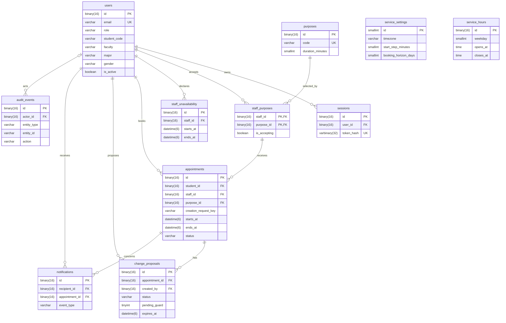

# Thiết kế cơ sở dữ liệu — Production Readiness Lab

**Phiên bản:** 1.6 · **Ngày cập nhật:** 18/10/2026 · **Database:** `production_readiness_lab`.

## Mục lục

1. Tổng quan dữ liệu
2. Quan hệ giữa các nhóm dữ liệu
3. Từ điển dữ liệu
4. Nguyên tắc thiết kế
5. Vòng đời lịch hẹn
6. Giao dịch và đồng thời
7. Chỉ mục và truy vấn
8. Migration và vòng đời dữ liệu
9. Kiểm chứng thiết kế

Phụ lục A. SQL cho các ràng buộc chính

## 1. Tổng quan dữ liệu

Cơ sở dữ liệu phục vụ ứng dụng đặt lịch tư vấn tại trường đại học. Dữ liệu mô tả ai đặt lịch, nhân viên nhận nhu cầu nào, thời gian có thể tiếp nhận và kết quả của từng buổi gặp.

MySQL 8.4 LTS với InnoDB là nguồn dữ liệu bền vững. Backend FastAPI truy cập database qua SQLAlchemy và quản lý thay đổi schema bằng migration Alembic.

Mô hình gồm **11 bảng**, chia thành năm nhóm:

| Nhóm | Bảng | Vai trò |
|---|---|---|
| Tài khoản | `users`, `sessions` | Danh tính, vai trò và phiên đăng nhập. |
| Nhu cầu tư vấn | `purposes`, `staff_purposes` | Thời lượng buổi gặp và khả năng tiếp nhận của nhân viên. |
| Khả dụng | `service_settings`, `service_hours`, `staff_unavailability` | Cấu hình đặt lịch, giờ phục vụ và khoảng không nhận. |
| Lịch hẹn | `appointments`, `change_proposals` | Lịch đã đặt và lịch sử đề nghị đổi. |
| Thông báo và lịch sử | `notifications`, `audit_events` | Thông báo cá nhân và đối chiếu thay đổi nghiệp vụ. |

Sinh viên, nhân viên và quản trị viên dùng chung bảng `users`, phân biệt bằng `role`. Phân quyền được kiểm tra tại backend; FK bảo đảm tài khoản tham chiếu tồn tại.

## 2. Quan hệ giữa các nhóm dữ liệu

Một nhân viên có thể nhận nhiều nhu cầu tư vấn; một nhu cầu có thể được nhiều nhân viên tiếp nhận. Bảng `staff_purposes` biểu diễn quan hệ này.

Một lịch hẹn tham chiếu sinh viên và cặp nhân viên–nhu cầu. Mỗi lịch có thể có nhiều đề nghị đổi trong lịch sử, nhưng chỉ có tối đa một đề nghị đang chờ.



`service_settings` và `service_hours` là cấu hình chung cho toàn trường. Một lịch tham chiếu cặp `(staff_id, purpose_id)` trong `staff_purposes`; liên kết này được giữ lại khi nhân viên ngừng nhận nhu cầu.

Sơ đồ thể hiện các quan hệ chính. Những khóa ngoại cho người hủy, người ghi kết quả và người giải quyết đề nghị được mô tả trong từ điển dữ liệu.

## 3. Từ điển dữ liệu

### 3.1. `users` — Tài khoản

Lưu danh tính và vai trò của người sử dụng ứng dụng.

| Cột | Kiểu | Bắt buộc / mặc định | Ý nghĩa |
|---|---|---|---|
| `id` | `binary(16)` | PK, NN | ID tài khoản. |
| `email` | `varchar(254)` | NN, UNIQUE | Email đăng nhập, chuẩn hóa chữ thường và bỏ khoảng trắng hai đầu. |
| `password_hash` | `text` | NN | Hash mật khẩu. |
| `name` | `varchar(150)` | NN | Tên hiển thị. |
| `role` | `varchar(10)` | NN | `STUDENT`, `STAFF` hoặc `ADMIN`. |
| `student_code` | `varchar(50)` | NULL | Mã sinh viên; chưa có dữ liệu thì để NULL. |
| `faculty` | `varchar(150)` | NULL | Khoa của sinh viên. |
| `major` | `varchar(150)` | NULL | Ngành học của sinh viên. |
| `gender` | `varchar(20)` | NULL | `MALE`, `FEMALE`, `OTHER`, `UNDISCLOSED`; không suy đoán từ tên. |
| `is_active` | `boolean` | NN, `true` | Cho phép đăng nhập và thao tác. |
| `created_at`, `updated_at` | `datetime(6)` | NN | Thời điểm tạo/sửa. |

**Ràng buộc:** email/tên không rỗng; `CAST(email AS BINARY) = CAST(LOWER(TRIM(email)) AS BINARY)`; `CHECK` cho tập vai trò.

FK tới `users.id` bảo đảm tài khoản tồn tại. Dịch vụ kiểm tra vai trò sau khi khóa tài khoản: người đặt là sinh viên; người tiếp nhận, khai báo thời gian không nhận, đề nghị đổi lịch và ghi kết quả là nhân viên. Danh tính người thao tác lấy từ phiên đã xác thực.

Vô hiệu hóa tài khoản thu hồi các phiên trong cùng giao dịch và giữ lịch sử lịch hẹn. Tạm từ chối đổi vai trò khi tài khoản đã có tham chiếu nghiệp vụ ở lịch hẹn, nhu cầu tiếp nhận, thời gian không nhận hoặc đề nghị; thao tác đổi vai trò dùng cùng khóa tài khoản với thao tác tạo dữ liệu nghiệp vụ.

### 3.2. `sessions` — Phiên đăng nhập

Lưu phiên đăng nhập và các mốc hết hạn, thu hồi.

| Cột | Kiểu | Bắt buộc / mặc định | Ý nghĩa |
|---|---|---|---|
| `id` | `binary(16)` | PK, NN | ID phiên. |
| `user_id` | `binary(16)` | NN, FK → `users.id` | Chủ phiên. |
| `token_hash` | `varbinary(32)` | NN, UNIQUE | Hash 32 byte của token ngẫu nhiên. |
| `created_at` | `datetime(6)` | NN | Lúc cấp phiên. |
| `expires_at` | `datetime(6)` | NN | Hạn phiên. |
| `revoked_at` | `datetime(6)` | NULL | Lúc thu hồi. |

**Ràng buộc:** `octet_length(token_hash) = 32`; `expires_at > created_at`.

Token gốc nằm trong cookie bảo mật. Khi xác thực, kiểm tra phiên chưa hết hạn/chưa bị thu hồi và tài khoản còn hoạt động.

### 3.3. `purposes` — Nhu cầu tư vấn

Lưu danh mục nhu cầu và thời lượng dùng khi tạo lịch.

| Cột | Kiểu | Bắt buộc / mặc định | Ý nghĩa |
|---|---|---|---|
| `id` | `binary(16)` | PK, NN | ID nhu cầu. |
| `code` | `varchar(50)` | NN, UNIQUE | Mã ổn định, ví dụ `ACADEMIC_ADVISOR`. |
| `name` | `varchar(150)` | NN | Tên hiển thị. |
| `duration_minutes` | `smallint` | NN | Thời lượng buổi hẹn. |
| `requires_free_text` | `boolean` | NN, `false` | Yêu cầu mô tả ngắn; bật cho nhu cầu có mã `OTHER`. |
| `is_active` | `boolean` | NN, `true` | Cho phép đặt mới. |
| `created_at`, `updated_at` | `datetime(6)` | NN | Thời điểm tạo/sửa. |

**Ràng buộc:** mã/tên không rỗng; `duration_minutes > 0`.

Mã nhu cầu giữ nguyên sau khi tạo. Danh mục đã được tham chiếu được vô hiệu hóa khi ngừng sử dụng. Tên hiển thị lấy từ danh mục hiện tại; thời lượng lịch hẹn giữ giá trị đã lưu lúc đặt.

### 3.4. `staff_purposes` — Nhu cầu nhân viên tiếp nhận

Liên kết nhân viên với những nhu cầu họ có thể tiếp nhận.

| Cột | Kiểu | Bắt buộc / mặc định | Ý nghĩa |
|---|---|---|---|
| `staff_id` | `binary(16)` | PK ghép, NN, FK → `users.id` | Nhân viên tiếp nhận. |
| `purpose_id` | `binary(16)` | PK ghép, NN, FK → `purposes.id` | Nhu cầu được chọn. |
| `is_accepting` | `boolean` | NN, `true` | Có nhận lịch mới. |
| `created_at`, `updated_at` | `datetime(6)` | NN | Thời điểm chọn/sửa. |

**Ràng buộc:** `PRIMARY KEY(staff_id, purpose_id)`.

Ngừng nhận dùng `is_accepting = false`; lịch đã có giữ nguyên. Giao dịch tạo/duyệt đổi lịch kiểm tra nhân viên đang nhận nhu cầu và danh mục còn hoạt động.

API STAFF giữ nguyên khóa ghép và không DELETE liên kết. Chỉ tạo liên kết với nhu cầu đang
hoạt động; liên kết nhu cầu ngừng hoạt động được giữ để đọc/lịch sử và chỉ cho tắt tiếp nhận.
PUT không đổi giữ nguyên `created_at`, `updated_at` và số audit. GET trả mọi nhu cầu active
(chưa liên kết thì acceptance=false) cộng liên kết inactive của chính staff, theo tên/ID.

### 3.5. `service_settings` — Cấu hình đặt lịch

Lưu cấu hình chung áp dụng cho việc đặt lịch trong toàn trường.

| Cột | Kiểu | Bắt buộc / mặc định | Ý nghĩa |
|---|---|---|---|
| `id` | `smallint` | PK, NN, `1` | Một cấu hình chung cho toàn trường. |
| `timezone` | `varchar(64)` | NN, `'Asia/Ho_Chi_Minh'` | Múi giờ nghiệp vụ. |
| `start_step_minutes` | `smallint` | NN, `15` | Bước chọn giờ bắt đầu. |
| `booking_horizon_days` | `smallint` | NN, `7` | Số ngày lịch kế tiếp ngày hiện tại được phép đặt. |
| `updated_at` | `datetime(6)` | NN | Lần sửa cấu hình. |

**Ràng buộc:** `id = 1`; bước chọn giờ và cửa sổ đặt lớn hơn 0. Seed bắt buộc tạo dòng cấu hình; dịch vụ kiểm tra múi giờ hợp lệ.

Thời lượng lấy từ nhu cầu. Hạn hủy và phản hồi đề nghị áp dụng theo mục 5.1. Người sửa cấu hình được ghi trong audit. Thao tác đổi múi giờ, cửa sổ đặt hoặc giờ phục vụ không tự sửa các lịch đã xác nhận.

### 3.6. `service_hours` — Giờ phục vụ chung

Lưu các khoảng phục vụ theo thứ trong tuần.

| Cột | Kiểu | Bắt buộc / mặc định | Ý nghĩa |
|---|---|---|---|
| `id` | `binary(16)` | PK, NN | ID khoảng phục vụ. |
| `weekday` | `smallint` | NN | Thứ ISO: 1 = thứ Hai, 7 = Chủ nhật. |
| `opens_at`, `closes_at` | `time(0)` | NN | Giờ bắt đầu/kết thúc theo múi giờ cấu hình. |
| `created_at`, `updated_at` | `datetime(6)` | NN | Thời điểm tạo/sửa. |

**Ràng buộc:** `weekday BETWEEN 1 AND 7`; `opens_at >= '00:00:00'`; `opens_at < closes_at`; `closes_at < '24:00:00'`; `UNIQUE(weekday, opens_at, closes_at)`.

Một ngày có thể có nhiều khoảng, ví dụ sáng và chiều. Ngày thiếu bản ghi là ngày nghỉ. Dịch vụ kiểm tra các khoảng cùng thứ không giao nhau khi cập nhật dưới khóa cấu hình. Mỗi khoảng nằm trong một ngày; hai giá trị giờ nằm từ `00:00:00` đến `23:59:59`. Giới hạn này giữ `TIME` của MySQL theo nghĩa giờ trong ngày và phù hợp kiểu giờ của adapter.

### 3.7. `staff_unavailability` — Thời gian nhân viên không nhận

Lưu khoảng thời gian nhân viên không nhận lịch.

| Cột | Kiểu | Bắt buộc / mặc định | Ý nghĩa |
|---|---|---|---|
| `id` | `binary(16)` | PK, NN | ID khoảng không nhận. |
| `staff_id` | `binary(16)` | NN, FK → `users.id` | Nhân viên. |
| `starts_at`, `ends_at` | `datetime(6)` | NN | Khoảng không nhận `[start, end)`. |
| `created_at` | `datetime(6)` | NN | Lúc khai báo. |

**Ràng buộc:** `ends_at > starts_at`; kiểu dữ liệu và SQL mode từ chối ngày giờ không hợp lệ.

Khi thêm, dịch vụ khóa nhân viên rồi kiểm tra không giao với lịch đang chiếm chỗ. Khi mở lại thời gian, xóa bản ghi và ghi audit trong cùng giao dịch. Các khoảng không nhận có thể giao nhau; availability loại bỏ thời gian nằm trong bất kỳ khoảng nào.

Sau khóa settings SHARE và staff UPDATE, POST tìm khoảng UTC chính xác của staff trước
kiểm tra xung đột; retry trả cùng ID/`created_at` và không thêm audit. Khóa staff bảo vệ cả
kết quả rỗng; không cần UNIQUE hoặc migration mới. Khoảng khác nhau có thể giao nhau,
không giới hạn theo slot, giờ phục vụ hay booking horizon. Chỉ UPCOMING/CHANGE_PENDING
của cùng staff chặn tạo mới; tiếp giáp được phép. GET owned lọc `ends_at > from` và
`starts_at < to`, xếp theo `starts_at`, ID. DELETE owned và audit nguyên tử; ID thiếu,
ngoài phạm vi hoặc đã xóa cùng 404, không tạo audit lặp. Chi tiết phục hồi khi commit chưa
rõ kết quả ở [task staff availability](../tasks/staff-availability-management.md).

### 3.8. `appointments` — Lịch hẹn

Lưu lịch hẹn đã xác nhận, dữ liệu tạo ban đầu và kết quả cuối.

| Cột | Kiểu | Bắt buộc / mặc định | Ý nghĩa |
|---|---|---|---|
| `id` | `binary(16)` | PK, NN | Mã lịch hẹn. |
| `student_id` | `binary(16)` | NN, FK → `users.id` | Sinh viên tự đặt. |
| `staff_id`, `purpose_id` | `binary(16)` | NN, FK ghép → `staff_purposes` | Nhân viên và nhu cầu được chọn. |
| `duration_minutes` | `smallint` | NN | Thời lượng lưu tại lúc đặt. |
| `other_reason` | `varchar(2000)` | NULL | Mô tả ngắn khi nhu cầu yêu cầu. |
| `starts_at`, `ends_at` | `datetime(6)` | NN | Khoảng gặp, khớp thời lượng đã lưu. |
| `location` | `varchar(500)` | NULL | Địa điểm của lịch; để NULL khi chưa xác định. |
| `status` | `varchar(20)` | NN, `'UPCOMING'` | Trạng thái lịch. |
| `creation_request_key` | `varchar(128)` | NN | Mã yêu cầu tạo lịch do client sinh. |
| `creation_request_hash` | `varbinary(32)` | NN | Hash 32 byte của nội dung yêu cầu đã chuẩn hóa. |
| `proposal_version` | `bigint` | NN, `0` | Bộ đếm tạo/thay đề nghị, không tăng khi quyết định hoặc hủy. |
| `cancelled_at` | `datetime(6)` | NULL | Lúc hủy. |
| `cancelled_by` | `binary(16)` | NULL, FK → `users.id` | Sinh viên/nhân viên hủy; NULL cho hệ thống. |
| `cancel_reason` | `varchar(2000)` | NULL | Lý do hủy tùy chọn. |
| `outcome_at` | `datetime(6)` | NULL | Lúc ghi kết quả. |
| `outcome_by` | `binary(16)` | NULL, FK → `users.id` | Nhân viên ghi kết quả. |
| `created_at`, `updated_at` | `datetime(6)` | NN | Thời điểm tạo/sửa. |

**Ràng buộc tại database:**

- Trạng thái thuộc `UPCOMING`, `CHANGE_PENDING`, `CANCELLED`, `COMPLETED`, `NO_SHOW`.
- Thời lượng dương; `ends_at > starts_at`; `ends_at = DATE_ADD(starts_at, INTERVAL duration_minutes MINUTE)`.
- `UNIQUE(student_id, creation_request_key)`; key không rỗng; `octet_length(creation_request_hash) = 32`.
- `CANCELLED` có `cancelled_at`; các trạng thái khác có `cancelled_at` và `cancel_reason` để NULL.
- `COMPLETED/NO_SHOW` có `outcome_at`; các trạng thái khác để `outcome_at` NULL.

**Quy tắc tại service:**

- Khóa hàng sinh viên và nhân viên, rồi kiểm tra giao khoảng và hạn mức trong cùng giao dịch trước khi ghi; áp dụng cho `UPCOMING/CHANGE_PENDING` theo mục 6.
- `cancelled_by` là sinh viên/nhân viên của lịch hoặc NULL khi hệ thống hủy; để NULL khi lịch không ở trạng thái `CANCELLED`.
- `COMPLETED/NO_SHOW` có `outcome_by = staff_id`; các trạng thái khác để `outcome_by` NULL. Kiểm tra danh tính và quyền trước khi ghi kết quả.

Người tham gia, nhu cầu, mô tả, thời lượng, mã/hash yêu cầu và `created_at` giữ nguyên sau khi tạo. Dịch vụ kiểm tra `requires_free_text` lúc đặt; mô tả đã có giữ nguyên khi danh mục thay đổi. Giờ/địa điểm chỉ cập nhật qua đề nghị được sinh viên chấp thuận. Giới hạn ba lịch được kiểm tra theo §6.

### 3.9. `change_proposals` — Đề nghị đổi lịch

Lưu từng đề nghị đổi lịch để giữ được lịch sử phản hồi.

| Cột | Kiểu | Bắt buộc / mặc định | Ý nghĩa |
|---|---|---|---|
| `id` | `binary(16)` | PK, NN | ID đề nghị. |
| `appointment_id` | `binary(16)` | NN, FK → `appointments.id` | Lịch cần thay đổi. |
| `created_by` | `binary(16)` | NN, FK → `users.id` | Nhân viên của lịch tạo đề nghị. |
| `creation_request_key` | `varchar(128)` | NULL | Key tạo/thay đề nghị; NULL cho lịch sử legacy. |
| `creation_request_hash` | `varbinary(32)` | NULL | Hash v1 của ý định và cả hai precondition. |
| `created_version` | `bigint` | NULL | Version cấp lúc tạo, bất biến; NULL cho legacy. |
| `proposed_starts_at`, `proposed_ends_at` | `datetime(6)` | NN | Toàn bộ khoảng giờ đề nghị. |
| `proposed_location` | `varchar(500)` | NULL | Địa điểm sau khi duyệt; có thể giữ nguyên. |
| `status` | `varchar(20)` | NN, `'PENDING'` | Trạng thái đề nghị. |
| `pending_guard` | `tinyint` | Generated, NULL | Tự tính: 1 khi `PENDING`, NULL ở trạng thái khác; không nhận giá trị từ ứng dụng. |
| `created_at` | `datetime(6)` | NN | Lúc tạo. |
| `expires_at` | `datetime(6)` | NN | Hạn phản hồi tính và lưu lúc tạo. |
| `resolved_at` | `datetime(6)` | NULL | Lúc kết thúc đề nghị. |
| `resolved_by` | `binary(16)` | NULL, FK → `users.id` | Người kết thúc; NULL khi tự hết hạn. |

**Ràng buộc tại database:**

- Trạng thái thuộc `PENDING`, `ACCEPTED`, `DECLINED`, `EXPIRED`, `SUPERSEDED`, `CANCELLED`.
- `proposed_ends_at > proposed_starts_at`; `expires_at > created_at`.
- `UNIQUE(appointment_id, pending_guard)` bảo đảm tối đa một đề nghị `PENDING` trên một lịch.
- `UNIQUE(appointment_id, creation_request_key)` giữ receipt; `UNIQUE(appointment_id, created_version)` bảo vệ version tạo. Ba cột metadata cùng NULL cho legacy hoặc cùng có giá trị: key không rỗng, hash 32 byte, version trong `[1, 9007199254740991]`. Counter appointment trong `[0, 9007199254740991]`.
- `PENDING` có `resolved_at` để NULL; trạng thái kết thúc có `resolved_at`.

**Quy tắc tại service:** `resolved_by` để NULL khi `PENDING` hoặc `EXPIRED`; các trạng thái kết thúc khác ghi người thao tác phù hợp. Service kiểm tra quyền và danh tính trong cùng giao dịch chuyển trạng thái.

Đổi địa điểm đơn thuần vẫn lưu đầy đủ giờ gốc trong hai cột proposed. Dịch vụ kiểm tra đề nghị thay đổi ít nhất giờ hoặc địa điểm và giữ nguyên thời lượng buổi hẹn. Giá trị đề nghị giữ nguyên trong lịch sử; đề nghị lại kết thúc bản cũ bằng `SUPERSEDED` rồi tạo bản mới.

Hạn phản hồi là 00:00 theo múi giờ nghiệp vụ của ngày hẹn sớm hơn giữa lịch gốc và lịch đề nghị. Hạn được lưu cụ thể để worker xử lý theo cùng quyết định đã áp dụng lúc tạo.

### 3.10. `notifications` — Thông báo

Lưu thông báo theo người nhận và trạng thái đã đọc.

| Cột | Kiểu | Bắt buộc / mặc định | Ý nghĩa |
|---|---|---|---|
| `id` | `binary(16)` | PK, NN | ID thông báo. |
| `recipient_id` | `binary(16)` | NN, FK → `users.id` | Người nhận. |
| `appointment_id` | `binary(16)` | NN, FK → `appointments.id` | Lịch liên quan. |
| `event_type` | `varchar(50)` | NN | Loại sự kiện: tạo lịch, đề nghị đổi, chấp thuận, hủy, hoàn thành, vắng mặt. |
| `created_at` | `datetime(6)` | NN | Lúc tạo. |
| `read_at` | `datetime(6)` | NULL | Lúc đọc. |

Mỗi thay đổi cần thông báo tạo hai bản ghi cho sinh viên và nhân viên trong cùng giao dịch cập nhật lịch. Nội dung hiển thị dựng từ loại sự kiện và dữ liệu lịch người nhận được phép xem. Retry thao tác đã hoàn tất trả kết quả hiện có và giữ nguyên số thông báo.

### 3.11. `audit_events` — Lịch sử thao tác

Lưu sự kiện để đối chiếu người thực hiện và thay đổi nghiệp vụ.

| Cột | Kiểu | Bắt buộc / mặc định | Ý nghĩa |
|---|---|---|---|
| `id` | `binary(16)` | PK, NN | ID sự kiện. |
| `actor_id` | `binary(16)` | NULL, FK → `users.id` | Người thực hiện; NULL cho worker/hệ thống. |
| `action` | `varchar(60)` | NN | Mã hành động như `APPOINTMENT_CREATED`, `CHANGE_ACCEPTED`. |
| `entity_type` | `varchar(50)` | NN | Loại đối tượng: lịch, đề nghị, nhu cầu, cấu hình, thời gian không nhận. |
| `entity_id` | `varchar(100)` | NN | ID đối tượng được ghi nhận. |
| `request_id` | `varchar(128)` | NN | Mã đối chiếu request hoặc lần chạy worker. |
| `metadata` | `json` | NN, backend gán `{}` khi không có metadata | Trạng thái/khoảng giờ trước và sau, ID liên quan cần thiết. |
| `created_at` | `datetime(6)` | NN | Lúc xảy ra hành động. |

Audit được ghi cùng giao dịch nghiệp vụ; tài khoản runtime chỉ được INSERT/SELECT. `entity_id` là tham chiếu tổng quát, phục vụ cả ID UUID và cấu hình `id = 1`; quan hệ này được dịch vụ kiểm soát. Sự kiện thay đổi lịch dùng `entity_type = 'APPOINTMENT'` và ID lịch để tra timeline.

Metadata giữ thông tin cần đối chiếu thay đổi; mật khẩu, token, mô tả tư vấn, lý do hủy tự do và toàn bộ request body được loại khỏi audit.

## 4. Nguyên tắc thiết kế

### 4.1. Trách nhiệm của database và service

Database bảo vệ sự tồn tại của đối tượng tham chiếu, tính hợp lệ trong từng hàng và những ràng buộc duy nhất. Service kiểm tra quyền, quy tắc giữa nhiều hàng và chuyển trạng thái trong một transaction.

Ví dụ, CHECK có thể xác nhận thời điểm kết thúc lớn hơn thời điểm bắt đầu. Việc hai lịch của cùng nhân viên giao nhau cần được service kiểm tra dưới khóa.

| Quy tắc | Lớp bảo đảm |
|---|---|
| Tài khoản/nhu cầu/lịch tham chiếu tồn tại | FK; cặp nhân viên–nhu cầu dùng FK ghép. |
| Đúng vai trò, sinh viên tự đặt, người thao tác có quyền | Dịch vụ xác thực và kiểm tra lại dưới khóa tài khoản. |
| Khoảng thời gian và thời lượng hợp lệ | `CHECK` trên bảng; SQL mode nghiêm ngặt cho ngày giờ. |
| Lịch đang chiếm chỗ không giao nhau | Khóa hàng nhân viên/sinh viên bằng `FOR UPDATE`, kiểm tra giao khoảng rồi ghi trong cùng transaction. |
| Tối đa ba lịch đang chiếm chỗ | Khóa sinh viên rồi đếm trong giao dịch tạo lịch. |
| Mỗi yêu cầu tạo tối đa một lịch | Unique theo sinh viên và mã yêu cầu; so sánh hash khi retry. |
| Tối đa một đề nghị đang chờ | Generated column `pending_guard` và unique ghép theo lịch. |
| Trạng thái lịch/đề nghị đồng bộ, trường bất biến | Luồng ghi của dịch vụ, khóa lịch và cập nhật trong cùng transaction. |
| Người hủy/ghi kết quả/giải quyết đề nghị phù hợp trạng thái | Dịch vụ kiểm tra quyền, danh tính và các cột actor dưới khóa. |
| Audit/thông báo khớp kết quả nghiệp vụ | Ghi trong cùng transaction. |

`CHECK` kiểm tra dữ liệu trong một hàng; không dùng subquery hoặc hàm thời gian hiện tại để kiểm tra khả dụng/quyền. MySQL hạn chế kết hợp `CHECK` với cột có hành động FK, vì vậy các điều kiện về `cancelled_by`, `outcome_by` và `resolved_by` được dịch vụ kiểm tra.

**Chống trùng khoảng giờ là quy tắc của giao dịch dịch vụ.** MySQL không có constraint khai báo tương đương để cấm mọi khoảng giao nhau giữa các hàng. Mọi luồng ghi ảnh hưởng khả dụng, gồm API, worker và công cụ nhập/chỉnh dữ liệu, phải tuân theo §6. Unique theo giờ bắt đầu chỉ chặn giờ bắt đầu giống nhau, nên không đáp ứng quy tắc này.

### 4.2. Quy ước lưu trữ

- **Tên và engine:** bảng/cột dùng tiếng Anh, `snake_case`; tất cả bảng dùng InnoDB, charset `utf8mb4`, collation mặc định `utf8mb4_0900_ai_ci`.
- **UUID:** backend sinh ID, lưu `BINARY(16)` theo thứ tự byte chuẩn. API trả chuỗi UUID chuẩn; PK và FK dùng cùng quy ước. Bảng liên kết dùng khóa ghép.
- **Cấu hình chung:** `service_settings` có đúng dòng `id = 1`.
- **Mã nghiệp vụ:** role, status, code, event type, action, entity type, mã đối chiếu và idempotency key dùng `utf8mb4_0900_bin` để so sánh chính xác.
- **Email:** chuẩn hóa chữ thường và bỏ khoảng trắng hai đầu; dùng `utf8mb4_0900_as_ci`, phân biệt dấu nhưng không phân biệt hoa/thường.
- **Thời điểm:** dùng `DATETIME(6)` theo UTC; mỗi kết nối đặt `time_zone = '+00:00'`. Adapter chuyển đầu vào có offset sang UTC và gắn UTC khi đọc.
- **Giờ phục vụ:** dùng `TIME(0)` theo múi giờ cấu hình, giới hạn trong một ngày.
- **Timestamp:** `created_at` mặc định `CURRENT_TIMESTAMP(6)`; backend gán `updated_at` trong giao dịch ghi.
- **SQL mode:** giữ chế độ nghiêm ngặt, gồm `STRICT_TRANS_TABLES`, `NO_ZERO_DATE`, `NO_ZERO_IN_DATE`; không dùng `ALLOW_INVALID_DATES`.
- **Khóa ngoại:** dùng `ON DELETE RESTRICT ON UPDATE RESTRICT`; kiểu cột FK và cột được tham chiếu phải khớp.
- **Trạng thái và cờ:** dùng `VARCHAR` với CHECK cho trạng thái; boolean tương đương `TINYINT(1)` và có CHECK giới hạn 0/1.
- **Hash:** SHA-256 lưu `VARBINARY(32)`, kèm CHECK độ dài. Key client được giữ nguyên, không chuẩn hóa lại.
- **Metadata:** dữ liệu nghiệp vụ dùng cột quan hệ; JSON phục vụ metadata audit đã lọc nội dung nhạy cảm.

Trong các bảng bên dưới, `PK` là khóa chính, `FK` là khóa ngoại, `UNIQUE` là duy nhất, `NN` là `NOT NULL`, `NULL` cho phép thiếu giá trị. Mặc định là giá trị tại database, trừ trường được ghi rõ do backend gán.

## 5. Vòng đời lịch hẹn

### 5.1. Thời gian và quyền thao tác

| Quy tắc | Cách áp dụng |
|---|---|
| Ngày nghiệp vụ | Tính theo `service_settings.timezone`, mặc định `Asia/Ho_Chi_Minh`. |
| Cửa sổ đặt | Với ngày hiện tại D, cho phép chọn ngày D+1 đến D+7, gồm cả hai biên; số ngày lấy từ `booking_horizon_days`. |
| Bước giờ | Giờ bắt đầu lấy đầu mỗi khoảng phục vụ làm mốc, tăng theo `start_step_minutes`. Toàn bộ thời lượng phải nằm trong khoảng đó. |
| Hạn hủy | Sinh viên/nhân viên của lịch hủy trước 00:00 ngày hẹn; đến hạn thì từ chối. |
| Hạn phản hồi đề nghị | Trước 00:00 ngày hẹn sớm hơn giữa lịch gốc và đề nghị; lưu thời điểm UTC vào `expires_at`. |
| Đúng thời điểm hết hạn | `now >= expires_at` không được phản hồi; worker chuyển đề nghị `EXPIRED` và lịch `CANCELLED`. |
| Ghi kết quả | Nhân viên nhận lịch ghi `COMPLETED/NO_SHOW` trên lịch `UPCOMING` sau `ends_at`. |
| Quyền quản trị | `ADMIN` quản lý tài khoản/danh mục/cấu hình, không mặc định có quyền đọc hoặc sửa nội dung tư vấn. |

Quyền, thời điểm hiện tại và khả dụng được kiểm tra lại sau khi có đủ khóa trong transaction. Danh tính người thao tác lấy từ phiên, không lấy từ trường ID tùy ý trong request.

Thời lượng lấy từ nhu cầu và được lưu tại lúc đặt. Thay đổi thời lượng danh mục không sửa lịch đã có. Sinh viên có tối đa ba lịch đang chiếm chỗ; `UPCOMING` và `CHANGE_PENDING` cùng được tính vào hạn mức.

### 5.2. Trạng thái lịch và đề nghị

| Thao tác | Trạng thái lịch sau thao tác | Trạng thái đề nghị |
|---|---|---|
| Sinh viên đặt thành công | `UPCOMING` | — |
| Nhân viên đề nghị đổi | `CHANGE_PENDING` | `PENDING` |
| Nhân viên đề nghị lại | `CHANGE_PENDING` | Bản cũ `SUPERSEDED`, bản mới `PENDING` |
| Sinh viên chấp thuận | `UPCOMING`, áp dụng giá trị đề nghị | `ACCEPTED` |
| Sinh viên từ chối | `CANCELLED` | `DECLINED` |
| Hết hạn phản hồi | `CANCELLED` | `EXPIRED` |
| Hủy trực tiếp | `CANCELLED` | Đề nghị đang chờ thành `CANCELLED` |
| Nhân viên ghi kết quả sau buổi gặp | `COMPLETED` hoặc `NO_SHOW` | — |

Lịch mới luôn là `UPCOMING`. `CHANGE_PENDING` có đúng một đề nghị `PENDING`. Các trạng thái kết thúc giữ nguyên khi retry; mọi cập nhật giờ/địa điểm đi qua luồng chấp thuận đề nghị. Chỉ nhân viên nhận lịch được ghi kết quả trên lịch `UPCOMING` sau `ends_at`.

Staff đọc lịch qua `/api/v1/staff/me/appointments`; truy vấn luôn giới hạn `appointments.staff_id`
theo session. Bộ lọc `date` dùng ngày trong `service_settings.timezone` và khoảng UTC nửa mở.
Khi hủy hoặc ghi outcome, service khóa settings, student/staff theo UUID byte tăng dần rồi
appointment. Hủy `CHANGE_PENDING` khóa và kết thúc proposal đang chờ sau appointment.

Hủy lịch cho phép `UPCOMING`/`CHANGE_PENDING` trước nửa đêm địa phương của ngày hẹn; DB clock
được đọc sau proposal lock. Ghi `COMPLETED`/`NO_SHOW` chỉ áp dụng với lịch `UPCOMING` sau
`ends_at` (strictly greater). Retry cùng trạng thái cuối trả thời điểm đã lưu; trạng thái đối
nghịch trả xung đột. Mỗi chuyển trạng thái ghi một audit event và hai notification cùng
transaction với appointment/proposal. Các cột `cancelled_*`, `outcome_*`, audit, notification và
proposal đã tồn tại; tính năng không cần migration.

### 5.3. Một lần đặt lịch

```text
Sinh viên chọn nhu cầu, nhân viên và giờ
    → Backend xác thực phiên
    → Service lấy khóa và kiểm tra lại quyền, hạn mức, khả dụng
    → Ghi lịch UPCOMING, audit và hai thông báo
    → Commit transaction
    → Trả kết quả tạo lịch
```

Ví dụ, hai lịch 09:00–09:30 và 09:30–10:00 được phép tiếp giáp. Hai yêu cầu cùng chọn khoảng 09:00–09:30 của một nhân viên phải được tuần tự hóa bằng khóa hàng tài khoản; chỉ một lịch được tạo.

Giờ gốc vẫn được giữ khi chờ đổi lịch. Giờ đề nghị được kiểm tra lại khi chấp thuận, vì đề nghị không tự giữ chỗ mới.

## 6. Giao dịch và đồng thời

### 6.1. Quy trình khóa

API và worker cấu hình tường minh isolation level `READ COMMITTED` trên SQLAlchemy engine. Mỗi lần đọc sau khi chờ khóa nhận snapshot mới, phù hợp việc kiểm tra lại số lịch và khả dụng.

Mọi luồng ghi áp dụng cùng thứ tự trong một transaction InnoDB:

1. Khóa dòng `service_settings(id = 1)` bằng `FOR SHARE` cho thao tác lịch, nhu cầu tiếp nhận và thời gian không nhận. Quản trị sửa giờ chung/cấu hình/danh mục dùng `FOR UPDATE` ngay từ đầu.
2. Sắp xếp ID các tài khoản liên quan theo 16 byte UUID tăng dần; khóa từng hàng `users` bằng một `SELECT ... WHERE id = :id FOR UPDATE` riêng. Khi tạo/đổi/hủy/ghi kết quả/hết hạn lịch, khóa cả sinh viên và nhân viên.
3. Khóa lịch bằng `FOR UPDATE` theo ID tăng dần nếu thao tác nhiều lịch; sau đó khóa đề nghị/liên kết nhu cầu liên quan.
4. Đọc lại dữ liệu sau khi có đủ khóa. Chạy câu lệnh riêng `SELECT UTC_TIMESTAMP(6)` để lấy thời điểm kiểm tra hạn, rồi kiểm tra quyền, trạng thái, hạn mức và khả dụng; ghi và commit.

Khóa nhân viên đồng bộ việc đặt lịch, đổi lịch, khai báo thời gian không nhận và bật/tắt nhu cầu. Khóa sinh viên đồng bộ việc tạo lịch, tránh trùng lịch và hạn mức ba lịch. Quản trị đổi vai trò/vô hiệu hóa tài khoản khóa cùng hàng tài khoản. Với lịch đã tồn tại, có thể đọc trước ID người tham gia để xác định khóa; phải đọc lại lịch sau khi khóa. Người tham gia là dữ liệu bất biến.

Ghi cấu hình STAFF chỉ khóa tài khoản actor sau settings rồi association/period liên quan,
kiểm tra lại account active/STAFF dưới khóa. Không sửa appointment nên không cần khóa
student. Booking vẫn khóa cùng staff trước kiểm tra eligibility/overlap. Cấu hình và audit
ghi cùng transaction; unchanged PUT hoặc exact POST replay không phát sinh audit/notification.

**Phải khóa hàng tài khoản đã tồn tại, kể cả khi chưa có lịch nào.** Chỉ đọc hoặc khóa các lịch giao khoảng không bảo vệ được trường hợp hai request cùng thấy kết quả rỗng ở `READ COMMITTED`. Request thứ hai chờ khóa nhân viên/sinh viên, rồi kiểm tra lại dữ liệu đã commit trước khi ghi. Các khóa giữ đến commit/rollback.

`UTC_TIMESTAMP(6)` được tính tại đầu câu lệnh; lấy thời gian bằng câu lệnh riêng sau các locking read để không dùng thời điểm cũ trước lúc chờ khóa.

Transaction kết thúc trong mỗi request. Thời gian chờ sinh viên phản hồi được lưu bằng trạng thái đề nghị.

### 6.2. Tạo lịch và giới hạn ba lịch

1. Xác thực sinh viên; chuẩn hóa nội dung yêu cầu và tính SHA-256. Hash bao gồm nhân viên, nhu cầu, giờ bắt đầu đã quy về UTC và mô tả theo biểu mẫu; loại bỏ các trường kỹ thuật như request ID.
2. Tra `(student_id, creation_request_key)`; nếu đã có, xử lý retry theo §6.3.
3. Bắt đầu transaction và lấy khóa theo §6.1; tra lại mã yêu cầu để xử lý request cạnh tranh.
4. Kiểm tra hai tài khoản còn hoạt động và đúng vai trò; nhu cầu còn hoạt động, nhân viên đang nhận; mô tả có nội dung nếu được yêu cầu.
5. Đếm lịch của sinh viên có trạng thái `UPCOMING/CHANGE_PENDING`; nếu đã có ba lịch thì từ chối.
6. Kiểm tra cửa sổ đặt, toàn bộ thời lượng nằm trong giờ phục vụ, bước chọn giờ, thời gian không nhận và xung đột. Tính `ends_at` từ thời lượng nhu cầu.
7. Insert lịch `UPCOMING` cùng mã/hash yêu cầu; insert audit và hai thông báo; commit rồi trả kết quả.

Mọi giao dịch tạo lịch của cùng sinh viên đều giữ khóa hàng sinh viên trước khi đếm. Request tiếp theo chờ, rồi đọc thấy kết quả đã commit để kiểm tra lại hạn mức. Unique bảo vệ mã yêu cầu; kiểm tra giao khoảng dưới khóa bảo vệ lịch của nhân viên và sinh viên. Lỗi trước commit rollback toàn bộ lịch, audit và thông báo.

### 6.3. Retry yêu cầu tạo lịch

Phạm vi chống gửi lặp là `POST /appointments`. Client tạo key mới cho mỗi thao tác đặt mới và giữ nguyên key khi thử lại.

- Key đã tồn tại, hash giống: trả lại kết quả tạo thành công ban đầu.
- Key đã tồn tại, hash khác: trả `409 IDEMPOTENCY_CONFLICT`.
- Request cùng key còn trong transaction: chờ khóa trong giới hạn timeout; tra lại sau khi có khóa. Chỉ trả `409 REQUEST_IN_PROGRESS` khi xác định yêu cầu cùng key chưa hoàn tất; timeout chưa xác định được nguyên nhân được xử lý là lỗi dịch vụ theo mục 7.3.
- Lỗi trước commit: chưa có lịch gắn key; lần thử lại kiểm tra nghiệp vụ từ đầu.

Phản hồi tạo lịch gồm các giá trị có thể dựng lại từ dữ liệu bất biến:

```json
{
  "id": "<appointment_id>",
  "status": "UPCOMING",
  "created_at": "<created_at>"
}
```

Ngay cả khi lịch đã hủy hoặc đổi giờ, replay vẫn trả kết quả tạo ban đầu; client đọc chi tiết lịch để lấy trạng thái hiện tại. Mã/hash được giữ cùng lịch sử lịch hẹn, bảo đảm replay tối thiểu 24 giờ. Việc dọn lịch sử không được xóa key trong khoảng bảo đảm này. Request ID thuộc lần HTTP hiện tại. Kiểm tra phiên/quyền trước khi trả kết quả.

### 6.4. Đổi, hủy và ghi kết quả

POST đề nghị nhận key riêng và hai precondition: version tạo gần nhất và pending ID/null đã đọc. Sau khi khóa và xác minh quyền, tra receipt trước khi kiểm tra precondition/trạng thái/hạn: cùng key/hash trả biên nhận bất biến, khác hash trả `409 IDEMPOTENCY_CONFLICT`. Chỉ ý định mới có context khớp mới tạo proposal và tăng counter. Thay pending phải flush trạng thái `SUPERSEDED` trước INSERT mới trong cùng transaction để giữ unique pending. Quyết định/hủy/hết hạn không tăng counter; thay đổi pending ID bảo vệ request thay đã cũ. Chi tiết [protocol và migration](../tasks/appointment-change-proposals.md).

- **Đề nghị:** lấy đủ khóa theo mục 6.1, xác minh nhân viên nhận lịch; kiểm tra trạng thái, giá trị thay đổi, thời lượng, hạn phản hồi và khả dụng của giờ đề nghị, bỏ qua chính lịch đang đổi khi xét giao khoảng; tạo đề nghị rồi chuyển lịch `CHANGE_PENDING`. Đề nghị lại kết thúc bản đang chờ và tạo bản mới trong cùng giao dịch.
- **Chấp thuận:** khóa lịch/đề nghị, xác minh sinh viên và hạn; kiểm tra lại toàn bộ khả dụng, bỏ qua chính lịch đang đổi khi xét xung đột; cập nhật giờ/địa điểm và hai trạng thái. Nếu giờ mới đã kín, giữ nguyên lịch/đề nghị và trả xung đột.
- **Từ chối:** hủy lịch và kết thúc đề nghị bằng `DECLINED`.
- **Hủy trực tiếp:** kiểm tra người thao tác và hạn, ghi metadata hủy; đóng đề nghị đang chờ nếu có.
- **Kết quả:** nhân viên nhận lịch ghi `COMPLETED/NO_SHOW` trên lịch `UPCOMING` sau giờ kết thúc.

Mỗi thao tác thành công ghi audit/thông báo trong cùng transaction. Retry thao tác đã hoàn tất giữ nguyên kết quả; quyết định trái ngược trên đề nghị đã kết thúc trả xung đột. Lịch kết thúc được loại khỏi truy vấn giao khoảng và phép đếm hạn mức theo trạng thái.

### 6.5. Đề nghị hết hạn

Worker lấy các ID đề nghị `PENDING` có `expires_at <= UTC_TIMESTAMP(6)`. Với từng ID, lấy khóa theo §6.1 rồi đọc lại hạn/trạng thái. Nếu vẫn chờ và đã quá hạn, chuyển đề nghị `EXPIRED`, lịch `CANCELLED`, lưu thời điểm hủy với `cancelled_by = NULL`, audit và hai thông báo rồi commit.

Worker và request sinh viên cùng khóa lịch; chỉ một kết quả cuối được ghi. Khi worker chậm, lịch vẫn chiếm chỗ đến khi trạng thái được cập nhật; availability và các truy vấn kiểm tra dưới khóa dùng cùng tập trạng thái `UPCOMING/CHANGE_PENDING`.

Worker issue #26 gọi helper hết hạn dùng chung của issue #25, không có state machine thứ
hai. Discovery không khóa proposal trước settings/accounts; mỗi ID được recheck và commit
riêng cùng một audit `CHANGE_PROPOSAL_EXPIRED`, hai notification, actor hệ thống NULL.
Resolved/superseded/not-due/missing là no-op; cặp PENDING không đi cùng CHANGE_PENDING
được báo lỗi vận hành và giữ nguyên. Disabled participant không ngăn cleanup. Bounded scan
và backlog estimate dùng index `(status, expires_at, id)`, không COUNT toàn bộ backlog.
Cursor cohort chỉ giúp công bằng; database mới là nguồn việc bền vững qua crash/restart.
Không thêm migration; xem [hợp đồng worker](../tasks/change-proposal-expiry-worker.md).

## 7. Chỉ mục và truy vấn

PK và UNIQUE có chỉ mục tương ứng. MySQL yêu cầu chỉ mục cho FK; migration đặt tên và tái sử dụng chỉ mục phù hợp, tránh tạo bản trùng. Các chỉ mục dưới đây là B-tree thông thường, áp dụng trên toàn bảng:

| Chỉ mục | Mục đích |
|---|---|
| `sessions(user_id)` | Tra/thu hồi phiên của tài khoản. |
| `sessions(expires_at)` | Dọn phiên hết hạn. |
| `staff_purposes(purpose_id, is_accepting, staff_id)` | Tìm nhân viên nhận nhu cầu. |
| `staff_unavailability(staff_id, starts_at, ends_at)` | Lấy các khoảng không nhận của nhân viên. |
| `appointments(student_id, status, starts_at, ends_at)` | Đếm hạn mức và kiểm tra giao khoảng của sinh viên. |
| `appointments(staff_id, status, starts_at, ends_at)` | Kiểm tra giao khoảng và giờ trống của nhân viên. |
| `appointments(student_id, starts_at DESC, id DESC)` | Lịch và lịch sử sinh viên, phân trang ổn định. |
| `appointments(staff_id, starts_at, id)` | Lịch nhân viên theo ngày. |
| `change_proposals(appointment_id, created_at DESC, id DESC)` | Lịch sử đề nghị. |
| `change_proposals(status, expires_at, id)` | Worker lấy đề nghị đến hạn. |
| `notifications(recipient_id, created_at DESC, id DESC)` | Danh sách thông báo cá nhân. |
| `audit_events(entity_type, entity_id, created_at, id)` | Timeline của đối tượng. |

Hai chỉ mục kiểm tra khả dụng không tạo ràng buộc chống giao khoảng. Chúng giảm lượng dữ liệu đọc trong thời gian giữ khóa; migration rà soát kế hoạch bằng `EXPLAIN` trên dữ liệu seed.

### 7.1. Kiểm tra giao khoảng

Các truy vấn sau được chạy **sau khi khóa cả hàng sinh viên và nhân viên** theo §6.1, trong cùng transaction sẽ ghi lịch. Tham số ID đã được chuyển thành 16 byte; thời điểm đã quy về UTC.

```sql
-- Có lịch nhân viên giao với khoảng đề nghị?
SELECT id
FROM appointments
WHERE staff_id = :staff_id
  AND status IN ('UPCOMING', 'CHANGE_PENDING')
  AND starts_at < :candidate_ends_at
  AND ends_at > :candidate_starts_at
LIMIT 1;

-- Có lịch sinh viên giao với khoảng đề nghị?
SELECT id
FROM appointments
WHERE student_id = :student_id
  AND status IN ('UPCOMING', 'CHANGE_PENDING')
  AND starts_at < :candidate_ends_at
  AND ends_at > :candidate_starts_at
LIMIT 1;

-- Giới hạn ba lịch của sinh viên.
SELECT COUNT(*)
FROM appointments
WHERE student_id = :student_id
  AND status IN ('UPCOMING', 'CHANGE_PENDING');
```

Khi chấp thuận đổi lịch, thêm `AND id <> :appointment_id` vào hai truy vấn giao khoảng. Với thời gian không nhận, dùng cùng điều kiện `starts_at < :candidate_ends_at AND ends_at > :candidate_starts_at` trên `staff_unavailability`. Giá trị được bind qua ORM/driver; cú pháp `:name` trong ví dụ là named bind của SQLAlchemy.

### 7.2. Tính giờ trống

Availability sinh giờ bắt đầu từ `opens_at` của mỗi khoảng phục vụ theo bước cấu hình. Toàn bộ thời lượng phải nằm trong khoảng đó. Sau đó lọc hạn đặt, khoảng không nhận và lịch đang chiếm chỗ. Kết quả đọc là gợi ý; giao dịch tạo/duyệt kiểm tra lại trước khi ghi.

### 7.3. Xử lý lỗi và retry

| Lỗi MySQL / tình huống | Xử lý |
|---|---|
| `1062` — duplicate key | Rollback toàn bộ thao tác. Nếu trùng `uq_appointments_creation_request`, tra lại lịch đã commit và so sánh hash để replay hoặc trả `409 IDEMPOTENCY_CONFLICT`. Trùng unique đề nghị đang chờ được xử lý là xung đột trạng thái. |
| `1213` — deadlock | InnoDB hủy transaction; tạo transaction mới, lấy khóa và chạy lại toàn bộ kiểm tra trong số lần/thời gian retry giới hạn. |
| `1205` — lock wait timeout | Backend chủ động rollback toàn bộ transaction rồi quyết định retry hoặc trả lỗi trong ngân sách timeout. |
| `3819` — vi phạm CHECK; `1452` — FK không tồn tại | Rollback; ánh xạ theo tên constraint và ngữ cảnh, không trả nội dung SQL cho client. |
| Truy vấn dưới khóa phát hiện giờ đã kín | Trả lỗi xung đột khả dụng theo hợp đồng API; không insert lịch/audit/thông báo. |

Lock wait timeout mặc định có thể chỉ rollback câu lệnh đang chờ. Backend luôn rollback **toàn bộ transaction** khi gặp lỗi ghi/khóa, không tiếp tục commit phần còn lại. Với timeout trong request tạo cùng key, chỉ trả `409 REQUEST_IN_PROGRESS` khi đã xác định thao tác cùng key chưa hoàn tất; các trường hợp khác trả lỗi dịch vụ trong ngân sách timeout, không tự suy ra xung đột cùng key.

## 8. Migration và vòng đời dữ liệu

### 8.1. Migration và seed

1. Tạo database/charset/collation; `users`, `sessions`, `purposes`, `service_settings`, `service_hours` dùng InnoDB.
2. `staff_purposes`, `staff_unavailability`, `appointments` cùng FK/CHECK/UNIQUE.
3. `change_proposals` cùng generated column/unique; `notifications`, `audit_events`; chỉ mục và quyền truy cập.
4. Seed tài khoản giả, danh mục nhu cầu, giờ phục vụ và cấu hình đã được chốt.

Các mã nhu cầu ban đầu: `CAREER_INTERNSHIP`, `THESIS_RESEARCH`, `ACADEMIC_ADVISOR`, `GENERAL_ADVICE`, `OTHER`. Seed cung cấp tên hiển thị và thời lượng dương cho từng mã; `OTHER` yêu cầu mô tả ngắn. Không dùng dữ liệu cá nhân thật trong seed và diễn tập.

DDL như `CREATE TABLE`/`ALTER TABLE` có thể gây implicit commit; không coi một chuỗi migration là giao dịch có thể rollback toàn bộ. Chạy migration một lần bằng job riêng, rà soát từng bước và kiểm thử lỗi giữa chừng. Rollback release khôi phục image ứng dụng tương thích, giữ schema/dữ liệu; không tự động chạy migration down phá dữ liệu.

Seed bắt buộc tạo `service_settings(id = 1)` với múi giờ hợp lệ, bước giờ và cửa sổ đặt dương. Các khoảng phục vụ cùng thứ không được giao nhau; ngày thiếu khoảng phục vụ là ngày nghỉ.

### 8.2. Quyền truy cập và dữ liệu nhạy cảm

- Backend kiểm tra quyền trên từng request; sinh viên xem lịch của mình, nhân viên xem lịch được giao. Quyền `ADMIN` giới hạn ở tài khoản, danh mục và cấu hình; không mặc định cho phép đọc nội dung lịch.
- Tách tài khoản migration và runtime. Runtime có quyền DML cần thiết, audit chỉ INSERT/SELECT. Log loại bỏ mật khẩu, token và nội dung tư vấn/lý do hủy tự do.

### 8.3. Lưu trữ và khôi phục

- Tài khoản, nhu cầu và liên kết đã được lịch tham chiếu được vô hiệu hóa thay vì xóa; lịch kết thúc vẫn được giữ để tra cứu.
- Phiên hết hạn/thu hồi có thể được dọn theo lịch vận hành. Lịch, đề nghị và audit chỉ được xóa theo chính sách lưu dữ liệu được cấu hình và phải giữ toàn vẹn tham chiếu.
- Backup ghi thời điểm, phiên bản schema và release tương ứng. Restore vào database riêng, đối chiếu dữ liệu mẫu, FK/CHECK/UNIQUE và giờ UTC trước khi xác nhận khả năng phục hồi.
- Mọi thay đổi schema cần migration có phiên bản và kế hoạch triển khai tương thích. Không dùng `create_all` để nâng cấp schema đang phục vụ người dùng.

Backup/restore #36 dùng cùng schema lifecycle guard với Alembic online; caller
programmatic phải giữ `migration_connection` đến sau version-table commit.
Backup dùng native DDL protection và một read-only REPEATABLE READ snapshot cho
tất cả bảng, gồm `alembic_version`; count/hash lấy từ snapshot, không đối chiếu live
counts sau đó. Target phải có tên khác, rỗng và tương thích release/schema/UTC/
charset. Native DDL, generated columns và mọi rows được verify trước success;
restore lỗi giữ target để quarantine, không tự seed/downgrade/drop rồi thử lại.
Xem [hợp đồng và evidence](../tasks/mysql-backup-restore.md).

Khi mở lại thời gian không nhận, xóa bản ghi và giữ audit trong cùng transaction. Thời hạn giữ telemetry được quản lý riêng với dữ liệu nghiệp vụ.

## 9. Kiểm chứng thiết kế

Các bài kiểm chứng chạy trên **MySQL 8.4/InnoDB thật**, cấu hình UTC, strict SQL mode và `READ COMMITTED` giống triển khai. Bài cạnh tranh dùng các kết nối/transaction độc lập; không thay bằng SQLite.

| Tình huống | Kết quả mong đợi |
|---|---|
| Người thao tác hoặc nhân viên sai vai trò | Dịch vụ từ chối. |
| Hai lịch tiếp giáp / hai lịch giao khoảng | Tiếp giáp được phép; giao khoảng bị chặn. |
| Hai request khác sinh viên đặt giao khoảng khi nhân viên chưa có lịch | Khóa hàng nhân viên bảo đảm chỉ một lịch được tạo. |
| Bốn request cùng sinh viên đặt các giờ khác nhau | Tối đa ba lịch đang chiếm chỗ. |
| 50 sinh viên cùng đặt một khoảng của một nhân viên | Một lịch được tạo. |
| Cùng key/hash gửi lại, kể cả sau khi lịch đã hủy | Cùng ID/kết quả tạo ban đầu; giữ nguyên số lịch/audit/thông báo. |
| Cùng key với nội dung khác | `409 IDEMPOTENCY_CONFLICT`. |
| Thêm khoảng không nhận đồng thời với đặt lịch giao khoảng | Khóa nhân viên bảo đảm chỉ một thao tác được chấp nhận. |
| Duyệt đổi lịch đồng thời với đặt giờ đề nghị | Kiểm tra lại khả dụng; giữ nguyên lịch gốc nếu giờ mới đã kín. |
| Sinh viên từ chối / worker hết hạn | Hủy lịch, giải phóng giờ/hạn mức, thông báo hai bên. |
| Worker cạnh tranh với phản hồi sinh viên | Một kết quả cuối; trạng thái lịch/đề nghị đồng bộ. |
| Lỗi trước commit hoặc mất phản hồi sau commit | Rollback đầy đủ hoặc retry trả đúng lịch đã tạo. |
| Hai đề nghị `PENDING` trên cùng lịch / nhiều đề nghị đã kết thúc | Unique từ chối hai bản chờ; cho phép nhiều bản kết thúc. |
| Key khác hoa/thường; hash thiếu byte; ngày giờ không hợp lệ | Key được phân biệt chính xác; CHECK/strict SQL mode từ chối dữ liệu lỗi. |
| Deadlock hoặc lock timeout sau khi đã ghi một phần | Toàn bộ thao tác rollback; retry không làm lệch lịch/audit/thông báo. |

## Phụ lục A. SQL cho các ràng buộc chính

Đoạn dưới dùng cú pháp MySQL 8.4, giả định bảng/cột đã được tạo theo mục 3, chưa có `pending_guard` và các constraint nêu trong đoạn SQL. Tất cả ID/FK dùng `BINARY(16)`; cột trạng thái và key đã có collation theo mục 4.2.

```sql
ALTER TABLE appointments
    ADD CONSTRAINT fk_appointments_staff_purpose
        FOREIGN KEY (staff_id, purpose_id)
        REFERENCES staff_purposes (staff_id, purpose_id)
        ON DELETE RESTRICT ON UPDATE RESTRICT,
    ADD CONSTRAINT ck_appointments_status
        CHECK (status IN (
            'UPCOMING', 'CHANGE_PENDING', 'CANCELLED',
            'COMPLETED', 'NO_SHOW'
        )),
    ADD CONSTRAINT ck_appointments_interval
        CHECK (
            duration_minutes > 0
            AND ends_at > starts_at
            AND DATE_ADD(
                starts_at, INTERVAL duration_minutes MINUTE
            ) IS NOT NULL
            AND ends_at = DATE_ADD(
                starts_at, INTERVAL duration_minutes MINUTE
            )
        ),
    ADD CONSTRAINT ck_appointments_creation_request
        CHECK (
            CHAR_LENGTH(TRIM(creation_request_key)) > 0
            AND OCTET_LENGTH(creation_request_hash) = 32
        ),
    ADD CONSTRAINT ck_appointments_cancellation
        CHECK (
            (status = 'CANCELLED' AND cancelled_at IS NOT NULL)
            OR
            (status <> 'CANCELLED'
                AND cancelled_at IS NULL AND cancel_reason IS NULL)
        ),
    ADD CONSTRAINT ck_appointments_outcome
        CHECK (
            (status IN ('COMPLETED', 'NO_SHOW')
                AND outcome_at IS NOT NULL)
            OR
            (status NOT IN ('COMPLETED', 'NO_SHOW')
                AND outcome_at IS NULL)
        ),
    ADD CONSTRAINT uq_appointments_creation_request
        UNIQUE (student_id, creation_request_key);

ALTER TABLE change_proposals
    ADD COLUMN pending_guard TINYINT
        GENERATED ALWAYS AS (
            CASE WHEN status = 'PENDING' THEN 1 ELSE NULL END
        ) VIRTUAL,
    ADD CONSTRAINT ck_change_proposals_status
        CHECK (status IN (
            'PENDING', 'ACCEPTED', 'DECLINED',
            'EXPIRED', 'SUPERSEDED', 'CANCELLED'
        )),
    ADD CONSTRAINT ck_change_proposals_interval
        CHECK (
            proposed_ends_at > proposed_starts_at
            AND expires_at > created_at
        ),
    ADD CONSTRAINT ck_change_proposals_resolution
        CHECK (
            (status = 'PENDING' AND resolved_at IS NULL)
            OR (status <> 'PENDING' AND resolved_at IS NOT NULL)
        ),
    ADD CONSTRAINT uq_change_proposals_pending
        UNIQUE (appointment_id, pending_guard);
```

`pending_guard` chỉ phục vụ ràng buộc: đề nghị chờ có giá trị 1, các bản kết thúc có NULL. Unique cho phép nhiều NULL nên giữ được toàn bộ lịch sử và vẫn chỉ có một bản chờ trên mỗi lịch. Backend không ghi cột này.

Hai lịch tiếp giáp, ví dụ 09:00–09:30 và 09:30–10:00, được phép cùng tồn tại. Truy vấn giao khoảng tại §7 dùng biên `[start, end)` để kiểm tra toàn bộ thời lượng.
