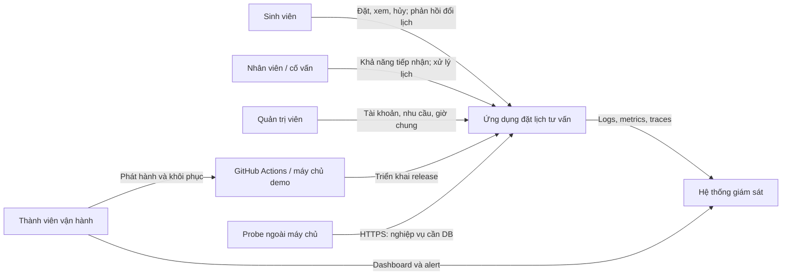
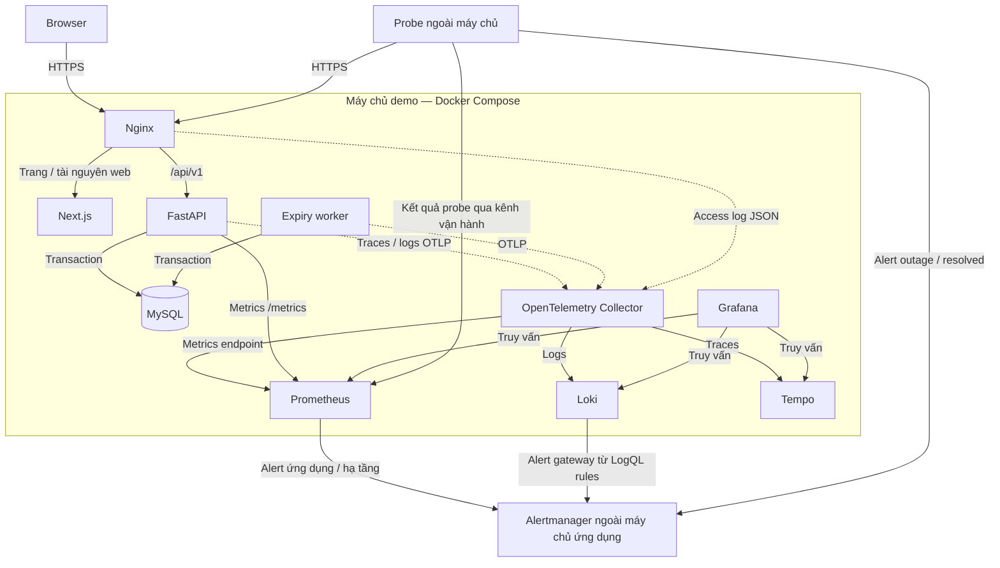
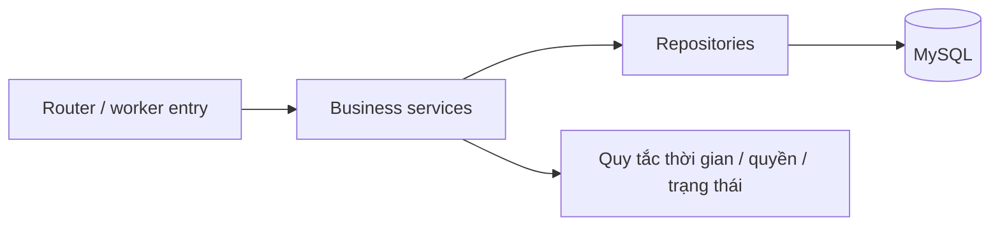

# Thiết kế hệ thống — Production Readiness Lab

**Phiên bản:** 1.2 · **Ngày cập nhật:** 13/10/2026

**Phạm vi:** MVP ứng dụng đặt lịch tư vấn tại trường đại học và môi trường Production Readiness Lab

**Loại tài liệu:** Thiết kế kiến trúc và tiêu chí nghiệm thu.

Tài liệu xác định phạm vi ứng dụng, quy tắc nghiệp vụ, thành phần hệ thống, trách nhiệm các tầng, hợp đồng API, bảo mật và phương án vận hành. Các quyết định kiến trúc đi kèm cách kiểm chứng; giá trị cấu hình được tách khỏi các nguyên tắc phải giữ trong mọi môi trường.

## Mục lục

1. Mục tiêu kiến trúc
2. Quyết định kiến trúc và công nghệ
3. Bối cảnh hệ thống
4. Các thành phần chạy
5. Thiết kế module và tầng ứng dụng
6. Dữ liệu, thời gian và nhất quán
7. Luồng xử lý chính
8. Hợp đồng API và giao diện
9. Xác thực, phân quyền và dữ liệu nhạy cảm
10. Hiệu năng và xử lý sự cố
11. Giám sát và mục tiêu chất lượng dịch vụ
12. Triển khai, phát hành và phục hồi
13. Kiểm chứng kiến trúc
14. Cấu hình và quản lý thay đổi

## 1. Mục tiêu kiến trúc

Hệ thống phục vụ ba nhóm người dùng: sinh viên tự đặt lịch, nhân viên/cố vấn quản lý khả năng tiếp nhận và xử lý lịch của mình, quản trị viên quản lý tài khoản, danh mục và giờ phục vụ chung. Thành viên vận hành dùng quyền hạ tầng riêng để triển khai và theo dõi lab.

| Mục tiêu | Cách đáp ứng | Kiểm chứng |
|---|---|---|
| Lịch hẹn nhất quán | Transaction InnoDB, khóa tài khoản/lịch và kiểm tra giao khoảng trước khi ghi. | Kiểm thử cạnh tranh, retry và lỗi giữa giao dịch. |
| Bảo vệ dữ liệu tư vấn | Xác thực phiên, kiểm tra vai trò và quyền trên từng đối tượng tại API. | Kiểm thử truy cập lịch của người khác và dữ liệu trả về. |
| Phát triển phù hợp nhóm 3–5 người | Một backend chia module, một database, giao diện và hợp đồng API rõ ràng. | Module có trách nhiệm cụ thể; dựng được từ clone mới. |
| Vận hành có thể quan sát | Request ID, logs/metrics/traces, dashboard, alert và probe ngoài ứng dụng. | Đối chiếu một request lỗi từ gateway đến DB. |
| Phát hành và phục hồi có thể tái lập | Image bất biến, migration tương thích, release đồng bộ UI/API/worker. | Pipeline, smoke test và diễn tập rollback. |

Phạm vi MVP là một trường đại học và một máy chủ demo. Ứng dụng sử dụng tài khoản nội bộ, thông báo trong ứng dụng và giờ phục vụ chung. Tích hợp SSO, email/SMS, nhiều trường và triển khai chịu lỗi nhiều máy chủ nằm ngoài phạm vi nghiệm thu MVP. Mục tiêu sẵn sàng và phục hồi được đánh giá bằng dữ liệu kiểm thử và vận hành.

## 2. Quyết định kiến trúc và công nghệ

### 2.1. Mô hình ứng dụng

Backend là **một ứng dụng chia thành các module nghiệp vụ** (modular monolith). API và worker dùng chung code, migration và image backend, chạy ở hai tiến trình để có thể quản lý vòng đời riêng. MySQL là nguồn dữ liệu chính thức cho tài khoản, lịch hẹn và các thay đổi liên quan.

| Quyết định | Lý do | Hệ quả triển khai |
|---|---|---|
| Ghi nghiệp vụ trong một database MySQL | Lịch, đề nghị, audit và thông báo cần commit cùng nhau. | Mỗi thao tác có một transaction do tầng service quản lý. |
| Worker đọc đề nghị từ database | Trạng thái chờ phải tồn tại qua restart và được xử lý khi người dùng không mở ứng dụng. | Worker quét định kỳ, khóa và đọc lại trước khi chuyển trạng thái. |
| Browser và API dùng cùng origin | Đơn giản hóa cookie phiên và cấu hình kết nối frontend. | Reverse proxy định tuyến trang web và `/api/v1` theo cùng tên miền. |
| Mã chống gửi lặp nằm trong lịch hẹn | Phạm vi hiện tại là yêu cầu tạo lịch thành công. | Unique theo sinh viên/key; replay dựng lại phản hồi tạo ban đầu. |
| Thông báo lưu trong ứng dụng | Cùng dữ liệu nghiệp vụ, không phụ thuộc dịch vụ gửi bên ngoài. | Thông báo được ghi cùng transaction và đọc qua API. |
| Cấu hình và khả dụng đọc từ database | Quyết định đặt lịch phụ thuộc cấu hình và trạng thái hiện tại. | Kiểm tra lại dưới khóa tại lúc ghi; UI cập nhật lại sau xung đột. |

### 2.2. Công nghệ triển khai

Các công nghệ và trách nhiệm tương ứng:

| Thành phần | Công nghệ | Trách nhiệm |
|---|---|---|
| Frontend | Next.js App Router, React, TypeScript strict | Trang web, điều hướng và tương tác người dùng. |
| API | FastAPI, Python theo phiên bản được khóa, tối thiểu 3.11; Pydantic | HTTP, xác thực, validation và điều phối nghiệp vụ. |
| Truy cập dữ liệu | SQLAlchemy 2, asyncmy, Alembic | Async session, truy vấn, transaction và migration. |
| Database | MySQL 8.4 LTS, InnoDB | Dữ liệu bền vững, FK/CHECK/UNIQUE; transaction và khóa hàng bảo vệ lịch. |
| Worker | Tiến trình Python trong cùng image backend | Xử lý đề nghị đổi lịch hết hạn. |
| Gateway | Nginx | HTTPS, định tuyến, giới hạn request và access log. |
| Triển khai | Docker Compose trên máy chủ Linux/VM | Container, network, volume và health check. |
| CI/CD | GitHub Actions và container registry | Kiểm tra, đóng gói, deploy và rollback. |
| Telemetry | OpenTelemetry Collector, Prometheus, Loki, Tempo | Thu thập và lưu metrics/logs/traces. |
| Theo dõi | Grafana, Alertmanager, probe ngoài máy chủ ứng dụng | Dashboard, cảnh báo và phát hiện outage. |

Phiên bản package được khóa bằng lockfile; image được khóa bằng digest. SQLAlchemy dùng async engine với driver asyncmy (`mysql+asyncmy`), isolation level `READ COMMITTED`; mỗi request hoặc giao dịch worker có một session riêng.

### 2.3. Thuật ngữ vận hành

| Thuật ngữ | Ý nghĩa trong tài liệu |
|---|---|
| SLI / SLO | Chỉ số đo chất lượng dịch vụ / mục tiêu cho chỉ số đó trong một cửa sổ thời gian. |
| Telemetry | Dữ liệu quan sát hệ thống, gồm metrics, logs và traces. |
| Probe | Kiểm tra chủ động từ bên ngoài để xác nhận ứng dụng còn phục vụ. |
| Readiness / liveness | Khả năng nhận request / tình trạng sống của tiến trình. |
| Smoke test | Kiểm tra nhanh các luồng chính sau triển khai hoặc phục hồi. |
| Image digest | Mã định danh bất biến của image được dùng trong một release. |
| RPO / RTO | Mục tiêu về lượng dữ liệu có thể mất, đo bằng thời gian / thời gian khôi phục dịch vụ. |

Các mục tiêu nghiệm thu mô tả yêu cầu đối với hệ thống. Việc đạt mục tiêu được xác nhận bằng kết quả kiểm thử và dữ liệu vận hành, không suy ra từ bản thiết kế.

## 3. Bối cảnh hệ thống



Tài khoản ứng dụng và quyền vận hành là hai phạm vi quyền riêng. Quản trị viên ứng dụng quản lý tài khoản, danh mục và cấu hình; vai trò này không tự cấp quyền đọc hoặc sửa nội dung tư vấn của người khác.

## 4. Các thành phần chạy



### 4.1. Gateway và frontend

Nginx là điểm vào ứng dụng. Request `/api/v1/*` được chuyển đến FastAPI với nguyên đường dẫn; các trang và tài nguyên frontend được chuyển đến Next.js. Health, metrics và dashboard được cung cấp qua mạng nội bộ hoặc kênh vận hành có kiểm soát.

Next.js chạy bằng server trong container. Reverse proxy phía trước phù hợp với phương án self-host của Next.js.

Frontend dùng Server Components cho khung trang/layout và Client Components cho form, chọn giờ, thao tác lịch. Dữ liệu có xác thực được lấy từ FastAPI qua lớp `services`, với URL tương đối cùng origin. Backend đặt `Cache-Control: private, no-store` cho phản hồi có dữ liệu người dùng và khả dụng; proxy giữ nguyên chính sách này.

### 4.2. API

FastAPI xử lý request theo chuỗi: request context → xác thực phiên → validation → kiểm tra quyền → service nghiệp vụ → truy cập database → ánh xạ response/lỗi. API sở hữu việc kiểm tra và ghi nghiệp vụ. UI dùng trạng thái/quyền trả về để hiển thị thao tác thích hợp.

### 4.3. Worker

Worker là tiến trình độc lập dùng service hết hạn của backend. Khoảng quét và số bản ghi mỗi đợt là cấu hình kỹ thuật; mỗi đề nghị được xử lý bằng một transaction ngắn. Worker khởi động lại sẽ đọc các đề nghị còn chờ từ database và xử lý backlog.

FastAPI `BackgroundTasks` phục vụ công việc sau response. Với yêu cầu hết hạn phải chạy độc lập với request và có thể tiếp tục sau restart, thiết kế chọn worker dựa trên trạng thái đã lưu tại MySQL. Đây là quyết định của dự án.

## 5. Thiết kế module và tầng ứng dụng

### 5.1. Trách nhiệm module

| Module | Trách nhiệm | Dữ liệu chính |
|---|---|---|
| Accounts | Đăng nhập/đăng xuất, phiên, thông tin tài khoản và vô hiệu hóa. | `users`, `sessions` |
| Catalog | Danh mục nhu cầu và thời lượng. | `purposes` |
| Availability | Nhu cầu nhân viên nhận, giờ chung, thời gian không nhận, tính giờ trống. | `staff_purposes`, `service_settings`, `service_hours`, `staff_unavailability`; đọc lịch chiếm chỗ |
| Appointments | Đặt/hủy, hạn mức, chống gửi lặp, đề nghị đổi và kết quả buổi gặp. | `appointments`, `change_proposals` |
| Notifications | Ghi thông báo và truy vấn theo người nhận. | `notifications` |
| Audit | Ghi sự kiện phục vụ đối chiếu thay đổi. | `audit_events` |
| Administration | Endpoint quản trị; gọi service Accounts/Catalog/Availability theo quyền. | Qua module sở hữu dữ liệu |

Appointments gọi cùng bộ quy tắc khả dụng cho tạo lịch, tạo đề nghị và duyệt đề nghị. API và worker dùng chung các hàm chuyển trạng thái; audit/thông báo nhận session của giao dịch đang xử lý.

### 5.2. Ranh giới các tầng



- **Router:** khai báo hợp đồng HTTP, nhận dependency xác thực, gọi service và ánh xạ response.
- **Schemas:** validation và kiểu request/response; DTO trả về giới hạn đúng dữ liệu được phép xem.
- **Services:** quản lý transaction, thứ tự khóa, kiểm tra nghiệp vụ và điều phối ghi dữ liệu.
- **Repositories:** truy vấn tham số và thao tác ghi; dùng session do service truyền vào.
- **Models/migrations:** mô hình lưu trữ và ràng buộc MySQL.

Repository thực hiện flush khi cần; service quyết định commit/rollback của toàn bộ thao tác. Các lời gọi module trong cùng thao tác dùng một session; session được đóng khi request/giao dịch worker kết thúc.

### 5.3. Cấu trúc repository

```text
src/
  frontend/
    app/                # App Router, pages, layouts
    components/         # Thành phần giao diện dùng chung
    features/           # Giao diện và tương tác theo nghiệp vụ
    hooks/              # Trạng thái tương tác và đọc dữ liệu
    services/           # HTTP client và lời gọi API
    types/              # Kiểu theo hợp đồng API
    lib/                # Tiện ích dùng chung
  backend/
    app/
      api/              # Routers và ánh xạ lỗi HTTP
      core/             # Cấu hình và hạ tầng ứng dụng
      dependencies/     # Dependency injection của API
      domain/           # Quy tắc nghiệp vụ dùng chung
      models/           # SQLAlchemy models
      schemas/          # Pydantic request/response
      services/         # Điều phối nghiệp vụ và transaction
      repositories/     # Truy vấn database
      utils/            # Tiện ích dùng chung
tests/
  backend/
    unit/               # Kiểm thử đơn vị
    integration/        # Kiểm thử với MySQL
  frontend/
    e2e/                # Kiểm thử luồng người dùng
tools/
  deploy/               # Compose, proxy và cấu hình phát hành
  infra/                # Hạ tầng, Collector, dashboard, alert rules
  scripts/              # Seed, smoke, backup/restore và diễn tập sự cố
```

Cây thư mục thể hiện cách tổ chức repository; phần chú thích xác định trách nhiệm của từng thư mục. API và worker dùng chung tầng domain/service/repository. Kiểm thử nằm tại `tests/` ở gốc repository.

## 6. Dữ liệu, thời gian và nhất quán

Mô hình dữ liệu gồm 11 bảng. Quyền ghi qua service và các constraint database cùng bảo vệ tính nhất quán.

| Nhóm dữ liệu | Bảng và quan hệ chính |
|---|---|
| Tài khoản | `users` có vai trò; `sessions` tham chiếu tài khoản và lưu hash token phiên. |
| Nhu cầu | `purposes` lưu thời lượng; `staff_purposes` liên kết nhân viên với nhu cầu tiếp nhận. |
| Khả dụng | `service_settings` có một dòng cấu hình chung; `service_hours` lưu giờ phục vụ theo thứ; `staff_unavailability` lưu khoảng nhân viên không nhận. |
| Lịch hẹn | `appointments` tham chiếu sinh viên và cặp nhân viên–nhu cầu; `change_proposals` lưu từng đề nghị và hạn phản hồi. |
| Lịch sử | `notifications` tham chiếu người nhận/lịch; `audit_events` lưu người thao tác, đối tượng và metadata đã lọc dữ liệu nhạy cảm. |

### 6.1. Quy tắc xuyên suốt

- Sinh viên tự đặt cho mình; `student_id` lấy từ phiên. Nhân viên được chọn phải còn hoạt động và đang nhận nhu cầu.
- Thời lượng lấy từ nhu cầu và lưu tại lúc đặt. Khoảng gặp là `[starts_at, ends_at)`; lịch tiếp giáp được phép.
- `UPCOMING` và `CHANGE_PENDING` chiếm chỗ, tính vào hạn mức ba lịch; trạng thái kết thúc giải phóng chỗ/hạn mức.
- Availability là kết quả đọc. Mỗi thao tác ghi khóa hàng sinh viên/nhân viên đã tồn tại, rồi kiểm tra giao khoảng và hạn mức trong cùng transaction. Mọi luồng API/worker/công cụ ghi dữ liệu phải tuân theo quy trình này.
- Lịch, đề nghị, audit và thông báo liên quan commit trong cùng transaction. Telemetry nằm ngoài transaction nghiệp vụ.

### 6.2. Thời gian và lịch chung

Database lưu `DATETIME(6)` theo UTC; mỗi kết nối đặt `time_zone = '+00:00'`. Adapter chuyển thời điểm có múi giờ sang UTC trước khi lưu và gắn UTC khi đọc; API dùng ISO 8601 có `Z`/offset. UI hiển thị theo `Asia/Ho_Chi_Minh`; ngày được chọn chuyển thành biên UTC theo múi giờ nghiệp vụ. Sau khi có đủ khóa, chạy câu lệnh riêng `SELECT UTC_TIMESTAMP(6)` để lấy thời điểm kiểm tra hạn.

Giờ trống được tính từ lịch phục vụ tuần, thời lượng nhu cầu, cửa sổ đặt, khoảng không nhận và lịch đang chiếm chỗ. Bước giờ bắt đầu là 15 phút, lấy đầu mỗi khoảng phục vụ làm mốc. Toàn bộ buổi gặp phải nằm trong một khoảng phục vụ.

| Quy tắc thời gian | Cách áp dụng |
|---|---|
| Cửa sổ đặt | Với ngày hiện tại D theo múi giờ nghiệp vụ, chọn ngày từ D+1 đến D+7, gồm cả hai biên. Số ngày lấy từ `booking_horizon_days`. |
| Hạn hủy | Người tham gia được hủy trước 00:00 ngày hẹn theo múi giờ nghiệp vụ; đến hạn thì từ chối yêu cầu hủy. |
| Hạn phản hồi đổi lịch | Trước 00:00 của ngày hẹn sớm hơn giữa lịch gốc và lịch đề nghị; thời điểm này được quy về UTC và lưu vào `expires_at`. |
| Hết hạn | Khi `now >= expires_at`, từ chối phản hồi và để worker kết thúc đề nghị bằng `EXPIRED`, lịch bằng `CANCELLED`. |
| Ghi kết quả | Nhân viên nhận lịch ghi `COMPLETED` hoặc `NO_SHOW` trên lịch `UPCOMING` khi thời điểm hiện tại đã qua `ends_at`. |

Thời lượng nhu cầu, giờ phục vụ và địa điểm là dữ liệu cấu hình của trường. Ngày không có khoảng phục vụ không có giờ trống. Thêm khoảng không nhận của nhân viên phải từ chối nếu giao với lịch đang chiếm chỗ.

### 6.3. Đồng thời và retry

Các thao tác áp dụng cùng thứ tự khóa: cấu hình → từng tài khoản liên quan theo 16 byte UUID tăng dần → lịch → đề nghị/liên kết nhu cầu. Cấu hình dùng `FOR SHARE` cho nghiệp vụ, `FOR UPDATE` khi quản trị sửa; tài khoản/lịch dùng `FOR UPDATE`. Sau khi có khóa, đọc lại vai trò, trạng thái, hạn và khả dụng bằng transaction `READ COMMITTED`. Khóa hàng tài khoản bảo vệ cả trường hợp chưa có lịch nào; giới hạn ba lịch được đếm sau khi giữ khóa sinh viên. Tối đa một đề nghị chờ được database bảo vệ bằng generated column và unique.

`POST /appointments` nhận `Idempotency-Key`. Client sinh key mới cho thao tác mới và giữ nguyên key/nội dung khi thử lại. Backend chuẩn hóa payload, lưu key/hash cùng lịch và dùng unique `(student_id, creation_request_key)`.

Retry thành công trả cùng `id`, `status = UPCOMING` và `created_at` của lần tạo ban đầu, kể cả khi lịch đã đổi/hủy. UI đọc chi tiết để lấy trạng thái hiện tại. Cùng key nhưng khác nội dung trả `409 IDEMPOTENCY_CONFLICT`. Lỗi trước commit rollback đầy đủ; retry kiểm tra nghiệp vụ từ đầu. Thời hạn bảo đảm tối thiểu 24 giờ được đáp ứng bằng việc giữ key/hash cùng lịch sử.

## 7. Luồng xử lý chính

### 7.1. Tạo lịch

```mermaid
sequenceDiagram
    actor Student as Sinh viên
    participant UI as Frontend
    participant API as FastAPI / service
    participant DB as MySQL
    Student->>UI: Xác nhận nhu cầu, nhân viên và giờ
    UI->>API: POST /appointments + key + cookie
    API->>DB: Xác thực; tra key đã có
    alt Đã có lịch cùng key
        API->>API: So sánh hash
        API-->>UI: Kết quả tạo ban đầu hoặc 409 khác nội dung
    else Chưa có lịch cùng key
        API->>DB: BEGIN; lấy khóa; tra lại key
        alt Key đã được request cạnh tranh lưu
            API->>API: So sánh hash
            API->>DB: Kết thúc transaction đọc
            API-->>UI: Kết quả tạo ban đầu hoặc 409 khác nội dung
        else Key vẫn chưa có
            API->>DB: Kiểm tra vai trò, hạn mức và khả dụng
            alt Đặt mới hợp lệ
                API->>DB: INSERT lịch, audit, hai thông báo; COMMIT
                API-->>UI: 201: id, UPCOMING, created_at
            else Vi phạm nghiệp vụ hoặc constraint
                API->>DB: ROLLBACK
                API-->>UI: Lỗi có mã và request ID
            end
        end
    end
    opt Kết quả tạo thành công
        UI->>API: GET chi tiết lịch
        API-->>UI: Trạng thái và dữ liệu hiện tại theo quyền
        UI-->>Student: Hiển thị lịch
    end
```

Trong nhánh chưa có key, nếu lần tra lại sau khóa thấy lịch đã được request khác tạo, service trả kết quả retry ngay. Khi phản hồi bị mất sau commit, UI giữ key để xác minh kết quả bằng lần thử lại.

### 7.2. Đổi giờ hoặc địa điểm

| Bước | Xử lý |
|---|---|
| Nhân viên đề nghị | Lấy đủ khóa, kiểm tra quyền, trạng thái, hạn, giá trị thay đổi, thời lượng và khả dụng; lưu `PENDING`, chuyển lịch `CHANGE_PENDING`, thông báo hai phía. |
| Chờ phản hồi | Giờ gốc tiếp tục chiếm chỗ; giờ mới chưa giữ. Lưu hạn 00:00 của ngày hẹn sớm hơn giữa lịch gốc và đề nghị. |
| Sinh viên chấp thuận | Lấy đủ khóa theo mục 6.3; kiểm tra quyền, hạn và khả dụng theo mục 6.2; áp dụng giá trị đề nghị, chuyển lịch `UPCOMING`, đề nghị `ACCEPTED`. |
| Giờ mới đã kín | Trả `409 STAFF_UNAVAILABLE`; lịch gốc và đề nghị còn chờ giữ nguyên. |
| Sinh viên từ chối | Hủy lịch, kết thúc đề nghị `DECLINED`, giải phóng chỗ/hạn mức và thông báo. |
| Nhân viên đề nghị lại | Đóng bản đang chờ bằng `SUPERSEDED`, tạo bản mới trong cùng transaction. |

Quyết định đã hoàn tất được đọc lại khi retry; phản hồi trái ngược trả xung đột. Lịch kết thúc giữ trạng thái; hẹn lại tạo lịch mới.

### 7.3. Hủy, ghi kết quả và hết hạn

Hủy trực tiếp kiểm tra người thao tác và hạn, chuyển lịch `CANCELLED`, đóng đề nghị đang chờ nếu có. Nhân viên nhận lịch ghi `COMPLETED/NO_SHOW` sau `ends_at` trên lịch `UPCOMING`; hệ thống lưu actor và thời điểm.

Worker tìm đề nghị `PENDING` đã quá hạn, lấy khóa theo cùng thứ tự với API và đọc lại. Nếu vẫn chờ, chuyển đề nghị `EXPIRED`, lịch `CANCELLED`, ghi audit và hai thông báo rồi commit. Worker và request phản hồi cạnh tranh trên cùng khóa; một kết quả cuối được ghi. Worker chậm thì lịch vẫn giữ chỗ đến khi trạng thái được cập nhật.

## 8. Hợp đồng API và giao diện

### 8.1. API

API dùng tiền tố `/api/v1`, hợp đồng OpenAPI và JSON request/response.

| Nhóm API | Quyền và trách nhiệm |
|---|---|
| Xác thực | Đăng nhập, đăng xuất, đọc tài khoản hiện tại; thu hồi phiên khi đăng xuất hoặc vô hiệu hóa tài khoản. |
| Danh mục và khả dụng | Người dùng đã đăng nhập đọc nhu cầu hoạt động, nhân viên tiếp nhận và giờ có thể đặt. |
| Lịch hẹn | Sinh viên tạo lịch qua `POST /appointments`; sinh viên/nhân viên đọc và hủy lịch trong phạm vi của mình. |
| Đề nghị đổi lịch | Nhân viên của lịch tạo/thay đề nghị; sinh viên của lịch chấp thuận hoặc từ chối. |
| Kết quả buổi gặp | Chỉ nhân viên nhận lịch ghi hoàn thành hoặc vắng mặt sau giờ kết thúc. |
| Khả năng tiếp nhận | Nhân viên quản lý nhu cầu và khoảng không nhận của chính mình. |
| Thông báo | Người nhận đọc danh sách và đánh dấu đã đọc thông báo của mình. |
| Quản trị | `ADMIN` quản lý tài khoản, nhu cầu, cấu hình và giờ phục vụ chung. |

- Pydantic kiểm tra kiểu, độ dài và trường bắt buộc; service kiểm tra điều kiện nghiệp vụ.
- Actor lấy từ phiên. Truy vấn lịch/đề nghị/thông báo luôn kèm điều kiện quyền của người đang đăng nhập.
- Phân trang dùng `page`, `page_size`, giới hạn 100; truy vấn availability bị giới hạn bởi cửa sổ đặt.
- Lỗi có `code`, thông điệp phù hợp người dùng và `request_id`. `401` cho phiên không hợp lệ; `403` cho thiếu vai trò/quyền thao tác; đối tượng ngoài phạm vi xem trả `404`; xung đột nghiệp vụ trả `409`.
- Gateway tạo request ID và truyền xuống API; API ghi vào logs/traces và trả `X-Request-ID`, kể cả nhánh lỗi. Lần retry có request ID mới nhưng giữ nguyên idempotency key.

OpenAPI được tạo từ schema/routes FastAPI, xuất thành `docs/api/openapi.yaml` khi triển khai API và được kiểm tra trong CI. Frontend tích hợp theo hợp đồng này. API giữ quy tắc nghiệp vụ tại backend và đóng vai trò nguồn xác nhận kết quả.

### 8.2. Giao diện

Giao diện gồm đăng nhập, đặt lịch, lịch cá nhân, trang nhân viên và trang quản trị. Dashboard vận hành dùng Grafana qua kênh vận hành.

Form có trạng thái đang gửi, hạn chế gửi lặp và giữ key khi kết quả chưa rõ. Sau tạo/hủy/duyệt, UI tải lại dữ liệu liên quan. Khi gặp `409`, hiển thị nguyên nhân, tải lại khả dụng/trạng thái và cho người dùng chọn thao tác tiếp theo. Phiên hết hạn dẫn về đăng nhập; nội dung lịch chỉ được hiển thị từ response có quyền.

Thông báo được tải khi mở trang và làm mới sau thao tác; người dùng có thể tải lại danh sách. Đọc thông báo dùng dữ liệu lịch theo quyền hiện tại và trạng thái đọc đã lưu.

## 9. Xác thực, phân quyền và dữ liệu nhạy cảm

### 9.1. Phiên và CSRF

Backend xác minh mật khẩu bằng hash mật khẩu phù hợp, tạo token phiên ngẫu nhiên và lưu hash token trong `sessions`. Cookie phiên có `HttpOnly`, `Secure` trên HTTPS, `SameSite=Lax`, phạm vi host và hạn dùng. Đăng xuất/vô hiệu hóa tài khoản thu hồi phiên. Local dùng cấu hình cookie theo HTTPS/HTTP của môi trường, tách khỏi cấu hình demo.

Thao tác ghi dùng cookie phải kiểm tra CSRF. Thiết kế chọn signed double-submit token gắn với phiên, gửi qua cookie riêng có thể đọc bởi frontend và header `X-CSRF-Token`; API xác minh chữ ký và liên kết phiên. Origin/Referer được đối chiếu với origin cấu hình. Đăng nhập chưa có phiên áp dụng kiểm tra origin và JSON request. Request bị từ chối khi token thiếu, sai hoặc thuộc phiên khác.

### 9.2. Phạm vi quyền

| Chủ thể | Phạm vi dữ liệu |
|---|---|
| Sinh viên | Lịch/đề nghị/thông báo của mình; danh mục và nhân viên có thể đặt. |
| Nhân viên | Lịch được đặt với mình, nhu cầu tiếp nhận và thời gian không nhận của mình. |
| Quản trị viên | Tài khoản, danh mục và cấu hình giờ chung; không mặc định có quyền đọc nội dung tư vấn. |
| Worker | Service hết hạn chạy dưới quyền runtime, actor hệ thống trong audit. |
| Thành viên vận hành | Công cụ hạ tầng/giám sát; thông tin log đã được giới hạn theo chính sách. |

DTO tránh trả password/token/hash yêu cầu và các trường nội bộ. Dữ liệu tư vấn và lý do hủy tự do chỉ nằm trong dữ liệu nghiệp vụ được phép xem; logs/traces/audit metadata loại bỏ nội dung này. Nội dung người dùng được hiển thị như văn bản. API dùng query tham số/ORM, giới hạn request đăng nhập và kiểm tra kích thước payload.

Database, Collector và backend telemetry nằm trong mạng nội bộ. Secret lấy từ môi trường triển khai; `.env.example` chỉ có tên biến và giá trị giả. Tài khoản migration có quyền schema; runtime dùng quyền DML cần thiết, audit chỉ INSERT/SELECT.

## 10. Hiệu năng và xử lý sự cố

### 10.1. Ngân sách tài nguyên

API có deadline request cấu hình, giá trị khởi điểm 3 giây; DB query/lock/pool timeout nằm trong ngân sách này. Retry deadlock có số lần giới hạn và dùng phần thời gian còn lại. Khi gặp lock timeout, backend rollback toàn bộ transaction trước khi retry hoặc trả lỗi. Timeout được xác minh trong bài cạnh tranh và bài tải; phản hồi chưa rõ commit được xác minh bằng cùng key.

Pool kết nối có giới hạn theo từng tiến trình. Tổng kết nối được tính từ số API process × giới hạn pool, cộng pool worker và phần dự phòng migration/giám sát; giữ dưới ngân sách MySQL. Query danh sách có phân trang, availability có cửa sổ giới hạn. Chỉ mục phải phục vụ truy vấn danh sách, availability và worker; kế hoạch truy vấn được kiểm tra trên dữ liệu seed.

API/worker xử lý shutdown bằng ngừng nhận công việc mới, hoàn tất hoặc rollback giao dịch đang chạy rồi đóng session/pool trong thời gian grace period. Thời gian chờ database và worker backlog được theo dõi qua telemetry.

### 10.2. Hành vi khi dependency lỗi

| Sự cố | Hành vi hệ thống |
|---|---|
| MySQL không truy cập được | Request cần DB trả lỗi dịch vụ trong timeout; readiness thất bại, liveness vẫn phản ánh tiến trình. |
| Mất response sau commit | Retry cùng key trả đúng kết quả tạo; số lịch/audit/thông báo giữ nguyên. |
| Worker dừng | API tiếp tục phục vụ; đề nghị quá hạn còn giữ chỗ. Cảnh báo backlog/heartbeat; restart xử lý lại. |
| Collector/Loki/Tempo/Prometheus lỗi | Transaction nghiệp vụ tiếp tục; exporter có timeout và hàng đợi hữu hạn, ghi nhận dữ liệu giám sát bị mất. |
| Gateway hoặc máy chủ dừng | Probe ngoài máy chủ phát hiện outage; kiểm tra host, network, container và volume trước khi khởi động lại dịch vụ. |
| Release gây lỗi | Phát hiện qua alert, xác minh release, rollback UI/API/worker về bản ổn định; giữ DB volume. |

## 11. Giám sát và mục tiêu chất lượng dịch vụ

### 11.1. Thu thập và đối chiếu

API/worker gửi traces và logs qua OTLP đến Collector; stdout giữ log JSON phục vụ thao tác tại container. Metrics API được Prometheus scrape tại `/metrics`; metrics worker đi qua OTLP đến endpoint metrics của Collector. Mỗi nguồn metrics có một đường thu thập. Nginx ghi access log JSON vào volume log mà Collector có quyền đọc. Collector chuyển logs sang Loki và traces sang Tempo.

Log chứa timestamp, service, environment, release, request ID, trace ID khi có, route template, method, status, duration và mã lỗi. Trace đặt lịch/lỗi có span HTTP, nghiệp vụ và DB; giá trị truy vấn nhạy cảm được loại bỏ. Metrics dùng nhãn hữu hạn như service/route/method/status class; ID người dùng/lịch/request nằm ngoài nhãn metrics.

### 11.2. Điểm đo SLO

SLO request và độ trễ được đo tại gateway để bao gồm lỗi upstream/gateway. Access log dùng status và thời gian request hoàn tất tại Nginx; route được chuẩn hóa. API cung cấp header `X-Error-Class` với nhóm `input`, `business` hoặc `service` cho gateway ghi `error_class`; mã chi tiết nằm trong JSON response. Gateway phân loại lỗi upstream/timeout và route đã công bố bị định tuyến sai là lỗi dịch vụ.

Loki giữ access log làm dữ liệu tính SLI tại gateway, kể cả phần thời gian API chưa khởi chạy. LogQL rules của Loki gửi alert gateway đến Alertmanager; Prometheus gửi alert ứng dụng/hạ tầng. Số liệu API phục vụ điều tra và đối chiếu.

Phạm vi SLI là request đến các route nghiệp vụ đã công bố dưới `/api/v1`. Loại khỏi phép tính tài nguyên tĩnh, health/metrics và lỗi đã phân loại `input` hoặc `business`, như payload sai, phiên không hợp lệ và xung đột giờ đặt. Lỗi `service`, `5xx`, timeout và `429` do thiếu năng lực vẫn được tính. Route đã công bố bị gateway định tuyến sai thuộc lỗi dịch vụ.

- **Availability:** số request trong phạm vi hoàn tất thành công chia cho tổng request trong phạm vi.
- **Độ trễ:** số request thành công trong phạm vi hoàn tất trong ≤500 ms chia cho tổng request thành công trong phạm vi.
- **Không có mẫu:** hiển thị không đủ dữ liệu; không suy ra availability 100%.
- **Mất telemetry:** báo cáo khoảng thiếu dữ liệu; outage được đối chiếu bằng probe, không coi khoảng trống access log là hệ thống khỏe.

| Mục tiêu nghiệm thu | Điểm đo / cách xác minh |
|---|---|
| Availability ≥99,5% trên request hợp lệ, cửa sổ trượt 7 ngày | Access log gateway; tính cả `5xx`, timeout và `429` do thiếu năng lực. |
| ≥95% request hợp lệ thành công hoàn tất trong ≤500 ms | Thời gian hoàn tất tại gateway, cùng cửa sổ 7 ngày. |
| Số cặp lịch chiếm chỗ giao nhau của cùng nhân viên bằng 0 | Kiểm tra dưới khóa và truy vấn kiểm chứng dữ liệu sau bài cạnh tranh/tải. |
| Alert firing trong ≤3 phút khi diễn tập | Timeline bắt đầu sự cố và thời điểm alert firing dưới tải diễn tập. |
| Khôi phục bằng rollback trong ≤5 phút | Từ quyết định rollback đến khi readiness, smoke test và probe xác nhận phục hồi. |

Probe và Alertmanager đặt ngoài máy chủ ứng dụng, có thể trên máy vận hành độc lập. Probe chạy chu kỳ tối đa 15 giây, dùng tài khoản lab gọi endpoint cần DB và kiểm tra JSON. Khi số lần thất bại liên tiếp đạt ngưỡng cấu hình, probe gửi cảnh báo mất dịch vụ trực tiếp đến Alertmanager; khi phục hồi gửi trạng thái resolved. Chu kỳ, timeout và số lần thất bại được cấu hình sao cho tổng thời gian phát hiện và gửi cảnh báo đáp ứng mục tiêu 3 phút. Đường cảnh báo tiếp tục hoạt động khi máy chủ ứng dụng dừng. Kết quả probe được đưa về Prometheus khi kết nối khả dụng.

Thời hạn lưu telemetry: logs/traces ít nhất 7 ngày, metrics ít nhất 14 ngày. Theo dõi riêng heartbeat worker, số đề nghị quá hạn còn chờ và độ trễ xử lý. Sampling, dung lượng queue và timeout exporter được cấu hình và ghi trong bằng chứng. Khoảng thiếu telemetry phải được báo cáo; kết luận SLO sử dụng đúng thời gian dữ liệu thực tế.

## 12. Triển khai, phát hành và phục hồi

### 12.1. Môi trường và health check

Local và demo dùng Docker Compose. Local có thể chạy toàn bộ thành phần cùng máy; demo tách probe/Alertmanager sang máy vận hành độc lập theo §11. Chỉ gateway công khai cổng ứng dụng; truy cập vận hành được giới hạn. MySQL có volume bền vững; telemetry có lưu trữ và giới hạn tài nguyên/retention. Next.js, API và worker chạy dưới user không có quyền root.

| Thành phần | Health và vòng đời |
|---|---|
| API | `/health/live` kiểm tra tiến trình; `/health/ready` kiểm tra DB có timeout và schema phù hợp release; `/metrics` nội bộ. |
| Frontend | HTTP health xác nhận server phục vụ; smoke xác minh trang và tích hợp API. |
| Worker | Heartbeat và lần quét thành công; restart theo cấu hình; đề nghị tồn tại trong DB để tiếp tục xử lý. |
| MySQL | Kiểm tra kết nối, volume và dung lượng; migration chạy một lần bởi job triển khai. |

### 12.2. Quy trình phát hành

1. CI chạy lint/typecheck, unit/integration trên MySQL thật, build và E2E.
2. Đóng gói image từ commit đã qua kiểm tra; ghi digest frontend/backend và phiên bản schema.
3. Xác minh cấu hình, khả năng tương thích migration và release ổn định trước đó; lưu manifest của release đang chạy.
4. Chạy migration bằng một job triển khai riêng; dừng phát hành nếu migration thất bại.
5. Triển khai frontend, API và worker bằng digest; API và worker dùng cùng digest backend.
6. Kiểm tra readiness, smoke test qua gateway, heartbeat worker và probe ngoài máy chủ. Ghi nhận release ổn định khi tất cả kiểm tra đạt.

Deploy và rollback chạy tuần tự để tránh hai thao tác phát hành cạnh tranh. Nếu smoke test thất bại và có release ổn định trước đó, pipeline quay lại digest tương ứng của frontend/backend, cập nhật cả API và worker. Database giữ dữ liệu đã commit.

Migration được rà soát FK/CHECK/UNIQUE, generated column, collation và chỉ mục MySQL; kiểm thử nâng cấp và rollback ứng dụng trên MySQL 8.4/InnoDB thật. Alembic autogenerate tạo bản nháp để rà soát. DDL có thể implicit commit nên job migration kiểm tra từng bước và xử lý lỗi giữa chừng. Rollback ứng dụng giữ schema tương thích, không tự động chạy migration down.

### 12.3. Rollback và xác minh phục hồi

1. Ghi thời điểm quyết định rollback, release lỗi và dấu hiệu quan sát được; giữ logs/traces phục vụ điều tra.
2. Chọn manifest của release ổn định gần nhất có schema tương thích. Nếu không có release phù hợp, dừng chuyển image và xử lý lỗi theo tình trạng hệ thống.
3. Khôi phục đồng bộ digest frontend, API và worker; giữ nguyên database volume, dữ liệu đã commit và schema tương thích.
4. Kiểm tra readiness, đăng nhập, đọc khả dụng, tạo/hủy lịch bằng tài khoản lab, heartbeat worker và probe. Retry cùng key phải trả đúng lịch, không tạo bản trùng.
5. Xác nhận probe phục hồi theo ngưỡng đã cấu hình; ghi thời điểm kết thúc, trạng thái alert và tổng thời gian phục hồi. Đối chiếu mục tiêu ≤5 phút.

### 12.4. Sao lưu và khôi phục dữ liệu

Backup bao gồm schema, dữ liệu và phiên bản migration; ghi thời điểm backup và release tương ứng. Restore thử vào database riêng, đối chiếu lịch mẫu, số bản ghi, FK/CHECK/UNIQUE và quy ước UTC. RPO được đối chiếu từ thời điểm dữ liệu khôi phục; RTO được đo từ lúc bắt đầu xử lý phục hồi đến khi dịch vụ được xác minh hoạt động.

Máy chủ đơn có thể gián đoạn khi deploy. Zero downtime hoặc chịu lỗi toàn bộ máy chủ yêu cầu kiến trúc và bài nghiệm thu bổ sung.

### 12.5. Diễn tập sự cố

Công cụ diễn tập yêu cầu `LAB_MODE`, TTL và kiểm tra release; dùng dữ liệu và tài khoản lab. Trạng thái kích hoạt được lưu bền ngoài tiến trình API để tồn tại qua restart. Khi hết TTL, kết thúc diễn tập hoặc rollback baseline, hành vi gây lỗi phải được gỡ bỏ. Dashboard, công cụ diễn tập và endpoint vận hành dùng quyền hạ tầng.

Mỗi lần diễn tập ghi kịch bản, người thực hiện, thời điểm bắt đầu/kết thúc, release, alert firing/resolved và kết quả kiểm tra dữ liệu. Các kịch bản gồm DB mất kết nối, worker dừng, telemetry gián đoạn, gateway/host dừng và release gây lỗi. Sau diễn tập, xác minh cấu hình gây lỗi đã tắt và hệ thống phục vụ bình thường.

## 13. Kiểm chứng kiến trúc

| Kịch bản | Yêu cầu kiểm chứng |
|---|---|
| Đặt lịch thông thường | Đúng người đặt/nhân viên/thời lượng; audit và hai thông báo cùng commit. |
| Truy cập trái quyền | API từ chối tài khoản sai vai trò và lịch/thông báo ngoài phạm vi. |
| CSRF và phiên | Request ghi thiếu/sai token hoặc origin bị từ chối; phiên thu hồi/hết hạn bị từ chối. |
| 50 request cạnh tranh | 50 sinh viên chọn cùng nhân viên và khoảng giờ: một lịch thành công, các request còn lại báo xung đột. |
| Bốn request cùng sinh viên | Tối đa ba lịch chiếm chỗ, kể cả khi các giờ khác nhau. |
| Retry/mất response | Cùng key trỏ tới cùng lịch; hash khác báo xung đột; giữ nguyên số audit/thông báo. |
| Duyệt/từ chối/hết hạn cạnh tranh | Một kết quả cuối; lịch và đề nghị nhất quán, giờ/hạn mức đúng trạng thái. |
| Restart worker | Xử lý được đề nghị quá hạn còn chờ; các cập nhật đã hoàn tất giữ nguyên. |
| DB/telemetry outage | DB lỗi ảnh hưởng readiness/request trong timeout; telemetry lỗi giữ khả năng phục vụ nghiệp vụ. |
| Máy chủ/gateway dừng | Probe và kênh cảnh báo ngoài máy chủ phát hiện outage. |
| Release lỗi và rollback | UI/API/worker về đúng digest; DB giữ lịch đã commit, readiness/smoke/probe xác nhận phục hồi. |

Bài tải chuẩn dùng 20 phiên đồng thời trong 10 phút và bộ seed ít nhất 10 nhân viên/1.000 lịch. Bằng chứng gồm cấu hình môi trường, commit/digest, kết quả test/tải, trace mẫu, trạng thái alert firing/resolved và timeline phục hồi.

## 14. Cấu hình và quản lý thay đổi

| Nhóm cấu hình | Yêu cầu |
|---|---|
| Nghiệp vụ | Seed đủ nhu cầu và thời lượng dương, giờ phục vụ, múi giờ, bước giờ và cửa sổ đặt. Giờ phục vụ cùng thứ không giao nhau. |
| Ứng dụng | Khóa phiên bản runtime/package; cấu hình origin, cookie, secret và deadline request cho từng môi trường. |
| Database | Giữ UTC, SQL mode nghiêm ngặt và `READ COMMITTED`; giới hạn tổng pool theo năng lực MySQL. |
| Worker | Cấu hình chu kỳ quét, batch size, grace period, heartbeat và ngưỡng cảnh báo backlog. |
| Giám sát | Cấu hình retention, sampling, queue exporter, timeout probe, ngưỡng firing/resolved và kênh nhận cảnh báo. |
| Release | Ghi commit, digest frontend/backend, phiên bản schema và release ổn định để rollback. |
| Dữ liệu | Lịch, đề nghị và audit được giữ để đối chiếu; không tự động xóa lịch sử ngoài chính sách lưu dữ liệu đã cấu hình. Sao lưu có lịch chạy và bài restore xác minh. |

Giá trị theo môi trường được ghi vào cấu hình triển khai và bằng chứng nghiệm thu. Thay đổi nghiệp vụ, mô hình giao dịch, quyền hoặc kiến trúc phải cập nhật thiết kế, hợp đồng API, kiểm thử và hướng dẫn vận hành trong cùng thay đổi.
