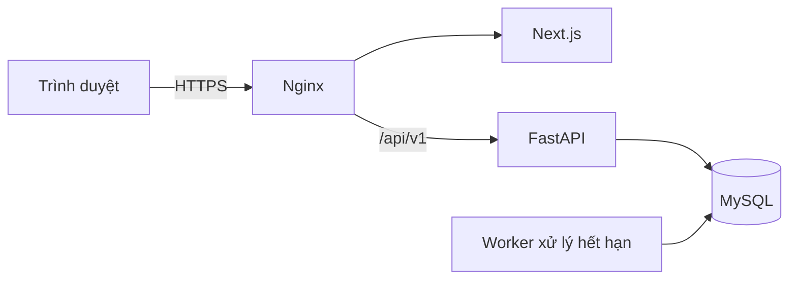
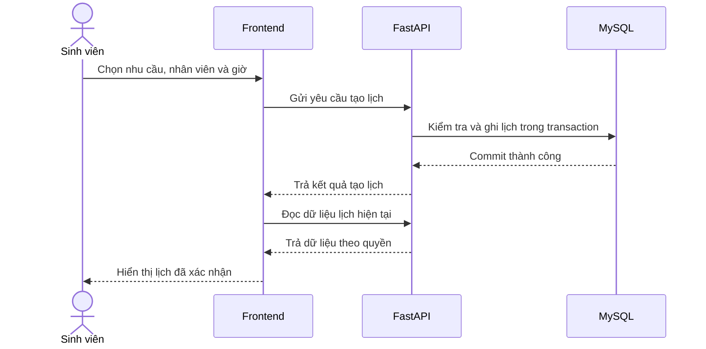
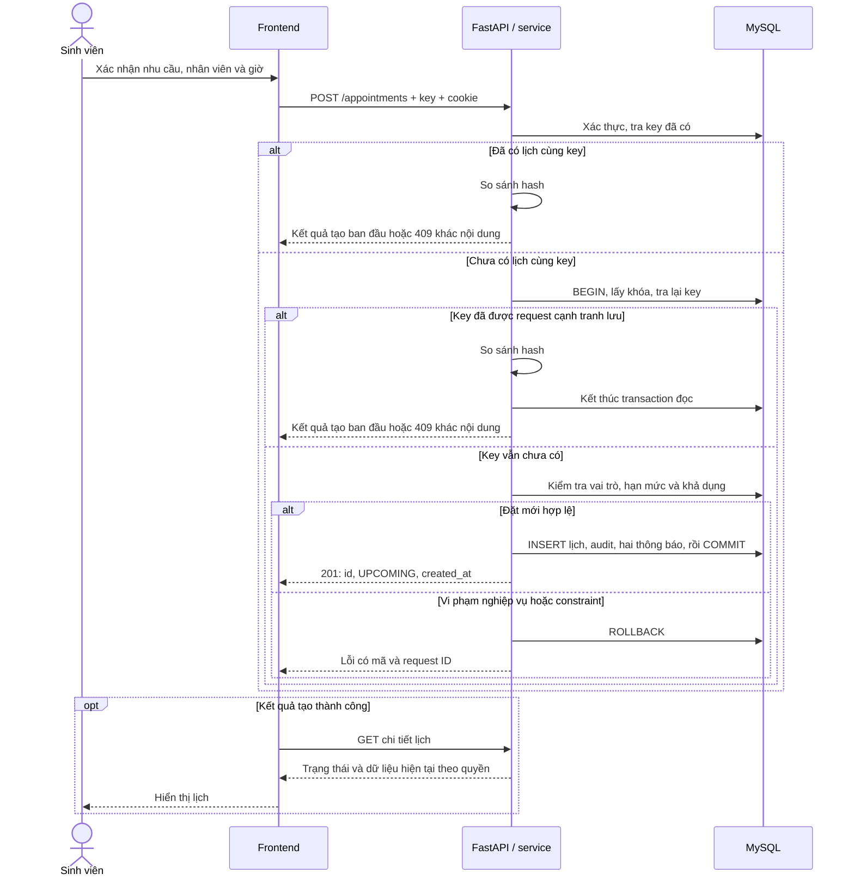
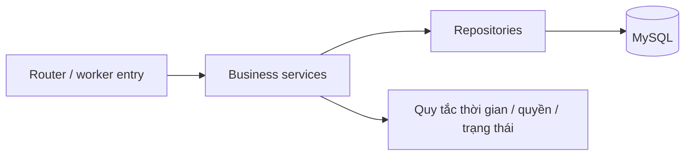
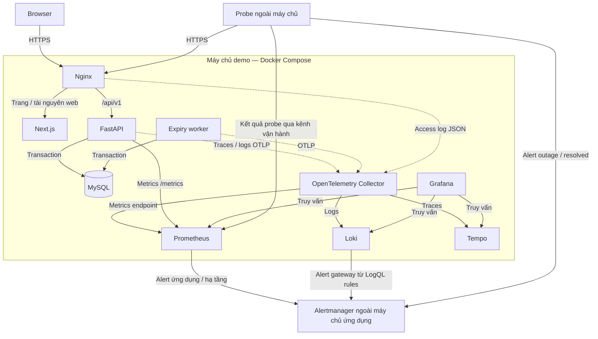

# Thiết kế hệ thống — Production Readiness Lab

**Phiên bản:** 1.3 · **Ngày cập nhật:** 13/10/2026 · **Phạm vi:** Kiến trúc MVP và môi trường vận hành lab.

## Mục lục

1. Tổng quan hệ thống
2. Kiến trúc tổng thể
3. Luồng nghiệp vụ chính
4. Nguyên tắc kiến trúc
5. Quyền truy cập và hợp đồng API
6. Dữ liệu, thời gian và nhất quán
7. Tổ chức mã nguồn
8. Môi trường vận hành và giám sát
9. Phát hành và phục hồi
10. Kiểm chứng và quản lý cấu hình

## 1. Tổng quan hệ thống

Production Readiness Lab là ứng dụng đặt lịch tư vấn tại trường đại học. Sinh viên chọn nhu cầu tư vấn, nhân viên/cố vấn và giờ phù hợp. Nhân viên quản lý khả năng tiếp nhận, xử lý thay đổi lịch và ghi nhận kết quả buổi gặp.

Ứng dụng đồng thời là môi trường thực hành vận hành phần mềm. Các bài tải và diễn tập dùng luồng đặt lịch để kiểm chứng tính nhất quán, khả năng quan sát, phát hành và phục hồi.

Hệ thống phục vụ bốn nhóm người dùng:

- **Sinh viên:** đặt/hủy lịch, phản hồi đề nghị đổi lịch và theo dõi lịch cá nhân.
- **Nhân viên / cố vấn:** quản lý nhu cầu tiếp nhận, khoảng không nhận và lịch được giao.
- **Quản trị viên:** quản lý tài khoản, danh mục và giờ phục vụ chung.
- **Thành viên vận hành:** triển khai, giám sát, sao lưu và xử lý sự cố bằng quyền hạ tầng riêng.

MVP phục vụ một trường đại học trên một máy chủ demo, sử dụng tài khoản nội bộ và thông báo trong ứng dụng. SSO, email/SMS, nhiều trường và triển khai chịu lỗi nhiều máy chủ nằm ngoài phạm vi nghiệm thu MVP.

## 2. Kiến trúc tổng thể

Backend theo mô hình **modular monolith**: một ứng dụng chia thành các module nghiệp vụ. API và worker dùng chung code, migration và image backend, nhưng chạy ở hai tiến trình để quản lý vòng đời riêng.

Kiến trúc ưu tiên ranh giới rõ ràng và khả năng kiểm chứng, phù hợp với nhóm phát triển 3–5 người.



### 2.1. Frontend

Frontend dùng Next.js App Router, React và TypeScript strict. Frontend chịu trách nhiệm:

- Hiển thị trang đăng nhập, đặt lịch, lịch cá nhân, trang nhân viên và trang quản trị.
- Nhận thao tác người dùng và gửi yêu cầu qua lớp `services`.
- Dùng Server Components cho khung trang/layout, Client Components cho form và thao tác lịch.
- Hiển thị kết quả backend xác nhận, làm mới dữ liệu sau khi trạng thái thay đổi.

Dữ liệu người dùng và khả dụng có chính sách `Cache-Control: private, no-store`. Giao diện xử lý đầy đủ trạng thái đang tải, đang gửi, lỗi và dữ liệu rỗng.

### 2.2. Backend

FastAPI cung cấp API nghiệp vụ. Backend chịu trách nhiệm:

- Xác thực phiên và kiểm tra quyền trên từng đối tượng.
- Kiểm tra đầu vào bằng Pydantic và quy tắc nghiệp vụ tại service.
- Điều phối transaction qua SQLAlchemy 2 với driver asyncmy.
- Ghi lịch hẹn, đề nghị, audit và thông báo.
- Ánh xạ kết quả thành JSON response hoặc lỗi có mã.

Các module nghiệp vụ gồm Accounts, Catalog, Availability, Appointments, Notifications, Audit và Administration. Router điều phối HTTP; service quyết định kết quả nghiệp vụ.

### 2.3. MySQL

MySQL 8.4 LTS/InnoDB lưu dữ liệu bền vững của hệ thống. Database cung cấp transaction, khóa hàng, khóa ngoại, CHECK, UNIQUE và chỉ mục.

Thay đổi schema được quản lý bằng migration Alembic. Cấu hình kết nối giữ UTC, SQL mode nghiêm ngặt và isolation level `READ COMMITTED`.

### 2.4. Worker

Worker đọc các đề nghị đổi lịch quá hạn từ MySQL và kết thúc chúng bằng cùng service chuyển trạng thái với API.

- Mỗi đề nghị được xử lý trong một transaction ngắn.
- Worker đọc lại trạng thái và hạn sau khi có khóa.
- Khi restart, worker tiếp tục xử lý các đề nghị còn chờ trong database.
- Chu kỳ quét, batch size và grace period là cấu hình vận hành.

Luồng hết hạn phải hoạt động độc lập với request. Trạng thái chờ được lưu trong database, thay vì phụ thuộc công việc chạy sau response của một request.

### 2.5. Nginx

Nginx là điểm vào HTTPS của ứng dụng:

- Chuyển trang và tài nguyên web đến Next.js.
- Chuyển `/api/v1/*` đến FastAPI với nguyên đường dẫn.
- Tạo request ID, giới hạn request và ghi access log.
- Giữ chính sách cache do backend cung cấp.

Browser và API dùng cùng origin. Health, metrics và dashboard được truy cập qua mạng nội bộ hoặc kênh vận hành có kiểm soát.

### 2.6. Hệ thống giám sát

OpenTelemetry Collector thu thập telemetry. Prometheus lưu metrics, Loki lưu logs, Tempo lưu traces; Grafana cung cấp dashboard.

Probe và Alertmanager nằm ngoài máy chủ ứng dụng để phát hiện và gửi cảnh báo khi cả máy chủ ngừng phục vụ. Giám sát sử dụng quyền hạ tầng riêng.

### 2.7. Công nghệ và đóng gói

| Thành phần | Công nghệ | Trách nhiệm |
|---|---|---|
| Frontend | Next.js App Router, React, TypeScript strict | Trang web, điều hướng và tương tác người dùng. |
| API | FastAPI, Python theo phiên bản được khóa, tối thiểu 3.11; Pydantic | HTTP, xác thực, validation và điều phối nghiệp vụ. |
| Truy cập dữ liệu | SQLAlchemy 2, asyncmy, Alembic | Async session, truy vấn, transaction và migration. |
| Database | MySQL 8.4 LTS, InnoDB | Dữ liệu bền vững, FK/CHECK/UNIQUE; transaction và khóa hàng bảo vệ lịch. |
| Worker | Tiến trình Python trong cùng image backend | Xử lý đề nghị đổi lịch hết hạn. |
| Gateway | Nginx | HTTPS, định tuyến, giới hạn request và access log. |
| Triển khai | Docker Compose trên máy chủ Linux/VM | Container, network, volume và health check. |
| CI/CD | GitHub Actions và container registry | Kiểm tra, đóng gói, deploy và rollback. |
| Telemetry | OpenTelemetry Collector, Prometheus, Loki, Tempo | Thu thập và lưu metrics/logs/traces. |
| Theo dõi | Grafana, Alertmanager, probe ngoài máy chủ ứng dụng | Dashboard, cảnh báo và phát hiện outage. |

Phiên bản package được khóa bằng lockfile; image được khóa bằng digest. Mỗi request hoặc giao dịch worker có một session riêng.

## 3. Luồng nghiệp vụ chính

### 3.1. Đặt lịch

Luồng thông thường bắt đầu từ lựa chọn của sinh viên và kết thúc bằng một lịch đã được backend xác nhận.



Ví dụ, sinh viên chọn một nhu cầu dài 30 phút lúc 09:00. Backend kiểm tra toàn bộ khoảng 09:00–09:30, hạn mức và quyền trước khi ghi. Nếu giờ đã kín, backend trả xung đột để giao diện tải lại giờ trống.

Khóa và xử lý retry được trình bày sau phần thời gian và nhất quán dữ liệu. Luồng thông thường trên chỉ trả thành công sau commit.

### 3.2. Đổi giờ hoặc địa điểm

Nhân viên của lịch tạo đề nghị; sinh viên quyết định chấp thuận hoặc từ chối.

1. Backend kiểm tra đề nghị và chuyển lịch sang `CHANGE_PENDING`.
2. Giờ gốc tiếp tục giữ chỗ trong thời gian chờ; giờ mới chưa được giữ.
3. Khi sinh viên chấp thuận, backend kiểm tra lại khả dụng rồi áp dụng giờ/địa điểm mới. Lịch trở về `UPCOMING`.
4. Nếu giờ mới đã kín, trả `409 STAFF_UNAVAILABLE` và giữ nguyên lịch gốc cùng đề nghị.
5. Nếu sinh viên từ chối, lịch chuyển `CANCELLED`, đề nghị chuyển `DECLINED`.

Nhân viên đề nghị lại bằng cách kết thúc bản chờ cũ với `SUPERSEDED` và tạo bản mới trong cùng giao dịch. Quyết định đã hoàn tất được đọc lại khi retry; phản hồi trái ngược trả xung đột.

### 3.3. Hủy, hết hạn và ghi kết quả

- **Hủy trực tiếp:** người tham gia hủy trong hạn cho phép. Backend chuyển lịch `CANCELLED` và đóng đề nghị đang chờ nếu có.
- **Hết hạn phản hồi:** worker chuyển đề nghị `EXPIRED` và lịch `CANCELLED`. Nếu worker chậm, lịch vẫn giữ chỗ đến khi trạng thái được cập nhật.
- **Kết quả buổi gặp:** nhân viên nhận lịch ghi `COMPLETED` hoặc `NO_SHOW` trên lịch `UPCOMING` sau giờ kết thúc.

Lịch kết thúc giữ nguyên khi retry. Hẹn lại được thực hiện bằng một lịch mới.

## 4. Nguyên tắc kiến trúc

### 4.1. Backend quyết định kết quả nghiệp vụ

Quyền, thời gian và khả dụng được kiểm tra tại backend. Giao diện hiển thị lựa chọn và phản hồi, còn kết quả cuối cùng đến từ API.

### 4.2. Database là nguồn dữ liệu chính thức

Tài khoản, lịch hẹn, đề nghị và lịch sử nằm trong MySQL. Cache giao diện và telemetry phục vụ hiển thị hoặc quan sát, không quyết định trạng thái nghiệp vụ.

### 4.3. Ghi thay đổi liên quan trong cùng giao dịch

Lịch, đề nghị, audit và thông báo liên quan phải commit hoặc rollback cùng nhau. Service quản lý transaction; repository sử dụng session của giao dịch đó.

### 4.4. Kiểm tra lại trước khi ghi

Giờ trống là kết quả đọc tại một thời điểm. Mọi thao tác ảnh hưởng khả dụng phải lấy đủ khóa và kiểm tra lại dữ liệu trước khi ghi, kể cả công cụ nhập/chỉnh dữ liệu.

### 4.5. Xử lý nền dựa trên trạng thái đã lưu

Worker và API dùng chung quy tắc chuyển trạng thái. Database giữ công việc còn chờ qua restart và khóa giúp chỉ một kết quả cuối được ghi khi worker cạnh tranh với request.

### 4.6. Tách nghiệp vụ khỏi telemetry

Exporter có timeout và queue hữu hạn. Sự cố Collector hoặc hệ thống lưu telemetry phải được ghi nhận nhưng không làm hỏng transaction nghiệp vụ.

### 4.7. Phát hành bằng artifact bất biến

Mỗi release ghi commit, image digest và phiên bản schema. Frontend, API và worker được phát hành đồng bộ; rollback giữ dữ liệu đã commit và schema tương thích.

## 5. Quyền truy cập và hợp đồng API

### 5.1. Phiên và CSRF

Backend xác minh mật khẩu bằng hash mật khẩu phù hợp, tạo token phiên ngẫu nhiên và lưu hash token trong `sessions`. Cookie phiên có `HttpOnly`, `Secure` trên HTTPS, `SameSite=Lax`, phạm vi host và hạn dùng. Đăng xuất/vô hiệu hóa tài khoản thu hồi phiên. Local dùng cấu hình cookie theo HTTPS/HTTP của môi trường, tách khỏi cấu hình demo.

Thao tác ghi dùng cookie phải kiểm tra CSRF. Thiết kế chọn signed double-submit token gắn với phiên, gửi qua cookie riêng có thể đọc bởi frontend và header `X-CSRF-Token`; API xác minh chữ ký và liên kết phiên. Origin/Referer được đối chiếu với origin cấu hình. Đăng nhập chưa có phiên áp dụng kiểm tra origin và JSON request. Request bị từ chối khi token thiếu, sai hoặc thuộc phiên khác.

### 5.2. Phạm vi quyền

| Chủ thể | Phạm vi dữ liệu |
|---|---|
| Sinh viên | Lịch/đề nghị/thông báo của mình; danh mục và nhân viên có thể đặt. |
| Nhân viên | Lịch được đặt với mình, nhu cầu tiếp nhận và thời gian không nhận của mình. |
| Quản trị viên | Tài khoản, danh mục và cấu hình giờ chung; không mặc định có quyền đọc nội dung tư vấn. |
| Worker | Service hết hạn chạy dưới quyền runtime, actor hệ thống trong audit. |
| Thành viên vận hành | Công cụ hạ tầng/giám sát; thông tin log đã được giới hạn theo chính sách. |

DTO tránh trả password/token/hash yêu cầu và các trường nội bộ. Dữ liệu tư vấn và lý do hủy tự do chỉ nằm trong dữ liệu nghiệp vụ được phép xem; logs/traces/audit metadata loại bỏ nội dung này. Nội dung người dùng được hiển thị như văn bản. API dùng query tham số/ORM, giới hạn request đăng nhập và kiểm tra kích thước payload.

Database, Collector và backend telemetry nằm trong mạng nội bộ. Secret lấy từ môi trường triển khai; `.env.example` chỉ có tên biến và giá trị giả. Tài khoản migration có quyền schema; runtime dùng quyền DML cần thiết, audit chỉ INSERT/SELECT.

### 5.3. Hợp đồng API

API dùng tiền tố `/api/v1`, hợp đồng OpenAPI và JSON request/response.

| Nhóm API | Quyền và trách nhiệm |
|---|---|
| Xác thực | Đăng nhập, đăng xuất, đọc tài khoản hiện tại; thu hồi phiên khi đăng xuất hoặc vô hiệu hóa tài khoản. |
| Danh mục và khả dụng | GET /api/v1/purposes, /api/v1/staff, /api/v1/availability và /api/v1/booking-context chỉ dành cho STUDENT, xác thực bằng session cookie; đọc nhu cầu, nhân viên, giờ trống và cửa sổ ngày đặt do server xác định. |
| Lịch hẹn | Sinh viên tạo qua POST /api/v1/appointments, xem lịch sử bằng GET /api/v1/appointments, xem chi tiết bằng GET /api/v1/appointments/{appointment_id} và hủy lịch bằng POST /api/v1/appointments/{appointment_id}/cancel. |
| Đề nghị đổi lịch | Nhân viên của lịch tạo/thay đề nghị; sinh viên của lịch chấp thuận hoặc từ chối. |
| Kết quả buổi gặp | Chỉ nhân viên nhận lịch ghi hoàn thành hoặc vắng mặt sau giờ kết thúc. |
| Khả năng tiếp nhận | Nhân viên quản lý nhu cầu và khoảng không nhận của chính mình. |
| Thông báo | Người nhận đọc danh sách và đánh dấu đã đọc thông báo của mình. |
| Quản trị | `ADMIN` quản lý tài khoản, nhu cầu, cấu hình và giờ phục vụ chung. |

- Pydantic kiểm tra kiểu, độ dài và trường bắt buộc; service kiểm tra điều kiện nghiệp vụ.
- Actor lấy từ phiên. API catalog, availability, booking context và các endpoint lịch hẹn sinh viên
  chỉ chấp nhận STUDENT; không nhận student_id từ client. GET không yêu cầu CSRF, còn POST
  tạo/hủy lịch yêu cầu same-origin và cặp CSRF đã ký.
- Catalog phân trang bằng `page`, `page_size` (tối đa 100), trả `items`, metadata phân trang
  và `total`; staff sắp theo tên rồi ID. Availability chỉ đọc trong ngày được chọn và cửa sổ
  đặt lấy từ cấu hình DB.
- Lỗi có `code`, thông điệp phù hợp người dùng và `request_id`. `401` cho phiên không hợp lệ; `403` cho thiếu vai trò/quyền thao tác; đối tượng ngoài phạm vi xem trả `404`; xung đột nghiệp vụ trả `409`.
- Gateway tạo request ID và truyền xuống API; API ghi vào logs/traces và trả `X-Request-ID`, kể cả nhánh lỗi. Lần retry có request ID mới nhưng giữ nguyên idempotency key.

Các endpoint catalog trả tên trường `snake_case`; adapter frontend khi tích hợp cần đổi sang
DTO `camelCase` hiện dùng, gồm `name` thành `displayName`, đồng thời giữ metadata phân trang
khi hiển thị/tải thêm. Slot availability chỉ có `starts_at` và `ends_at`: API không phát hành
slot ID ổn định hoặc địa điểm. Kết quả availability là preview có thể thay đổi; thao tác
booking sau này phải kiểm tra lại quyền, quota và xung đột trong transaction trước khi ghi.

Booking context trả ngày nghiệp vụ theo timezone trong service_settings, ngày đặt nhỏ nhất
D+1 và ngày lớn nhất D+booking_horizon_days, đều bao gồm biên. Cùng một hàm ngày dùng để
hiển thị cửa sổ và xác thực booking; cấu hình thiếu hoặc sai trả lỗi dịch vụ đã sanitize. Lịch
sử vẫn hiển thị khi nhu cầu hoặc nhân viên ngừng hoạt động hay nhân viên không còn nhận nhu cầu.
Mã/tên nhu cầu và tên nhân viên được đọc từ các bản ghi liên quan hiện tại; thời lượng là snapshot
đã lưu trên appointment lúc tạo. GET lịch hẹn cũng trả Cache-Control: private, no-store, kể
cả khi có lỗi. Xem [hợp đồng quản lý lịch hẹn](../tasks/student-appointment-management.md).

OpenAPI được tạo từ schema/routes FastAPI, xuất thành `docs/api/openapi.yaml` khi triển khai API và được kiểm tra trong CI. Frontend tích hợp theo hợp đồng này. API giữ quy tắc nghiệp vụ tại backend và đóng vai trò nguồn xác nhận kết quả.

### 5.4. Phản hồi trên giao diện

Giao diện gồm đăng nhập, đặt lịch, lịch cá nhân, trang nhân viên và trang quản trị. Dashboard vận hành dùng Grafana qua kênh vận hành.

Form có trạng thái đang gửi, hạn chế gửi lặp và giữ key khi kết quả chưa rõ. Sau tạo/hủy/duyệt, UI tải lại dữ liệu liên quan. Khi gặp `409`, hiển thị nguyên nhân, tải lại khả dụng/trạng thái và cho người dùng chọn thao tác tiếp theo. Phiên hết hạn dẫn về đăng nhập; nội dung lịch chỉ được hiển thị từ response có quyền.

Thông báo được tải khi mở trang và làm mới sau thao tác; người dùng có thể tải lại danh sách. Đọc thông báo dùng dữ liệu lịch theo quyền hiện tại và trạng thái đọc đã lưu.

## 6. Dữ liệu, thời gian và nhất quán

Mô hình dữ liệu gồm 11 bảng. Quyền ghi qua service và các constraint database cùng bảo vệ tính nhất quán.

| Nhóm dữ liệu | Bảng và quan hệ chính |
|---|---|
| Tài khoản | `users` có vai trò; `sessions` tham chiếu tài khoản và lưu hash token phiên. |
| Nhu cầu | `purposes` lưu thời lượng; `staff_purposes` liên kết nhân viên với nhu cầu tiếp nhận. |
| Khả dụng | `service_settings` có một dòng cấu hình chung; `service_hours` lưu giờ phục vụ theo thứ; `staff_unavailability` lưu khoảng nhân viên không nhận. |
| Lịch hẹn | `appointments` tham chiếu sinh viên và cặp nhân viên–nhu cầu; `change_proposals` lưu từng đề nghị và hạn phản hồi. |
| Lịch sử | `notifications` tham chiếu người nhận/lịch; `audit_events` lưu người thao tác, đối tượng và metadata đã lọc dữ liệu nhạy cảm. |

### 6.1. Quy tắc xuyên suốt

- Sinh viên tự đặt cho mình; `student_id` lấy từ phiên. Nhân viên được chọn phải còn hoạt động và đang nhận nhu cầu.
- Thời lượng lấy từ nhu cầu và lưu tại lúc đặt. Khoảng gặp là `[starts_at, ends_at)`; lịch tiếp giáp được phép.
- `UPCOMING` và `CHANGE_PENDING` chiếm chỗ, tính vào hạn mức ba lịch; trạng thái kết thúc giải phóng chỗ/hạn mức.
- Availability là kết quả đọc. Mỗi thao tác ghi khóa hàng sinh viên/nhân viên đã tồn tại, rồi kiểm tra giao khoảng và hạn mức trong cùng transaction. Mọi luồng API/worker/công cụ ghi dữ liệu phải tuân theo quy trình này.
- Lịch, đề nghị, audit và thông báo liên quan commit trong cùng transaction. Telemetry nằm ngoài transaction nghiệp vụ.

### 6.2. Thời gian và lịch chung

Thời điểm được lưu theo UTC và hiển thị theo múi giờ nghiệp vụ:

- Database dùng `DATETIME(6)`; mỗi kết nối đặt `time_zone = '+00:00'`.
- Adapter chuyển đầu vào có múi giờ sang UTC trước khi lưu và gắn UTC khi đọc.
- API trả ISO 8601 có `Z`/offset. UI hiển thị theo `Asia/Ho_Chi_Minh` và chuyển ngày được chọn thành biên UTC.
- Sau khi có đủ khóa, dùng câu lệnh riêng `SELECT UTC_TIMESTAMP(6)` để lấy thời điểm kiểm tra hạn.

Giờ trống được tính từ lịch phục vụ tuần, thời lượng nhu cầu, cửa sổ đặt, khoảng không nhận và lịch đang chiếm chỗ. Bước giờ bắt đầu là 15 phút, lấy đầu mỗi khoảng phục vụ làm mốc. Toàn bộ buổi gặp phải nằm trong một khoảng phục vụ.

| Quy tắc thời gian | Cách áp dụng |
|---|---|
| Cửa sổ đặt | Với ngày hiện tại D theo múi giờ nghiệp vụ, chọn ngày từ D+1 đến D+7, gồm cả hai biên. Số ngày lấy từ `booking_horizon_days`. |
| Hạn hủy | Người tham gia được hủy trước 00:00 ngày hẹn theo múi giờ nghiệp vụ; đến hạn thì từ chối yêu cầu hủy. |
| Hạn phản hồi đổi lịch | Trước 00:00 của ngày hẹn sớm hơn giữa lịch gốc và lịch đề nghị; thời điểm này được quy về UTC và lưu vào `expires_at`. |
| Hết hạn | Khi `now >= expires_at`, từ chối phản hồi và để worker kết thúc đề nghị bằng `EXPIRED`, lịch bằng `CANCELLED`. |
| Ghi kết quả | Nhân viên nhận lịch ghi `COMPLETED` hoặc `NO_SHOW` trên lịch `UPCOMING` khi thời điểm hiện tại đã qua `ends_at`. |

GET /api/v1/booking-context là nguồn ngày nghiệp vụ cho giao diện: nó dùng một lần lấy giờ
server và cấu hình timezone/horizon từ DB; đồng hồ trình duyệt không quyết định ngày hiện tại.
Giá trị trả về là snapshot tại lúc đọc, vì vậy backend vẫn xác thực lại starts_at trong
transaction tạo lịch bằng thời gian DB sau khi lấy khóa.

Thời lượng nhu cầu, giờ phục vụ và địa điểm là dữ liệu cấu hình của trường. Ngày không có khoảng phục vụ không có giờ trống. Thêm khoảng không nhận của nhân viên phải từ chối nếu giao với lịch đang chiếm chỗ.

### 6.3. Khóa và chống gửi lặp

Các thao tác ghi dùng transaction `READ COMMITTED` và lấy khóa theo cùng thứ tự:

1. Khóa cấu hình bằng `FOR SHARE`; thao tác quản trị sửa cấu hình dùng `FOR UPDATE`.
2. Khóa từng tài khoản liên quan theo 16 byte UUID tăng dần.
3. Khóa lịch, sau đó đề nghị hoặc liên kết nhu cầu liên quan.
4. Đọc lại vai trò, trạng thái, thời gian, hạn mức và khả dụng trước khi ghi.

Khóa hàng tài khoản bảo vệ cả trường hợp nhân viên hoặc sinh viên chưa có lịch nào. Giới hạn ba lịch được đếm sau khi có khóa sinh viên. Database dùng generated column và UNIQUE để bảo đảm tối đa một đề nghị chờ trên mỗi lịch.

Khi sinh viên hủy lịch, service lấy khóa theo thứ tự: service_settings FOR SHARE, các user
student/staff theo UUID byte tăng dần, appointment, rồi proposal PENDING nếu lịch ở trạng thái
CHANGE_PENDING. Sau khóa cuối cùng, service đọc UTC_TIMESTAMP(6) từ DB và chỉ cho hủy khi
thời điểm này nhỏ hơn nửa đêm địa phương của ngày hẹn. Vì vậy yêu cầu chờ khóa qua mốc này bị
từ chối. Lịch đã hủy trả lại thời điểm hủy ban đầu, không đổi người hủy/lý do và không ghi thêm
audit hay notification; lịch COMPLETED/NO_SHOW trả xung đột trạng thái.

Việc đổi trạng thái, hủy proposal đang chờ, một audit APPOINTMENT_CANCELLED và hai notification
commit trong cùng transaction. Lý do tự do không đi vào audit metadata/logs/traces. Nếu DB trả
kết quả commit chưa xác định, connection bị invalidate và API trả 503; service không tự phát lại
ghi. Client không được suy luận 503 là rollback. Gửi lại yêu cầu hủy trả kết quả đã lưu nếu commit
đã xảy ra, không nhân đôi side effects; nếu lần trước rollback, yêu cầu được đánh giá lại theo
trạng thái và hạn hủy hiện tại. Xem hợp đồng chi tiết trong
[tài liệu lịch sử và quản lý lịch hẹn](../tasks/student-appointment-management.md).

`POST /appointments` nhận `Idempotency-Key`. Client tạo key mới cho thao tác mới và giữ nguyên key/nội dung khi retry. Backend lưu key cùng hash nội dung đã chuẩn hóa, dùng UNIQUE `(student_id, creation_request_key)`.

- Cùng key và nội dung: trả `id`, `status = UPCOMING` và `created_at` của lần tạo ban đầu, kể cả khi lịch đã đổi/hủy.
- Cùng key nhưng khác nội dung: trả `409 IDEMPOTENCY_CONFLICT`.
- Lỗi trước commit: rollback toàn bộ, lần retry kiểm tra nghiệp vụ từ đầu.
- UI đọc chi tiết lịch để lấy trạng thái hiện tại sau khi nhận kết quả tạo hoặc replay.

Key/hash được giữ cùng lịch sử để bảo đảm replay tối thiểu 24 giờ.

### 6.4. Luồng tạo lịch khi có retry và cạnh tranh



Sau khi lấy khóa, service tra lại key để xử lý request cạnh tranh. Nếu request khác đã tạo lịch cùng key, service trả kết quả retry thay vì ghi thêm. Khi mất response sau commit, UI dùng lại key để xác minh kết quả.

## 7. Tổ chức mã nguồn

### 7.1. Trách nhiệm module

| Module | Trách nhiệm | Dữ liệu chính |
|---|---|---|
| Accounts | Đăng nhập/đăng xuất, phiên, thông tin tài khoản và vô hiệu hóa. | `users`, `sessions` |
| Catalog | Danh mục nhu cầu và thời lượng. | `purposes` |
| Availability | Nhu cầu nhân viên nhận, giờ chung, thời gian không nhận, tính giờ trống. | `staff_purposes`, `service_settings`, `service_hours`, `staff_unavailability`; đọc lịch chiếm chỗ |
| Appointments | Đặt/hủy, hạn mức, chống gửi lặp, đề nghị đổi và kết quả buổi gặp. | `appointments`, `change_proposals` |
| Notifications | Ghi thông báo và truy vấn theo người nhận. | `notifications` |
| Audit | Ghi sự kiện phục vụ đối chiếu thay đổi. | `audit_events` |
| Administration | Endpoint quản trị; gọi service Accounts/Catalog/Availability theo quyền. | Qua module sở hữu dữ liệu |

Appointments gọi cùng bộ quy tắc khả dụng cho tạo lịch, tạo đề nghị và duyệt đề nghị. API và worker dùng chung các hàm chuyển trạng thái; audit/thông báo nhận session của giao dịch đang xử lý.

### 7.2. Ranh giới các tầng



- **Router:** khai báo hợp đồng HTTP, nhận dependency xác thực, gọi service và ánh xạ response.
- **Schemas:** validation và kiểu request/response; DTO trả về giới hạn đúng dữ liệu được phép xem.
- **Services:** quản lý transaction, thứ tự khóa, kiểm tra nghiệp vụ và điều phối ghi dữ liệu.
- **Repositories:** truy vấn tham số và thao tác ghi; dùng session do service truyền vào.
- **Models/migrations:** mô hình lưu trữ và ràng buộc MySQL.

Repository thực hiện flush khi cần; service quyết định commit/rollback của toàn bộ thao tác. Các lời gọi module trong cùng thao tác dùng một session; session được đóng khi request/giao dịch worker kết thúc.

### 7.3. Cấu trúc repository

```text
src/
  frontend/
    app/                # App Router, pages, layouts
    components/         # Thành phần giao diện dùng chung
    features/           # Giao diện và tương tác theo nghiệp vụ
    hooks/              # Trạng thái tương tác và đọc dữ liệu
    services/           # HTTP client và lời gọi API
    types/              # Kiểu theo hợp đồng API
    lib/                # Tiện ích dùng chung
  backend/
    app/
      api/              # Routers và ánh xạ lỗi HTTP
      core/             # Cấu hình và hạ tầng ứng dụng
      dependencies/     # Dependency injection của API
      domain/           # Quy tắc nghiệp vụ dùng chung
      models/           # SQLAlchemy models
      schemas/          # Pydantic request/response
      services/         # Điều phối nghiệp vụ và transaction
      repositories/     # Truy vấn database
      utils/            # Tiện ích dùng chung
tests/
  backend/
    unit/               # Kiểm thử đơn vị
    integration/        # Kiểm thử với MySQL
  frontend/
    e2e/                # Kiểm thử luồng người dùng
tools/
  deploy/               # Compose, proxy và cấu hình phát hành
  infra/                # Hạ tầng, Collector, dashboard, alert rules
  scripts/              # Seed, smoke, backup/restore và diễn tập sự cố
```

Cây thư mục thể hiện cách tổ chức repository; phần chú thích xác định trách nhiệm của từng thư mục. API và worker dùng chung tầng domain/service/repository. Kiểm thử nằm tại `tests/` ở gốc repository.

## 8. Môi trường vận hành và giám sát

### 8.1. Thành phần triển khai



### 8.2. Thu thập telemetry

- API và worker gửi logs/traces qua OTLP đến Collector; stdout giữ log JSON để kiểm tra tại container.
- Prometheus scrape metrics API tại `/metrics`. Metrics worker đi qua OTLP đến endpoint của Collector; mỗi nguồn chỉ có một đường thu thập.
- Nginx ghi access log JSON vào volume mà Collector có quyền đọc.
- Collector chuyển logs sang Loki và traces sang Tempo.

Log chứa timestamp, service, environment, release, request ID, trace ID khi có, route, method, status, duration và mã lỗi. Trace đặt lịch có span HTTP, nghiệp vụ và database; nội dung truy vấn nhạy cảm được loại bỏ.

Metrics dùng nhãn hữu hạn như service, route, method và nhóm status. ID người dùng/lịch/request được giữ trong logs/traces, không làm nhãn metrics.

### 8.3. Chỉ số và mục tiêu dịch vụ

SLO request và độ trễ được đo tại gateway để bao gồm lỗi upstream/gateway. Access log dùng status và thời gian request hoàn tất tại Nginx; route được chuẩn hóa. API cung cấp header `X-Error-Class` với nhóm `input`, `business` hoặc `service` cho gateway ghi `error_class`; mã chi tiết nằm trong JSON response. Gateway phân loại lỗi upstream/timeout và route đã công bố bị định tuyến sai là lỗi dịch vụ.

Loki giữ access log làm dữ liệu tính SLI tại gateway, kể cả phần thời gian API chưa khởi chạy. LogQL rules của Loki gửi alert gateway đến Alertmanager; Prometheus gửi alert ứng dụng/hạ tầng. Số liệu API phục vụ điều tra và đối chiếu.

Phạm vi SLI là request đến các route nghiệp vụ đã công bố dưới `/api/v1`. Loại khỏi phép tính tài nguyên tĩnh, health/metrics và lỗi đã phân loại `input` hoặc `business`, như payload sai, phiên không hợp lệ và xung đột giờ đặt. Lỗi `service`, `5xx`, timeout và `429` do thiếu năng lực vẫn được tính. Route đã công bố bị gateway định tuyến sai thuộc lỗi dịch vụ.

- **Availability:** số request trong phạm vi hoàn tất thành công chia cho tổng request trong phạm vi.
- **Độ trễ:** số request thành công trong phạm vi hoàn tất trong ≤500 ms chia cho tổng request thành công trong phạm vi.
- **Không có mẫu:** hiển thị không đủ dữ liệu; không suy ra availability 100%.
- **Mất telemetry:** báo cáo khoảng thiếu dữ liệu; outage được đối chiếu bằng probe, không coi khoảng trống access log là hệ thống khỏe.

| Mục tiêu nghiệm thu | Điểm đo / cách xác minh |
|---|---|
| Availability ≥99,5% trên request hợp lệ, cửa sổ trượt 7 ngày | Access log gateway; tính cả `5xx`, timeout và `429` do thiếu năng lực. |
| ≥95% request hợp lệ thành công hoàn tất trong ≤500 ms | Thời gian hoàn tất tại gateway, cùng cửa sổ 7 ngày. |
| Số cặp lịch chiếm chỗ giao nhau của cùng nhân viên bằng 0 | Kiểm tra dưới khóa và truy vấn kiểm chứng dữ liệu sau bài cạnh tranh/tải. |
| Alert firing trong ≤3 phút khi diễn tập | Timeline bắt đầu sự cố và thời điểm alert firing dưới tải diễn tập. |
| Khôi phục bằng rollback trong ≤5 phút | Từ quyết định rollback đến khi readiness, smoke test và probe xác nhận phục hồi. |

Probe và Alertmanager đặt ngoài máy chủ ứng dụng, có thể trên máy vận hành độc lập. Probe chạy chu kỳ tối đa 15 giây, dùng tài khoản lab gọi endpoint cần DB và kiểm tra JSON. Khi số lần thất bại liên tiếp đạt ngưỡng cấu hình, probe gửi cảnh báo mất dịch vụ trực tiếp đến Alertmanager; khi phục hồi gửi trạng thái resolved. Chu kỳ, timeout và số lần thất bại được cấu hình sao cho tổng thời gian phát hiện và gửi cảnh báo đáp ứng mục tiêu 3 phút. Đường cảnh báo tiếp tục hoạt động khi máy chủ ứng dụng dừng. Kết quả probe được đưa về Prometheus khi kết nối khả dụng.

Thời hạn lưu telemetry: logs/traces ít nhất 7 ngày, metrics ít nhất 14 ngày. Theo dõi riêng heartbeat worker, số đề nghị quá hạn còn chờ và độ trễ xử lý. Sampling, dung lượng queue và timeout exporter được cấu hình và ghi trong bằng chứng. Khoảng thiếu telemetry phải được báo cáo; kết luận SLO sử dụng đúng thời gian dữ liệu thực tế.

### 8.4. Ngân sách tài nguyên

- Deadline request có giá trị khởi điểm 3 giây. Timeout query, chờ khóa và chờ pool phải nằm trong ngân sách này.
- Retry deadlock có số lần giới hạn và dùng thời gian còn lại. Lock timeout phải rollback toàn bộ transaction.
- Tổng kết nối gồm pool của các API process, worker và phần dự phòng migration/giám sát; giữ dưới năng lực MySQL.
- Truy vấn danh sách có phân trang; availability có cửa sổ giới hạn. Kiểm tra kế hoạch truy vấn trên dữ liệu seed.
- Khi shutdown, API/worker ngừng nhận việc mới, hoàn tất hoặc rollback transaction rồi đóng session/pool trong grace period.

Thời gian chờ database và backlog worker được theo dõi qua telemetry. Kết quả chưa rõ commit được xác minh bằng retry cùng key.

### 8.5. Hành vi khi có sự cố

| Sự cố | Hành vi hệ thống |
|---|---|
| MySQL không truy cập được | Request cần DB trả lỗi dịch vụ trong timeout; readiness thất bại, liveness vẫn phản ánh tiến trình. |
| Mất response sau commit | Retry cùng key trả đúng kết quả tạo; số lịch/audit/thông báo giữ nguyên. |
| Worker dừng | API tiếp tục phục vụ; đề nghị quá hạn còn giữ chỗ. Cảnh báo backlog/heartbeat; restart xử lý lại. |
| Collector/Loki/Tempo/Prometheus lỗi | Transaction nghiệp vụ tiếp tục; exporter có timeout và hàng đợi hữu hạn, ghi nhận dữ liệu giám sát bị mất. |
| Gateway hoặc máy chủ dừng | Probe ngoài máy chủ phát hiện outage; kiểm tra host, network, container và volume trước khi khởi động lại dịch vụ. |
| Release gây lỗi | Phát hiện qua alert, xác minh release, rollback UI/API/worker về bản ổn định; giữ DB volume. |

## 9. Phát hành và phục hồi

### 9.1. Môi trường và health check

Local và demo dùng Docker Compose. Local có thể chạy toàn bộ thành phần cùng máy; demo tách probe/Alertmanager sang máy vận hành độc lập theo mục 8. Chỉ gateway công khai cổng ứng dụng; truy cập vận hành được giới hạn. MySQL có volume bền vững; telemetry có lưu trữ và giới hạn tài nguyên/retention. Next.js, API và worker chạy dưới user không có quyền root.

| Thành phần | Health và vòng đời |
|---|---|
| API | `/health/live` kiểm tra tiến trình; `/health/ready` kiểm tra DB có timeout và schema phù hợp release; `/metrics` nội bộ. |
| Frontend | HTTP health xác nhận server phục vụ; smoke xác minh trang và tích hợp API. |
| Worker | Heartbeat và lần quét thành công; restart theo cấu hình; đề nghị tồn tại trong DB để tiếp tục xử lý. |
| MySQL | Kiểm tra kết nối, volume và dung lượng; migration chạy một lần bởi job triển khai. |

### 9.2. Quy trình phát hành

1. CI chạy lint/typecheck, unit/integration trên MySQL thật, build và E2E.
2. Đóng gói image từ commit đã qua kiểm tra; ghi digest frontend/backend và phiên bản schema.
3. Xác minh cấu hình, khả năng tương thích migration và release ổn định trước đó; lưu manifest của release đang chạy.
4. Chạy migration bằng một job triển khai riêng; dừng phát hành nếu migration thất bại.
5. Triển khai frontend, API và worker bằng digest; API và worker dùng cùng digest backend.
6. Kiểm tra readiness, smoke test qua gateway, heartbeat worker và probe ngoài máy chủ. Ghi nhận release ổn định khi tất cả kiểm tra đạt.

Deploy và rollback chạy tuần tự để tránh hai thao tác phát hành cạnh tranh. Nếu smoke test thất bại và có release ổn định trước đó, pipeline quay lại digest tương ứng của frontend/backend, cập nhật cả API và worker. Database giữ dữ liệu đã commit.

Migration được rà soát FK/CHECK/UNIQUE, generated column, collation và chỉ mục MySQL; kiểm thử nâng cấp và rollback ứng dụng trên MySQL 8.4/InnoDB thật. Alembic autogenerate tạo bản nháp để rà soát. DDL có thể implicit commit nên job migration kiểm tra từng bước và xử lý lỗi giữa chừng. Rollback ứng dụng giữ schema tương thích, không tự động chạy migration down.

### 9.3. Rollback và xác minh phục hồi

1. Ghi thời điểm quyết định rollback, release lỗi và dấu hiệu quan sát được; giữ logs/traces phục vụ điều tra.
2. Chọn manifest của release ổn định gần nhất có schema tương thích. Nếu không có release phù hợp, dừng chuyển image và xử lý lỗi theo tình trạng hệ thống.
3. Khôi phục đồng bộ digest frontend, API và worker; giữ nguyên database volume, dữ liệu đã commit và schema tương thích.
4. Kiểm tra readiness, đăng nhập, đọc khả dụng, tạo/hủy lịch bằng tài khoản lab, heartbeat worker và probe. Retry cùng key phải trả đúng lịch, không tạo bản trùng.
5. Xác nhận probe phục hồi theo ngưỡng đã cấu hình; ghi thời điểm kết thúc, trạng thái alert và tổng thời gian phục hồi. Đối chiếu mục tiêu ≤5 phút.

### 9.4. Sao lưu và khôi phục dữ liệu

Backup bao gồm schema, dữ liệu và phiên bản migration; ghi thời điểm backup và release tương ứng. Restore thử vào database riêng, đối chiếu lịch mẫu, số bản ghi, FK/CHECK/UNIQUE và quy ước UTC. RPO được đối chiếu từ thời điểm dữ liệu khôi phục; RTO được đo từ lúc bắt đầu xử lý phục hồi đến khi dịch vụ được xác minh hoạt động.

Máy chủ đơn có thể gián đoạn khi deploy. Zero downtime hoặc chịu lỗi toàn bộ máy chủ yêu cầu kiến trúc và bài nghiệm thu bổ sung.

### 9.5. Diễn tập sự cố

Công cụ diễn tập yêu cầu `LAB_MODE`, TTL và kiểm tra release; dùng dữ liệu và tài khoản lab. Trạng thái kích hoạt được lưu bền ngoài tiến trình API để tồn tại qua restart. Khi hết TTL, kết thúc diễn tập hoặc rollback baseline, hành vi gây lỗi phải được gỡ bỏ. Dashboard, công cụ diễn tập và endpoint vận hành dùng quyền hạ tầng.

Mỗi lần diễn tập ghi kịch bản, người thực hiện, thời điểm bắt đầu/kết thúc, release, alert firing/resolved và kết quả kiểm tra dữ liệu. Các kịch bản gồm DB mất kết nối, worker dừng, telemetry gián đoạn, gateway/host dừng và release gây lỗi. Sau diễn tập, xác minh cấu hình gây lỗi đã tắt và hệ thống phục vụ bình thường.

## 10. Kiểm chứng và quản lý cấu hình

### 10.1. Kiểm chứng kiến trúc

| Kịch bản | Yêu cầu kiểm chứng |
|---|---|
| Đặt lịch thông thường | Đúng người đặt/nhân viên/thời lượng; audit và hai thông báo cùng commit. |
| Truy cập trái quyền | API từ chối tài khoản sai vai trò và lịch/thông báo ngoài phạm vi. |
| CSRF và phiên | Request ghi thiếu/sai token hoặc origin bị từ chối; phiên thu hồi/hết hạn bị từ chối. |
| 50 request cạnh tranh | 50 sinh viên chọn cùng nhân viên và khoảng giờ: một lịch thành công, các request còn lại báo xung đột. |
| Bốn request cùng sinh viên | Tối đa ba lịch chiếm chỗ, kể cả khi các giờ khác nhau. |
| Retry/mất response | Cùng key trỏ tới cùng lịch; hash khác báo xung đột; giữ nguyên số audit/thông báo. |
| Duyệt/từ chối/hết hạn cạnh tranh | Một kết quả cuối; lịch và đề nghị nhất quán, giờ/hạn mức đúng trạng thái. |
| Restart worker | Xử lý được đề nghị quá hạn còn chờ; các cập nhật đã hoàn tất giữ nguyên. |
| DB/telemetry outage | DB lỗi ảnh hưởng readiness/request trong timeout; telemetry lỗi giữ khả năng phục vụ nghiệp vụ. |
| Máy chủ/gateway dừng | Probe và kênh cảnh báo ngoài máy chủ phát hiện outage. |
| Release lỗi và rollback | UI/API/worker về đúng digest; DB giữ lịch đã commit, readiness/smoke/probe xác nhận phục hồi. |

Bài tải chuẩn dùng 20 phiên đồng thời trong 10 phút và bộ seed ít nhất 10 nhân viên/1.000 lịch. Bằng chứng gồm cấu hình môi trường, commit/digest, kết quả test/tải, trace mẫu, trạng thái alert firing/resolved và timeline phục hồi.

Các mục tiêu mô tả yêu cầu đối với hệ thống. Việc đạt mục tiêu được xác nhận bằng kết quả kiểm thử và dữ liệu vận hành.

### 10.2. Cấu hình và quản lý thay đổi

| Nhóm cấu hình | Yêu cầu |
|---|---|
| Nghiệp vụ | Seed đủ nhu cầu và thời lượng dương, giờ phục vụ, múi giờ, bước giờ và cửa sổ đặt. Giờ phục vụ cùng thứ không giao nhau. |
| Ứng dụng | Khóa phiên bản runtime/package; cấu hình origin, cookie, secret và deadline request cho từng môi trường. |
| Database | Giữ UTC, SQL mode nghiêm ngặt và `READ COMMITTED`; giới hạn tổng pool theo năng lực MySQL. |
| Worker | Cấu hình chu kỳ quét, batch size, grace period, heartbeat và ngưỡng cảnh báo backlog. |
| Giám sát | Cấu hình retention, sampling, queue exporter, timeout probe, ngưỡng firing/resolved và kênh nhận cảnh báo. |
| Release | Ghi commit, digest frontend/backend, phiên bản schema và release ổn định để rollback. |
| Dữ liệu | Lịch, đề nghị và audit được giữ để đối chiếu; không tự động xóa lịch sử ngoài chính sách lưu dữ liệu đã cấu hình. Sao lưu có lịch chạy và bài restore xác minh. |

Giá trị theo môi trường được ghi vào cấu hình triển khai và bằng chứng nghiệm thu. Thay đổi nghiệp vụ, mô hình giao dịch, quyền hoặc kiến trúc phải cập nhật thiết kế, hợp đồng API, kiểm thử và hướng dẫn vận hành trong cùng thay đổi.

### 10.3. Thuật ngữ vận hành

| Thuật ngữ | Ý nghĩa trong tài liệu |
|---|---|
| SLI / SLO | Chỉ số đo chất lượng dịch vụ / mục tiêu cho chỉ số đó trong một cửa sổ thời gian. |
| Telemetry | Dữ liệu quan sát hệ thống, gồm metrics, logs và traces. |
| Probe | Kiểm tra chủ động từ bên ngoài để xác nhận ứng dụng còn phục vụ. |
| Readiness / liveness | Khả năng nhận request / tình trạng sống của tiến trình. |
| Smoke test | Kiểm tra nhanh các luồng chính sau triển khai hoặc phục hồi. |
| Image digest | Mã định danh bất biến của image được dùng trong một release. |
| RPO / RTO | Mục tiêu về lượng dữ liệu có thể mất, đo bằng thời gian / thời gian khôi phục dịch vụ. |
