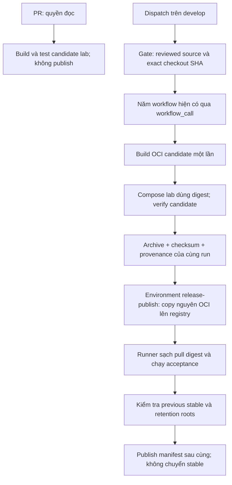

# Kế hoạch triển khai issue #44

- **Issue:** [#44 — Publish immutable application images and versioned release manifests](https://github.com/4PMs-3Workers/Production-Readiness-Lab/issues/44).
- **Trạng thái:** Đề xuất để duyệt; chưa triển khai code, workflow hay publish artifact.
- **Ngày lập:** 03/11/2026, Asia/Bangkok.
- **Baseline đã khảo sát:** `develop` tại `aa8c5b0be057754f9b3409c8699537d4aeb887b9`.
- **Khi bắt đầu code:** cập nhật `develop`, kiểm tra lại khác biệt với baseline và tạo nhánh `feature/immutable-release-artifacts` theo `GITFLOW.md`. Không thay đổi nhánh làm việc hiện tại chỉ để lập kế hoạch.

## 1. Kết quả cần bàn giao

Từ một commit đã được review và merge vào `develop`, CI tạo candidate, kiểm thử candidate đó, xuất bản nguyên artifact và tạo release manifest có phiên bản. Consumer tải manifest cùng các image theo digest và xác minh chúng trước khi sử dụng Compose.

Điều kiện cốt lõi:

1. Image được publish chính là image đã kiểm thử. Build lại từ cùng source SHA tạo ra artifact khác và không được kế thừa bằng chứng của candidate cũ.
2. Frontend/backend có đúng source SHA; API và worker dùng cùng backend digest và image ID.
3. Manifest thiếu/sai dữ liệu, image không tồn tại hoặc schema/config không tương thích đều phải thất bại rõ ràng.
4. Deployment evidence v1/v2 vẫn được đọc theo hợp đồng cũ; chúng không tự trở thành bằng chứng release.
5. Publish thất bại không tạo release hoàn chỉnh và không cập nhật trạng thái stable.
6. Giữ artifact cho previous stable và backup còn được giữ lại.

Issue này bàn giao publishing, provenance, validation và khả năng chuẩn bị Compose bằng digest. Serialized deployment, chuyển stable, rollback, chạy migration trên host và đo thời gian phục hồi thuộc #45. Registry account, quyền truy cập và host provisioning là đầu vào môi trường.

## 2. Nền tảng sẽ tái sử dụng

| Thành phần hiện có trên `develop`                         | Cách sử dụng                                                                                                                                       |
| --------------------------------------------------------- | -------------------------------------------------------------------------------------------------------------------------------------------------- |
| `Dockerfile.backend`, `Dockerfile.frontend`               | Giữ runtime, user và revision label; build từ đúng checkout SHA.                                                                                   |
| Năm workflow backend/frontend/security/container/recovery | Cho phép gọi lại bằng `workflow_call`, giữ trigger PR/push và các kiểm tra hiện tại.                                                               |
| `tools/deploy/evidence.py`                                | Giữ nguyên ý nghĩa và cách tính dữ liệu v1/v2; bổ sung regression coverage khi nối consumer mới.                                                   |
| `tools/deploy/demo.py`                                    | Tái sử dụng quy tắc source label, API/worker equality và danh sách config công khai; không dùng source label làm bằng chứng duy nhất cho artifact. |
| Compose local/HTTPS/observability/backup/recovery         | Thêm overlay release, không thay luồng demo build hiện tại.                                                                                        |
| Backup/recovery #43                                       | Giữ format backup và phép so sánh source/image ID; nối registry digest với đúng image ID.                                                          |

Hai chi tiết ảnh hưởng thiết kế:

- SHA checkout ở PR có thể là merge ref tổng hợp, khác PR head và khác commit thực tế được merge. Release phải kiểm tra lại chính commit sau merge.
- Profile observability có collector tự build; alert receiver dùng backend image. Release bật profile này phải có collector artifact tương ứng, không được để Compose tự build bù.

## 3. Các lựa chọn kỹ thuật đề xuất

### 3.1. Registry, platform và cách giữ nguyên candidate

- Mặc định dùng GHCR; registry/repository là cấu hình, không hardcode tài khoản cá nhân.
- Phiên bản đầu hỗ trợ **`linux/amd64`**. Từ chối platform khác; multi-platform là phần mở rộng sau.
- Build một lần cho từng candidate image thành OCI archive. Lưu raw manifest digest, config/image ID, platform và checksum archive.
- Import candidate vào registry lab của runner bằng cơ chế copy OCI bảo toàn digest; chạy Compose theo digest.
- Chuyển các archive đã kiểm thử sang job publish bằng artifact ID và checksum, gắn với đúng workflow run/attempt. Không chọn artifact bằng tên của một run khác.
- Publish bằng copy OCI bảo toàn manifest/layer/config bytes. Chọn và pin công cụ OCI khi triển khai; nếu registry/công cụ làm đổi digest thì dừng, không chấp nhận chỉ vì label source vẫn khớp.
- Sau publish, một job sạch pull lại bằng digest và chạy acceptance. Không có Docker build trong đường publish hoặc consume.

Các build phục vụ test nền tảng trong năm workflow cũ là fixture của các bài test đó; chúng không phải candidate được đưa đi publish.

### 3.2. Nguồn được phép publish

- Workflow release có hai đường: PR chỉ kiểm tra candidate với quyền đọc; `workflow_dispatch` trên `refs/heads/develop` mới có thể publish.
- Không nhận tùy ý branch/ref từ PR hoặc một SHA bên ngoài để đưa vào publisher.
- Gate xác minh SHA checkout, repository, event/ref và PR đã merge vào `develop`; source phải có review approval phù hợp với PR head được merge. Thiếu bằng chứng hoặc gọi API không thành công thì dừng.
- Repository phải bảo vệ `develop` bằng reviewed PR. Environment `release-publish` giới hạn branch `develop` và có reviewer; registry push credential chỉ nằm trong environment này.
- Token mặc định của workflow giữ quyền đọc. Không truyền registry credential cho PR, source-check jobs hoặc candidate-test jobs; không dùng `pull_request_target` chạy PR code.
- Publisher chạy trên runner mới, chỉ nhận artifact đã xác minh từ cùng release run. Không có `secrets: inherit` sang các workflow kiểm thử.
- Khi dispatch, gọi lại đủ năm workflow trên exact source SHA. Không lấy kết quả xanh trên PR head/merge ref khác để thay thế.

Việc provision environment, reviewer và registry credential được ghi trong hướng dẫn. Nếu môi trường chưa có, phần publish thật chưa được coi là nghiệm thu.

### 3.3. Hợp đồng release manifest

Tạo format độc lập **`format: prl-release`, `format_version: 1`**. Không tăng version hoặc đổi nghĩa deployment evidence cũ.

| Nhóm trường        | Nội dung bắt buộc                                                                                                                                     |
| ------------------ | ----------------------------------------------------------------------------------------------------------------------------------------------------- |
| Định danh          | Format/version, release ID duy nhất theo run/attempt, thời gian UTC.                                                                                  |
| Source             | Repository, `source_sha` chính xác 40 ký tự từ `git rev-parse HEAD`.                                                                                  |
| Provenance         | PR number/head SHA/merge SHA khi có; SHA checkout dùng kiểm tra; workflow ref, run ID và attempt; các artifact ID/checksum và verification reference. |
| Application images | Frontend/backend registry reference dạng `repository@sha256:...`, image/config ID và platform.                                                        |
| Service mapping    | `api`, `worker`, `schema`, `migrate`, `seed`, `backup` trỏ backend; `frontend` trỏ frontend; các service chỉ được bật khi profile cần.                |
| Profile inventory  | Collector nếu bật observability; alert receiver trỏ backend; vendor images của profile được khóa digest.                                              |
| Schema             | Danh sách revision mà backend chấp nhận; khớp code/migration contract và cấu hình runtime được xác minh.                                              |
| Configuration      | Version của hợp đồng config, profile, public selections và SHA-256 của các file/input công khai được allowlist.                                       |
| Previous stable    | Manifest reference bất biến theo digest của previous stable; chỉ `null` khi bootstrap đầu tiên được yêu cầu rõ ràng.                                  |
| Verification       | Tham chiếu bằng chứng candidate, các check bắt buộc thành công và identity chính xác của artifact đã kiểm thử.                                        |

Các quy tắc:

- Reader/writer chung một model strict; xuất JSON Schema để consumer sử dụng. Từ chối unknown fields, duplicate keys, sai kiểu, version lạ, JSON quá lớn, NaN/Infinity và timestamp không hợp lệ.
- Phân biệt **registry manifest digest**, **image/config ID** và **archive checksum**; không so sánh hoặc thay thế chúng cho nhau.
- Digest đúng cú pháp vẫn chưa đủ: phải tải/inspect được artifact, đối chiếu bytes, platform, revision label và identity dự kiến.
- API/worker dùng một định danh backend chung; manifest/service mapping cố gắng tách chúng thành hai image phải bị từ chối.
- Config identity chỉ dùng input công khai được allowlist. Không hash hoặc lưu `.env`, mật khẩu, session/CSRF key, DSN có credential hay payload người dùng. Không dump toàn bộ Docker inspect hoặc resolved Compose config ra evidence.
- Config hash của release có hợp đồng riêng; không đổi thuật toán hash v2 trong `evidence.py`. Các digest do manifest cung cấp được kiểm tra riêng để tránh vòng tham chiếu khi tính config identity.
- JSON được canonicalize, ghi atomic. Digest của OCI artifact chứa manifest được trả bên ngoài JSON; manifest không tự chứa digest của chính nó.
- Verification reference không được tự khai là đủ tin cậy: publisher kiểm tra chúng thuộc cùng run/source/candidate. Consumer chỉ dùng manifest lấy từ registry/repository tin cậy và digest đã được chọn rõ ràng.

### 3.4. Consumer và Compose

- CLI cung cấp các thao tác `validate`, `fetch`, `verify-images`, `render-compose`, `retention-check` và các thao tác nội bộ của pipeline.
- Manifest được lưu dưới dạng OCI artifact theo digest trong repository release; JSON có thể export kèm checksum cho kiểm tra offline. Consumer không dùng tag `latest` làm identity.
- `compose.release.yaml` và phần render cấu hình thay image reference cho toàn bộ application/operational services của profile, đồng thời loại bỏ `build` kế thừa.
- Render chỉ tạo phần config công khai; secret/env file vẫn do host cung cấp bên ngoài repository và artifact.
- Trước khi trả config cho consumer: validate manifest, kiểm tra config/schema, pull và inspect image theo digest. Missing artifact, sai source, sai platform, config drift hoặc schema mismatch đều chặn sử dụng.
- Acceptance xác nhận rendered config không còn application `build`; chạy với `--no-build`, kiểm tra container `.Image` khớp config ID đã ghi và reference khớp digest.
- Local/HTTPS và observability bật/tắt được khai báo rõ trong manifest. Với observability, build/test/publish collector như artifact bổ sung và tái sử dụng vendor lock hiện có. Không fallback sang local tag khi thiếu image.
- Không thêm lệnh chuyển stable hoặc deploy/rollback host vào CLI của #44.

### 3.5. Publish hoàn chỉnh, stable và retention

Trình tự publish:

1. Kiểm tra source/checks, archive checksums và candidate evidence.
2. Copy frontend/backend và collector nếu cần lên registry; verify từng digest.
3. Runner sạch pull các digest vừa publish, chạy acceptance và đối chiếu candidate identity.
4. Xác minh previous-stable reference, config/schema và retention roots.
5. Publish release manifest **sau cùng**, pull lại và validate. Chỉ lúc này pipeline mới báo release đã published.

Nếu lỗi giữa chừng, có thể còn image chưa được manifest tham chiếu; không xuất manifest hoàn chỉnh, không cập nhật stable. Nếu response publish bị mất, retry kiểm tra bytes/digest đã tồn tại để hoàn tất idempotently. Cùng release ID nhưng khác nội dung phải thất bại.

Policy retention ban đầu là **giữ toàn bộ release đã publish và các image liên quan**; không có job tự động xóa registry artifact trong issue này. Tag theo release ID phục vụ giữ artifact, còn consumer luôn sử dụng digest. Registry phải tắt cleanup có thể xóa các artifact đang được giữ; không giả định một tag tự ngăn được quản trị viên xóa.

`retention-check` nhận danh sách roots công khai từ môi trường: previous stable và các release phục vụ backup còn được giữ. Nó kiểm tra manifest cùng mọi image còn truy xuất được; root không resolve được phải báo lỗi. Không đưa private backup manifest, dữ liệu backup hoặc tài khoản vào CI.

Backup cũ có thể chỉ chứa `source_sha`/local `image_id`. Chỉ map sang release khi đúng image ID đã có bằng chứng; không suy ra từ source SHA. Nếu chưa map được, cần tiếp tục giữ/export đúng image gốc; thiếu image gốc là khoảng trống cần xử lý, không được build lại rồi nhận là tương đương. Giữ nguyên khả năng đọc format backup cũ của #43.

## 4. Luồng CI dự kiến



- Job có timeout, namespace tài nguyên theo run/attempt và cleanup fixture được sở hữu bởi bài test.
- Concurrency của reusable workflows phải tách khỏi run PR/push thông thường để không tự hủy release checks.
- Bất kỳ required check failed/cancelled/skipped hoặc thiếu artifact đều chặn publisher.
- Khi thay `workflow_call`, checkout dùng SHA được truyền rõ ràng; các test ghi `PR_HEAD_SHA` riêng, không gán nhầm thành source của image.
- Evidence công khai chỉ chứa metadata đã allowlist. Không upload `.env`, Docker config/login, backup payload hay raw logs có secret.

## 5. Phân rã công việc và file dự kiến

| Bước | Công việc                                                                                  | File chính dự kiến                                                                                                       | Điều kiện hoàn thành                                                                                        |
| ---- | ------------------------------------------------------------------------------------------ | ------------------------------------------------------------------------------------------------------------------------ | ----------------------------------------------------------------------------------------------------------- |
| 1    | Chốt schema v1, model strict, canonical read/write và error codes                          | `tools/deploy/release_manifest.py`, `release-manifest.schema.json`, unit tests                                           | Round-trip hợp lệ; malformed/version/schema/config cases thất bại; evidence v1/v2 vẫn đọc được.             |
| 2    | OCI identity, bounded registry operations, fetch/copy/pull/inspect và candidate provenance | `tools/deploy/release_images.py`, CLI `tools/deploy/release.py`                                                          | Same-source/different-artifact bị từ chối; network/missing digest trả lỗi an toàn.                          |
| 3    | Consumer config và Compose theo digest                                                     | `tools/deploy/compose.release.yaml`, CLI/render tests                                                                    | Không còn application build/tag fallback; API/worker cùng backend; các profile không làm đổi luồng demo cũ. |
| 4    | Reusable source checks và release candidate workflow                                       | Năm workflow cũ, `.github/workflows/release.yml`                                                                         | PR không nhận push credential; dispatch kiểm tra exact merged SHA; zero-skip gates giữ nguyên.              |
| 5    | Publisher, manifest OCI và retention preflight                                             | Workflow release, `tools/deploy/release_retention.py`, CLI                                                               | Published digest khớp candidate; manifest xuất sau kiểm chứng; lỗi không tạo stable transition.             |
| 6    | Acceptance với registry/Compose thật và hồi quy recovery                                   | `tests/release/`, unit tests release, các test deploy/recovery bị ảnh hưởng                                              | Consumer sạch tải đúng manifest/images; negative cases không fallback/rebuild; identity checks cũ vẫn pass. |
| 7    | Config mẫu, hướng dẫn chạy, evidence và PR                                                 | `tools/deploy/release-config.example.json`, `release-retention.example.json`, `docs/tasks/immutable-releases.md`, README | Hướng dẫn có lệnh tái hiện; PR nêu source/artifact/config identity, kết quả và giới hạn.                    |

Tên module có thể điều chỉnh để phù hợp mã nguồn khi bắt đầu. Giữ thay đổi tập trung trong deployment tooling, workflows và tests. Bổ sung `tools/deploy` mới vào phạm vi Black/Ruff/Pyright; không sửa frontend/backend business flows hoặc tạo migration.

## 6. Ma trận kiểm thử và nghiệm thu

| Nhóm              | Trường hợp cần chứng minh                                                                                                                                                       |
| ----------------- | ------------------------------------------------------------------------------------------------------------------------------------------------------------------------------- |
| Manifest          | Version hợp lệ/không hỗ trợ; thiếu/thừa field; duplicate key; sai kiểu; SHA/digest/timestamp sai; file thiếu/truncated/quá lớn; reader/writer atomic.                           |
| Artifact identity | Frontend hoặc backend sai source; cùng source nhưng digest/ID khác; API/worker khác nhau; registry bytes khác digest; sai platform; missing image/layer/manifest.               |
| Config/schema     | Revision không được chấp nhận; config identity sai; profile khác; input chưa allowlist; thiếu collector khi bật observability; runtime không khớp schema contract.              |
| Provenance/trust  | PR head khác merge SHA được ghi riêng; source kiểm thử khác source publish; artifact khác run/attempt; checksum sai; PR chưa merge/review hoặc ref không hợp lệ bị chặn.        |
| Publishing        | Registry unreachable/denied; frontend thành công nhưng backend lỗi; post-push test lỗi; manifest upload lỗi; retry sau mất response; không có đường lỗi nào được chuyển stable. |
| Retention         | Resolve đủ previous stable/backup roots; bootstrap có chủ đích; root mất; legacy image ID chưa map; không xóa artifact đang được giữ.                                           |
| Secrets           | Giá trị secret giả được cài vào fixture; manifest/evidence/error output không chứa chúng; không serialize raw env/inspect/backup data.                                          |
| Hồi quy           | Evidence v1/v2, demo lifecycle, source/image/config checks #34/#36 và backup/recovery #43 tiếp tục pass.                                                                        |

Bài acceptance chính dùng registry lab thật và Docker Compose thật:

1. Build candidate, ghi manifest/config ID và archive checksum, test candidate bằng digest.
2. Copy candidate sang repository đích lab, xóa local application image cache của consumer, fetch lại bằng digest và chạy Compose với `--no-build`.
3. Kiểm tra frontend hoạt động, API readiness/schema gate, worker có tiến triển; kiểm tra service mapping và container image ID.
4. Lặp với một artifact khác cùng source SHA: validator phải từ chối dùng bằng chứng candidate cũ.
5. Chạy failure cases của registry và kiểm tra không có release hoàn chỉnh/stable update.
6. CI trusted thực hiện lại copy/pull/verify trên GHCR đã provision; lab proof và publish thật được ghi riêng.

Thiếu Docker, Compose, registry fixture hoặc MySQL ở required integration job phải **fail**, không silently skip. Full recovery rehearsal hiện có tiếp tục chạy với fixture riêng; release-specific tests mới phải tiêu thụ đúng candidate/published images, không thay bằng image tự build trong rehearsal.

Các lệnh dự kiến ghi vào hướng dẫn và chạy sau khi code xong:

```bash
python -m black --check tools/deploy tests/backend/unit/test_release*.py tests/release
python -m ruff check tools/deploy tests/backend/unit/test_release*.py tests/release
pyright
python -m pytest tests/backend/unit/test_release*.py -q
python -m pytest tests/release -q --junitxml=build/release-tests.xml
```

Workflow còn chạy Prettier cho YAML/JSON/Markdown thay đổi, YAML/workflow validation, đủ năm bộ kiểm tra nền tảng và kiểm tra JUnit zero-skip. Cú pháp CLI và danh sách test cụ thể sẽ được hoàn thiện cùng implementation; các lệnh ở trên chưa phải kết quả đã chạy.

## 7. Bằng chứng và điều kiện kết thúc

PR tới `develop` phải cung cấp:

- Source SHA thực tế, PR head/merge SHA riêng biệt, workflow run/attempt.
- Candidate checksum/manifest digest/image ID đối chiếu với published digest và container đã chạy.
- Release-manifest OCI reference, schema/config identity và previous-stable reference hoặc bootstrap rõ ràng.
- Lệnh kiểm chứng, số test pass/fail/skip và links CI; bằng chứng publish failure không chuyển stable.
- Hướng dẫn retrieve/verify/render Compose, provision registry/environment và retention roots.
- Giới hạn: platform amd64, chính sách giữ toàn bộ artifact, các prerequisite môi trường còn thiếu nếu có. Không tuyên bố deploy thật, SLO hay rollback RTO từ bài lab.

Không merge hoặc đóng #44 chỉ vì code/test local xong. Đóng sau review, merge và đáp ứng acceptance; thiếu registry credential thì báo riêng phần publish thật chưa nghiệm thu.

## 8. Nội dung cần duyệt trước khi triển khai

Đề nghị duyệt toàn bộ kế hoạch với các quyết định chính:

1. **GHCR + OCI artifact, `linux/amd64`**, giữ nguyên bytes/digest từ candidate sang published image.
2. **Dispatch từ reviewed `develop`**, năm workflow tái sử dụng và environment riêng cho push credential.
3. **Release manifest v1 độc lập**, consumer theo digest; bao gồm collector khi profile observability cần.
4. **Giữ mọi release đã publish**, kiểm tra previous stable/backup roots, chưa làm garbage collection.
5. **Giới hạn ở #44**; stable promotion, deploy và rollback host để #45 thực hiện.

Sau khi kế hoạch được duyệt mới bắt đầu bước 1. Hiện tại chỉ bổ sung tài liệu kế hoạch này.
