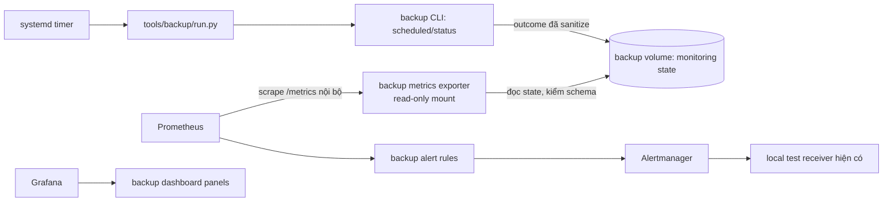

# Thiết kế: giám sát freshness và health của backup (Issue #46)

**Trạng thái:** Bản thiết kế chờ người dùng review
**Issue:** [#46 – Export backup job health and freshness metrics with tested alert rules](https://github.com/4PMs-3Workers/Production-Readiness-Lab/issues/46)
**Baseline khảo sát:** `aa8c5b0be057754f9b3409c8699537d4aeb887b9` (`develop`, đã gồm PR #43)

## Ý định

Hiển thị cho nhóm vận hành khi artifact backup local bị thiếu/cũ, lịch backup thất bại hoặc bản thân tín hiệu giám sát mất freshness. Tích hợp với Prometheus/Grafana/Alertmanager hiện có, đồng thời giữ cho việc tạo và phục hồi backup hoạt động được khi telemetry dừng.

## Mục tiêu

- Xuất lần hoàn tất backup đã xác minh gần nhất, tuổi artifact, kết quả/lần chạy scheduled gần nhất, thời lượng, trạng thái kiểm tra integrity, tình trạng collection và dung lượng filesystem có thể quan sát.
- Phân biệt backup artifact integrity, application recovery rehearsal và remote-copy verification thành các kết quả riêng.
- Dùng ngưỡng cấu hình theo RPO/lịch của từng môi trường. Thiếu hoặc sai cấu hình phải hiện `unknown` và cảnh báo cấu hình; không suy ra trạng thái khỏe.
- Chỉ dùng labels hữu hạn đã kiểm tra; không dùng backup ID, UUID, path, credential hoặc chuỗi lỗi tự do làm metric label.
- Không thêm phụ thuộc nghiệp vụ vào API, database hay telemetry stack.

## Ngoài mục tiêu và điều kiện thất bại

- Không triển khai truyền backup off-host, probe ngoài host hoặc kênh notification thật; chúng thuộc #47 và #48.
- Không coi local artifact checksum là bằng chứng ứng dụng đã khôi phục được.
- Không đặt RPO/schedule sản xuất mặc định dựa trên timer demo hoặc một lần diễn tập.
- Không để exporter truy cập credential database, ghi vào backup artifact, gọi API nghiệp vụ, hoặc làm job backup thất bại khi telemetry/exporter không khả dụng.
- Không hiển thị missing/no-data như zero tuổi hoặc backup khỏe.

## Hiện trạng liên quan

- `python -m app.backup status` đọc artifact và trả latest completion, age, số artifact hợp lệ/bị bỏ qua cùng `artifact_integrity_verified`; status hiện giữ operation lock trong khi scan.
- `scheduled` chạy backup rồi retention. CLI báo riêng backup thành công và kết quả job; retention có thể lỗi sau khi backup đã hoàn tất.
- `tools/backup/run.py` gọi scheduled job có timeout, giới hạn report JSON 64 KiB, chỉ cho qua các trường trong allowlist và dùng lỗi host đã sanitize khi không đọc được kết quả.
- Backup dùng external Docker volume `backup_storage`, tách với MySQL data; Linux systemd timer mặc định chạy hằng ngày lúc 02:00 UTC nhưng cho phép override bằng drop-in.
- Telemetry stack đang scrape API/Collector/receiver và cung cấp năm dashboard. Chưa có exporter, metric, alert hay dashboard backup.

## Các cách tiếp cận đã cân nhắc

1. **Exporter riêng đọc snapshot đã sanitize — chọn.** Producer backup ghi state nhỏ, có version, vào backup volume; exporter riêng mount volume chỉ đọc và expose endpoint nội bộ cho Prometheus. Cách này thêm một service và hợp đồng state, nhưng giữ telemetry ngoài luồng backup, không cấp DB credentials cho exporter và tận dụng mô hình pull hiện tại.
2. **Mở rộng API `/metrics`.** Ít service mới nhưng API phải đọc backup store/job state, chia sẻ quyền truy cập vận hành và có nguy cơ đưa backup/telemetry vào cùng vòng đời ứng dụng. Không phù hợp với ranh giới độc lập của Issue #36.
3. **Push từ scheduled job vào telemetry.** Dễ truyền outcome ngay lúc chạy, nhưng job sẽ phụ thuộc đường telemetry hoặc cần thêm buffer/push gateway để giữ state khi collector dừng; freshness và retry phức tạp hơn Prometheus scrape.

## Thiết kế được chọn

### Luồng dữ liệu và trách nhiệm

- **Backup CLI / `src/backend/app/backup/`:** tiếp tục là nguồn dữ liệu có thẩm quyền cho artifact và job result. Một module monitoring ghi `job_started` và final outcome vào state, chỉ sau khi operation lock được nhả mới ghi snapshot cuối. Ghi state là best-effort: lỗi ghi chỉ làm tín hiệu monitor unavailable/stale, không đổi exit code hay kết quả backup.
- **`tools/backup/run.py`:** giữ orchestration, timeout và allowlist. Bổ sung lệnh one-shot để khởi tạo baseline state từ artifact hiện có bằng backup container/config hiện hữu; không chuyển DB credentials sang exporter, không ghi raw stderr/error vào state. Nếu Docker/job không khởi động được trước khi CLI ghi trạng thái thì schedule-missed alert phát hiện lần chạy thiếu.
- **Metrics exporter trong `tools/infra` hoặc `tools/backup/`:** chạy bằng backend image đã pin, UID không đặc quyền, backup volume mount read-only, không nhận backup env-file/DB URL. Parse strict một file state nhỏ; giới hạn byte/schema/labels; expose `/metrics` chỉ trên internal telemetry network. Không đọc từng artifact, không gọi CLI, không giữ backup lock ở mỗi scrape.
- **Compose/Prometheus:** nối exporter vào telemetry network, thêm scrape target và đưa target vào kiểm tra trạng thái monitor. Exporter down hoặc state thiếu/sai phải tạo tín hiệu monitor unavailable/stale.
- **Rules và tests:** thêm recording/alert rules cho freshness, job outcome, monitor/configuration. Giữ cấu trúc fixture `prometheus-rule-tests.yml` và chạy bằng pinned `promtool` như rule tests hiện tại.
- **Grafana:** bổ sung dashboard vận hành backup (hoặc panel nhóm rõ trong dashboard phù hợp) hiển thị artifact freshness/integrity, job success/failure, duration, storage capacity, exporter/state freshness và remote-copy unknown. Không thêm UI vào ứng dụng sinh viên/nhân viên.
- **Docs/runbook:** hướng dẫn cấu hình ngưỡng theo môi trường, đọc unknown/stale, kiểm tra local receiver và giới hạn của bằng chứng local.

### State contract và metrics

State file là JSON versioned, atomic replace, kích thước tối đa hữu hạn và chỉ có một snapshot hiện tại (không append log không giới hạn). Producer ghi start và completion qua module trong `src/backend/app/backup/`; exporter chỉ đọc. Trường đề xuất:

- `schema_version`, `environment`, `store`, `updated_at`.
- `last_verified_backup_at`, `artifact_integrity_verified`, `application_rehearsal_verified`.
- `last_job_started_at`, `last_job_finished_at`, `last_job_result`, `last_job_reason` (reason thuộc enum), `last_job_duration_seconds`.
- `last_backup_at` riêng với `last_job_result`, để retention failure sau backup success vẫn thể hiện artifact mới nhưng job lỗi.
- `store_total_bytes`, `store_free_bytes`, `minimum_free_bytes` khi filesystem cung cấp số đo hợp lệ; không suy ra quota nếu volume không có quota.
- `remote_copy` optional theo schema version: `configured`, trạng thái hữu hạn (`not_configured`, `unknown`, `pending`, `success`, `failure`) và thời điểm verified nếu có. Vắng trường/producer nghĩa là unknown/not-configured; định dạng phải được phối hợp với #47 trước khi merge tích hợp.

Exporter chỉ chuyển timestamp/duration/byte/count/status thành số liệu. Label allowlist dự kiến: `environment`, `store`, `operation`, `result`, `reason` (enum hữu hạn); không xuất identity artifact thành label. Timestamp mẫu gồm last verified backup, last job start/finish, producer state update, exporter last successful state read và remote verified completion. Exporter freshness đo lần đọc state thành công gần nhất, không dùng producer `updated_at` (producer chỉ đổi theo job) làm monitor heartbeat. Không có giá trị hợp lệ thì bỏ sample hoặc dùng trạng thái hữu hạn `unknown`, tuyệt đối không ghi timestamp hiện tại thay cho dữ liệu thiếu.

### Cấu hình và cảnh báo

- Bắt buộc cấu hình theo môi trường: RPO/freshness limit, expected schedule interval, maximum job runtime (khớp với timeout job hiện hành), job grace, monitor stale limit, environment/store label. Tên biến chính thức và kiểm tra quan hệ RPO–schedule được chốt khi triển khai; không đặt giá trị mặc định mang ý nghĩa nghiệm thu.
- Thiếu/sai cấu hình phát metric trạng thái cấu hình không hợp lệ và alert `BackupMonitorConfigurationMissing`; freshness là unknown.
- `BackupArtifactMissing` khi store rỗng/không có artifact hợp lệ; `BackupArtifactStale` khi age vượt RPO đã cấu hình; `BackupJobFailed` khi scheduled outcome lỗi; `BackupJobMissing` khi chưa có lần start mới sau `expected schedule interval + job grace`; `BackupJobIncomplete` khi đã có start nhưng không có final report sau `maximum job runtime + job grace`. Khi một run đang incomplete thì không phát thêm `BackupJobMissing` cho cùng run. `BackupMonitorDown`/`BackupMonitorDataStale` báo exporter target hoặc lần đọc state hợp lệ gần nhất vượt monitor stale limit.
- Backup artifact success và job success phải là hai trạng thái độc lập. Job lỗi sau backup thành công không làm mất freshness của artifact. `BackupJobFailed` chỉ resolve khi một scheduled run sau đó hoàn tất thành công; không tự resolve theo thời gian. `BackupJobIncomplete` firing sau `maximum job runtime + job grace` khi start thiếu final report, và resolve khi có final report. Thiếu final report là trạng thái job incomplete, không đổi thành monitor stale; monitor stale vẫn đo riêng độ mới của exporter/state.
- `prometheus-rules.yml` đang dùng evaluation interval 15s. Alert `for` và notification timing phải được ghi rõ trong rules/tests; không được nhầm thời gian firing với thời gian nhận notification.
- Remote-copy panel hiển thị unknown/not-configured đến khi producer #47 phát state hợp lệ. Không tuyên bố remote alert/notification delivery đã nghiệm thu từ local receiver.

### Thu thập status và operation lock

Exporter không gọi `app.backup status` theo mỗi scrape. State được khởi tạo một lần từ artifact hiện có bằng một read-only scan hữu hạn và được cập nhật bởi scheduled job sau đó. Vì CLI `status` hiện giữ operation lock qua toàn bộ inventory scan, implementation cần cung cấp đường đọc monitor không chặn: giới hạn số entry, tổng byte đọc và deadline; không lấy operation lock. Artifact bị xóa/đổi trong lúc đọc được xem là race, retry hữu hạn hoặc trả unknown. Không hợp lệ/timeout/corrupt không được thay bằng health success. CLI JSON hiện hành giữ nguyên hoặc chỉ mở rộng có version rõ ràng. Exporter cập nhật riêng `last_successful_state_read_timestamp` khi parse snapshot thành công; producer state cũ do chưa tới lịch job không tự nó làm monitor stale, mà được đánh giá bởi RPO/schedule rules.

### Lỗi, quyền và trường hợp biên

- Empty store: `BackupArtifactMissing`, freshness unknown; không lấy timestamp scrape làm completion.
- Corrupt/old artifact: bỏ qua artifact lỗi; nếu không có artifact integrity-verified hợp lệ thì không phát success/fresh. Giữ finite reason code.
- Failed backup: cập nhật job failure nếu có report; giữ `last_verified_backup_at` trước đó để alert stale tính đúng tuổi. Start không có final report vượt quá `maximum job runtime + job grace` kích hoạt `BackupJobIncomplete`; alert resolve khi final report đến. Nếu final report là lỗi thì `BackupJobIncomplete` resolve và `BackupJobFailed` firing/tiếp tục firing đến lần scheduled success hoàn chỉnh.
- Retention lỗi sau backup thành công: giữ `last_backup_at` mới và integrity success, đồng thời cập nhật job failure riêng.
- State file thiếu/corrupt/oversize, exporter parse lỗi, storage I/O lỗi: metric monitor không khỏe và trạng thái backup unknown; không đưa exception text vào label/log.
- Thiếu capacity metric: hiển thị unknown cho capacity, không suy ra 0 byte. Threshold dung lượng dùng `minimum_free_bytes` hiện hữu hoặc cấu hình môi trường đã nêu, không tự chọn ngưỡng mới.
- Exporter down, Prometheus down hoặc Alertmanager/receiver không sẵn sàng: backup job vẫn tiếp tục độc lập. Local receiver chỉ xác minh rule/route, không chứng minh delivery ngoài host.
- Thời điểm lưu UTC; phép so tuổi dùng epoch từ producer đã kiểm tra. Tương lai bất hợp lý, timestamp sai timezone hoặc thời gian đảo ngược thành configuration/data error.

## API, database và UI

- **Application API:** không thay đổi route/auth/session/CSRF.
- **Database:** không schema/migration mới; artifact store và state file là nguồn giám sát vận hành.
- **UI:** chỉ dashboard Grafana trong operations boundary; không có màn hình nghiệp vụ.
- **CLI JSON:** giữ contract hiện tại; nếu cần trường mới phải version rõ ràng hoặc thêm file contract riêng, không đổi ý nghĩa `application_rehearsal_verified`.

## Ảnh hưởng và phối hợp

- #35: tái sử dụng Prometheus, Grafana, rules, `promtool`, Alertmanager và receiver local; không sửa phạm vi gateway SLI/API/worker telemetry ngoài phần scrape target cần thiết.
- #36/#43: giữ nguyên backup/restore semantics, operation leases, retention và CLI; bổ sung monitor metadata best-effort, không thay đổi khả năng restore artifact.
- #47: cần đồng thuận schema `remote_copy` trước khi producer được merge; #47 có thể bắt đầu độc lập nhưng integration cuối cần state producer tương thích.
- #48: notification delivery độc lập và host-loss proof nằm ngoài phạm vi; chỉ ghi rõ local Alertmanager receiver không tương đương external notification.
- #54: có thể tiêu thụ alert mới trong fault/recovery drills sau khi #46/#47/#48 hoàn tất; không phải blocker cho core coding.
- Worktree gốc đang có `.gitignore` sửa local; mọi implementation tiếp tục trong worktree `D:\Production-Readiness-Lab-issue-46`.

## Kiểm chứng và tiêu chí nghiệm thu

1. **Unit tests cho adapter/state:** empty store; artifact cũ/hỏng; report job failure; retention failure sau backup success; RPO/schedule boundaries; `BackupJobFailed` chỉ resolve sau success; `BackupJobIncomplete` tại runtime + grace và resolve khi có final report; timestamp sai/tương lai; state file missing/corrupt/oversize; collection stale; race khi retention đổi artifact; finite labels/no secrets.
2. **Prometheus rule tests với promtool pinned:** freshness firing/resolved đúng RPO; job failure chỉ resolve sau scheduled success; incomplete start firing tại runtime + grace và resolve khi có final report; monitor target down; stale/missing state; config thiếu/sai; no-data không thành healthy; remote status unknown/not-configured khi producer vắng mặt.
3. **Integration trên Compose/test receiver:** scheduled success/failure cập nhật metric và alert tương ứng; job failure giữ firing đến scheduled success; missing final report vượt runtime + grace phát incomplete; lịch job bị bỏ lỡ phát missing-job; tình huống backup success + retention failure giữ hai tín hiệu riêng; stop exporter/Collector/Prometheus không làm hỏng hoặc kéo dài vô hạn backup/recovery; exporter không có DB credentials và chỉ mount store read-only.
4. **Dashboard/Compose contracts:** cấu hình hợp lệ, target exporter nội bộ, labels hữu hạn, panels thể hiện unknown, alert runbook links, không có port public. Không tuyên bố host-outage coverage hoặc notification delivery thật.
5. **Tương thích:** test JSON CLI hiện có; cài monitoring trên store đã có artifact; nâng cấp state schema có version và unknown an toàn.
6. **Evidence PR:** source SHA, image/config identity, commands/results, alert firing/resolved và dashboard query evidence; không đưa artifact backup, credential, ID/path riêng tư hoặc payload nghiệp vụ vào public evidence.

## Các quyết định để builder giữ nguyên

- Exporter riêng Prometheus-pull, state file versioned trên backup volume; mount read-only vào exporter.
- RPO/schedule/grace/monitor-stale là cấu hình môi trường bắt buộc; thiếu/sai là unknown và alert cấu hình.
- Metrics giữ backup success riêng với scheduled job success; không đổi ứng xử backup khi monitoring lỗi.
- `BackupJobFailed` chỉ resolve sau scheduled run hoàn chỉnh thành công; thiếu final report quá runtime + grace là `BackupJobIncomplete` riêng.
- Remote-copy status có hợp đồng versioned nhưng hiển thị unknown đến khi #47 phát producer.
- Không thêm API nghiệp vụ hoặc database migration.

## Lựa chọn còn cho người triển khai

- Tên biến cuối cùng, giới hạn byte/scan hợp lý trong bounds hiện có, labels cụ thể trong allowlist, cách sinh capacity metrics từ filesystem, layout file/mô-đun và panel/rule naming.
- Chốt schema `remote_copy` với người làm #47 trước khi tích hợp; nếu producer thay đổi, giữ trạng thái unknown cho tới khi contract được xác minh.
- Chọn đường khởi tạo monitor state không khóa backup operation; nếu inventory không thể xác minh trong ngân sách, giữ unknown và báo monitor/config error.
